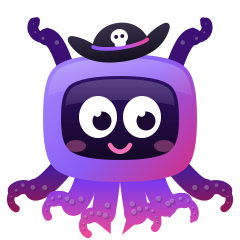
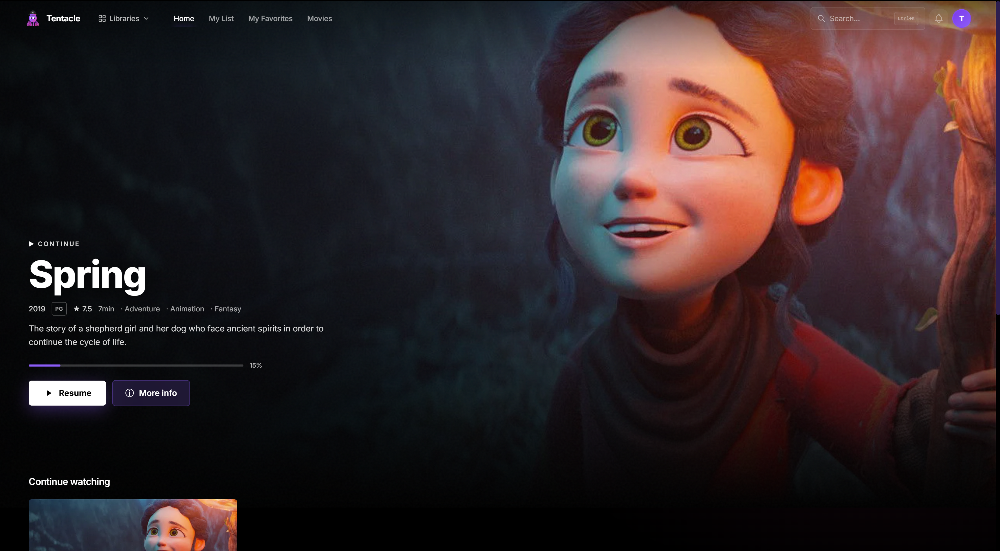

<p align="center">
  
</p>

<h1 align="center">Tentacle TV</h1>

<p align="center">
  <strong>A premium, modern media client for Jellyfin, on every screen you own</strong>
</p>

<p align="center">
  <a href="https://ko-fi.com/knaox_"></a>
  <a href="https://discord.gg/FRse3yMhnc"></a>
  <a href="#quick-start-docker"></a>
  <a href="https://github.com/Knaox/Tentacle-TV/releases"></a>
  <a href="#quick-start-docker"></a>
  <a href="LICENSE"></a>
  
  
</p>

<p align="center">
  Browse and stream your Jellyfin library through a dark, glassy interface — on the web, the desktop, your phone
  and your TV. Self-hosted, free, no ads, no tracking.
</p>

> [!IMPORTANT]
> **Tentacle TV is not affiliated with, endorsed by, or sponsored by the Jellyfin
> project.** It is an independent third-party client that connects to a Jellyfin server
> you run yourself. Official Jellyfin project: <https://jellyfin.org>.
>
> **Tentacle TV n'est ni affilié au projet Jellyfin, ni approuvé ou soutenu par lui.**
> C'est un client tiers indépendant qui se connecte à un serveur Jellyfin que vous
> hébergez vous-même.

<p align="center">
  
  <br />
  <sub>Screenshots: open movies by the Blender Foundation, CC BY — <a href="docs/screenshots/CREDITS.md">credits</a> · Captures : films libres de la Blender Foundation, CC BY — <a href="docs/screenshots/CREDITS.md">crédits</a></sub>
</p>

---

## Why Tentacle TV

Jellyfin is a great server. Tentacle TV is a **different family of clients** for it, plus a small companion
server that adds what a household actually asks for:

- **One design on every screen.** Web, Windows, macOS, Linux, iPhone, iPad, Android, Apple TV, Android TV and LG
  webOS share the same card model, the same actions and the same TV navigation rules.
- **Playback that respects the source.** Direct play first; a native mpv player on desktop (Dolby Vision, HDR10,
  Atmos passthrough), ExoPlayer on Android TV, AVPlayer on Apple TV. Each player *declares* what its engine
  decodes and the server decides what has to be transcoded — no hard-coded "H.264 + AAC" fallback.
- **What Jellyfin clients usually don't do.** Family profiles with PINs, Watch Together, offline copies on phone
  and desktop, personal recommendations, trailer previews, a guided setup and a tested remote access.
- **Yours.** Self-hosted, free and open source (AGPL), no account on our side, nothing behind a paywall.

---

## Quick Start (Docker)

**One file, one command: Tentacle and Jellyfin, ready together.** A setup wizard then configures everything
from your browser.

You only need Docker (or Podman). Pick one of two ready-to-copy stacks — **nothing to edit, no password to
write, no database to install**: Tentacle keeps its data in a file (SQLite) of its volume.

| Stack | Contains | For |
|---|---|---|
| [`stacks/tentacle-full`](stacks/tentacle-full/compose.yaml) (recommended) | Tentacle, **Jellyfin** | starting from scratch |
| [`stacks/tentacle-only`](stacks/tentacle-only/compose.yaml) | Tentacle | a Jellyfin that already runs elsewhere |

```bash
mkdir tentacle && cd tentacle
curl -fsSLo compose.yaml https://raw.githubusercontent.com/Knaox/Tentacle-TV/main/stacks/tentacle-full/compose.yaml
docker compose up -d
docker compose logs tentacle     # the one-time setup code and the link (Portainer: the container's Logs)
```

Portainer, a NAS, another service name? The code is in **the Tentacle container's log**, wherever you read
it; the wizard's code screen shows this container's ID and the commands for each case. From the same local
network, the first browser to open the wizard doesn't even need the code.

Open `http://<your-server>:3000` and answer the wizard's questions one at a time: Jellyfin is configured for
you, your libraries are created, remote access is guided and tested from the outside. No stack ships a reverse
proxy: for HTTPS from the Internet, Tentacle goes behind **yours** (Nginx Proxy Manager, Caddy, Traefik…), and
the admin page writes what to put in it.

**Step-by-step guide, with screenshots, in English and French: <https://tentacletv.app/docs/server/>** —
every screen of the wizard, adding content, remote access (port forwarding, your reverse proxy, CGNAT),
troubleshooting and FAQ. Reference pages for maintainers: [docs/server](docs/server/README.md)
([français](docs/server/fr/README.md)).

> **No Docker, on Windows?** **Tentacle Server** is the same server packaged as a Microsoft Store app: it lives
> in the notification area, starts with your session and updates through the Store —
> [docs/server/windows.md](docs/server/windows.md).

> **Updating from before 1.25** (a stack or a `docker-compose.yml` with a MariaDB or MySQL)? Keep your file as it
> is and update the image: Tentacle migrates its database to SQLite by itself, then the dashboard says how to
> remove MariaDB — [sqlite-migration](docs/server/sqlite-migration.md).

### Update

The admin overview (`/admin`) shows the running version, the latest published release and, when a newer one is
out, the command to copy. With Docker Compose, run it in the folder of your `compose.yaml`:

```bash
docker compose pull && docker compose up -d
```

If you pin a version (`TENTACLE_VERSION=v1.23.0`, or `ghcr.io/knaox/tentacle-tv:v1.23.0`), change it to the new
one first — `pull` would fetch nothing new otherwise. Tentacle never talks to Docker itself (no socket mounted);
the overview notices the restarted server on its own.

---

## Platforms

| Platform | Status | Get it | Technology |
|----------|--------|--------|------------|
| **Web** |  | Served by your Tentacle server | React 19 + Vite 6 + Tailwind CSS |
| **macOS** |  | <a href="https://apps.apple.com/app/id6760205634"></a> | Electron + native mpv player |
| **Windows** |  | <a href="https://apps.microsoft.com/detail/9NKHL0T84245"></a> | Electron + native mpv player |
| **Linux** |  | <a href="https://github.com/Knaox/Tentacle-TV/releases"></a> | Electron + native mpv player (HDR on Wayland) |
| **iOS / iPadOS** |  | <a href="https://apps.apple.com/app/id6760205634"></a> | React Native + Expo |
| **Android** |  | <a href="https://play.google.com/store/apps/details?id=com.tentacletv.mobile"></a> | React Native + Expo |
| **Apple TV** |  | <a href="https://apps.apple.com/app/id6760205634"></a> | React Native (tvOS) + AVPlayer |
| **Android TV** |  | <a href="https://play.google.com/store/apps/details?id=com.tentacletv.mobile"></a> | React Native + ExoPlayer/Media3 |
| **LG webOS** |  | <a href="https://github.com/Knaox/Tentacle-TV/releases"></a> | Web client served by your server under `/tv` |
| **Tentacle Server (Windows)** |  | Microsoft Store — [guide](docs/server/windows.md) | The Docker image's server, without Docker |

<details>
<summary>🇫🇷 Plateformes (français)</summary>

| Plateforme | Statut | Où la trouver | Technologie |
|------------|--------|---------------|-------------|
| **Web** |  | Servie par votre serveur Tentacle | React 19 + Vite 6 + Tailwind CSS |
| **macOS** |  | <a href="https://apps.apple.com/app/id6760205634"></a> | Electron + lecteur mpv natif |
| **Windows** |  | <a href="https://apps.microsoft.com/detail/9NKHL0T84245"></a> | Electron + lecteur mpv natif |
| **Linux** |  | <a href="https://github.com/Knaox/Tentacle-TV/releases"></a> | Electron + lecteur mpv natif (HDR sous Wayland) |
| **iOS / iPadOS** |  | <a href="https://apps.apple.com/app/id6760205634"></a> | React Native + Expo |
| **Android** |  | <a href="https://play.google.com/store/apps/details?id=com.tentacletv.mobile"></a> | React Native + Expo |
| **Apple TV** |  | <a href="https://apps.apple.com/app/id6760205634"></a> | React Native (tvOS) + AVPlayer |
| **Android TV** |  | <a href="https://play.google.com/store/apps/details?id=com.tentacletv.mobile"></a> | React Native + ExoPlayer/Media3 |
| **LG webOS** |  | <a href="https://github.com/Knaox/Tentacle-TV/releases"></a> | Client web servi par votre serveur sous `/tv` |
| **Tentacle Server (Windows)** |  | Microsoft Store — [guide](docs/server/fr/windows.md) | Le serveur de l'image Docker, sans Docker |

</details>

---

## Features

### Playback
- **Direct play first**, with automatic transcoding only for what the device's engine cannot decode
- Desktop: native **mpv** (Dolby Vision, HDR10, Atmos/TrueHD passthrough), **real HDR on Linux Wayland**, picture-in-picture
- Apple TV: AVPlayer; Android TV: ExoPlayer/Media3 with HDR/DV and surround bitstream
- Skip intros, recaps and credits — Tentacle installs and configures the segment plugins in Jellyfin for you
- Resume anywhere, per-library audio and subtitle preferences, trickplay thumbnails

### Watching together and as a family
- **Watch Together**: synchronised playback across devices, chat, "everyone ready" before a skip
- **Family**: one owner, members and guest profiles, each with an optional PIN checked by the server; a
  "Who's watching?" screen on TV, desktop and web
- **Offline**: keep titles on your phone or computer, including a lighter version prepared by the server, and
  finish the transfer with the app closed

### Discovery
- **"For you"**: personal recommendations built from what you watch, like and rate (needs a free TMDB key)
- Trailer previews on focus or hover, on desktop, web, Apple TV and Android TV
- Ratings, favourites, My list and "watched" — the same card and the same actions on every platform
- New titles appear live on the home screen, without refreshing
- Requests for missing movies and seasons through the optional **Vigie** plugin (Jellyseerr / Overseerr)

### Interface
- Dark glassmorphism theme with purple → pink accents, and **Liquid Glass** on macOS 26
- TV navigation designed for the remote: Siri Remote, Android TV remotes, LG Magic Remote
- 36 hand-drawn avatar characters (no AI-generated images)
- English and French throughout

### Administration
- A guided setup wizard (no database to set up) and a dashboard that says what is broken, then what to improve
- Remote access: the admin writes your reverse-proxy config and tests the ports **from the outside**
- Invitations, support tickets, TV pairing by code, real-time notifications
- A plugin system with a marketplace and SHA-256 verification

---

## Remote Access and Reverse Proxy

The stacks ship no reverse proxy: Tentacle goes behind yours. **Administration › Remote access** writes what to
put in it — a Caddyfile block, an Nginx / Nginx Proxy Manager block or a Traefik routes file — then guides the
router ports and tests them from the outside.

- General guide: [docs/server/remote-access.md](docs/server/remote-access.md)
- Nginx Proxy Manager in detail (WebSockets, same-domain Jellyfin for direct streaming, CORS):
  [docs/server/reverse-proxy-npm.md](docs/server/reverse-proxy-npm.md)

---

## Desktop App

The desktop app wraps the web client with [Electron](https://www.electronjs.org/) on all three systems, and
drives a native **mpv** through [koffi](https://koffi.dev/) for the video (Direct Play, Dolby Vision, HDR,
Atmos). Windows and macOS update through their stores; **Linux has a built-in updater** that detects how the
app was installed, verifies the SHA-256 and installs through polkit (or swaps the AppImage in place).

### Linux

Four packages, and **mpv is bundled in every one of them** — nothing else to install.

**One command, any distribution** — detects the format, installs the right package and adds the menu entry
(`--uninstall` removes both):

```bash
curl -fsSL https://raw.githubusercontent.com/Knaox/Tentacle-TV/main/scripts/install-linux.sh | sh
```

Or by hand:

```bash
sudo apt install ./tentacle-tv_*_amd64.deb        # Debian / Ubuntu / Mint / Pop!_OS
sudo dnf install ./tentacle-tv_*.x86_64.rpm       # Fedora / openSUSE / RHEL
sudo pacman -U ./tentacle-tv_*.pkg.tar.zst        # Arch / Manjaro / EndeavourOS
chmod +x tentacle-tv_*.AppImage && ./tentacle-tv_*.AppImage   # any distribution
```

The AppImage needs FUSE (`fuse2` on Arch, `libfuse2t64` on Ubuntu); the install script says so if it is missing.

#### HDR, Wayland and X11

Linux forces a trade-off no other system does: **X.Org will never support HDR** (HDR on Linux goes through the
Wayland `wp-color-management-v1` protocol), and **Wayland does not let an application position its own
windows**. The app picks the best setup for your session at start-up:

| Session | Video window | HDR |
|---------|--------------|-----|
| **Wayland + KDE Plasma** | follows the window, windowed or fullscreen (KWin script) | **yes**, even windowed |
| **Wayland, other compositors** (GNOME, wlroots) | windowed through XWayland; fullscreen when an HDR screen is plugged in | **yes** when an HDR screen is plugged in |
| **X11** | windowed | no — tone-mapped to SDR |

HDR needs a colour-managed compositor (KDE Plasma 6.2+, GNOME 48+, Hyprland), plus Mesa 25.1+ or NVIDIA 595+.
X11 sessions need a compositing window manager — every modern desktop has one. A setting forces Wayland or X11.

### First Launch

1. Enter the URL of your Tentacle server (e.g. `http://192.168.1.100:3000` or `https://tentacle.example.com`)
2. Sign in with your Jellyfin credentials
3. Start watching

---

## Android TV App

The Android TV app uses **ExoPlayer (Media3)** for all video playback, with hardware decoding. Player
architecture inspired by [VoidTV for Jellyfin](https://github.com/hritwikjohri/VoidTV-for-jellyfin).

The app reads what **this device** can decode and declares it to the server: what the device can play is played
directly, the rest is converted by the server — and the player says so.

| Codec | Direct play | Notes |
|-------|-------------|-------|
| **H.264 / AVC** | Hardware (MediaCodec) | All Android TV devices |
| **HEVC / H.265** | Hardware (MediaCodec) | Shield, Chromecast, Fire TV, etc. |
| **VP9** | Hardware (MediaCodec) | Wide device support |
| **AV1** | Hardware, where the device has a decoder | Otherwise converted by the server |
| **Dolby Vision P8** | Hardware (MediaCodec) | Native DV decoder on supported devices |
| **Dolby Vision P7** | `DvCompatRenderer` | P7 → P8.1 rewrite for device compatibility |

Audio passthrough over HDMI uses the device's real `AudioCapabilities`:

| Format | Passthrough | Notes |
|--------|-------------|-------|
| AC3 / EAC3 | Yes | Wide device support |
| EAC3 JOC (Dolby Atmos) | Yes | If the device/AVR reports `ENCODING_E_AC3_JOC` |
| TrueHD (Dolby Atmos) | Yes | NVIDIA Shield only |
| DTS / DTS-HD MA | Yes | Shield and select devices |
| Fallback | PCM decode | Automatic when passthrough is unavailable |

---

## Environment Variables

None is required with the stacks: the data is a file of the data volume (`data/tentacle.db`), Jellyfin comes
from the wizard. Full list in [docs/server/install.md](docs/server/install.md#settings-env).

| Variable | Description | Default |
|----------|-------------|---------|
| `DATABASE_URL`, or `DB_HOST` · `DB_PORT` · `DB_NAME` · `DB_USER` · `DB_PASSWORD` / `DB_PASSWORD_FILE` | An installation from before 1.25 only: its MariaDB, read ONCE by the migration to SQLite, then removed ([sqlite-migration](docs/server/sqlite-migration.md)) | — |
| `PORT` | Server listening port | `3000` |
| `HOST` | Server bind address | `0.0.0.0` |
| `PUID` / `PGID` | Account the server runs as (the image starts as root only to fix the data folder's ownership) | `1000` |
| `RATE_LIMIT` | Max requests per minute per IP | `1000` |
| `TRUSTED_PROXIES` | Extra proxies (IPs/CIDRs) whose `X-Forwarded-For` is trusted — neighbours (local and Docker networks) always are | — |
| `REMOTE_CHECK_URL` | Remote access test service; `off` disables the test | `https://check.tentacletv.app` |
| `TENTACLE_PUBLIC_URL` | Fallback public link (the one set in the administration wins) | — |
| `TENTACLE_WEB_UI` | `off` turns the web interface off (apps, TV client and invitation links keep working) | on |
| `CORS_ORIGIN` | Allowed CORS origin (dev only) | — |
| `TENTACLE_IMAGE` | The image you deploy (e.g. `ghcr.io/knaox/tentacle-tv:v1.23.0`): the admin overview then gives the exact update command for a pinned tag | — |
| `TENTACLE_INSTALL_RUNTIME` | `docker`, `podman` or `none`: forces container detection where its marker file is missing (Kubernetes, LXC…) | auto |
| `TENTACLE_SERVER_UPDATE_REPO` | `off` turns off the update check (GitHub, at most every six hours) | Knaox/Tentacle-TV |

> The Jellyfin URL and API key are configured through the setup wizard and stored in the database — never in
> environment variables, and never sent to a client.

---

## Development Setup

### Prerequisites

- [Node.js](https://nodejs.org/) >= 22.13 (the backend uses `node:sqlite` without a flag)
- [pnpm](https://pnpm.io/) >= 9

No database server: the backend keeps its data in `apps/backend/data/tentacle.db` (SQLite), created and kept up
to date by the server itself on start.

### Get running

```bash
git clone https://github.com/Knaox/Tentacle-TV.git
cd Tentacle-TV
pnpm install                                   # also enables the pre-push hook

cp apps/backend/.env.example apps/backend/.env # nothing is required for a local run
pnpm --filter @tentacle-tv/backend db:generate      # Prisma client (never `prisma db push`)
pnpm --filter @tentacle-tv/backend build:shared-deps # needed by plugin pages

pnpm dev:backend    # API server → http://localhost:3001
pnpm dev:web        # Web client → http://localhost:5173 (proxies /api to :3001)
```

### Other commands

```bash
pnpm dev:electron   # Desktop app (Windows, macOS, Linux)
pnpm dev:mobile     # Expo app (iOS, Android)
pnpm dev:tv         # Apple TV / Android TV app
pnpm dev:webos      # LG webOS client

pnpm lint           # ESLint across all packages
pnpm typecheck      # TypeScript --noEmit across all packages
pnpm test           # Unit tests (Vitest)

pnpm docker:rebuild # Build the image from this repository (:local) and start the stack on it
pnpm docker:logs    # Tail its logs
```

Database changes are versioned SQL migrations: after editing `prisma/schema.prisma`, run
`pnpm db:migration <name>` from `apps/backend/`.

### Quality gates

A `pre-push` hook runs typecheck and tests on the packages a push touches (and those that depend on them). The
same check runs on GitHub (`quality.yml`), and **no release workflow builds a commit that hasn't passed it**.
Releases are never triggered by a push: each platform has its own workflow, run on demand, with three levels
— build only, test tracks (TestFlight, Play internal, pre-release), and store.

---

## Project Structure

```
apps/
  web/               React 19 + Vite 6 + Tailwind (web client, also the desktop UI)
  desktop-electron/  Electron shell + native mpv (Windows, macOS, Linux)
  mobile/            Expo 52 + React Native (iPhone, iPad, Android)
  tv/                React Native for Apple TV (tvOS) and Android TV
  tv-webos/          LG webOS shell (IPK); the client itself is a build variant of apps/web
  backend/           Fastify 5 + Prisma 6 + SQLite (the Tentacle server)
  server-windows/    Tentacle Server packaged for the Microsoft Store
  port-check/        External service that tests remote access from the Internet
  server-e2e/        End-to-end benches against real stacks (never run by `pnpm test`)

packages/
  shared/            Types, i18n, contracts and pure rules shared by every client
  api-client/        Jellyfin + Tentacle API client, TanStack Query hooks
  tv-core/           TV navigation: remote intents, focus and player behaviours (pure, platform-agnostic)
  ui/, theme/        Shared React components and design tokens
  offline-core/      Offline engine shared by mobile and desktop
  plugins-api/       Plugin system interfaces
  brand-intro-native/ The start-up animation on TV and mobile

stacks/              The two Docker Compose stacks
brand/               The logo and every icon, generated from one source
relay/               Cloudflare Worker for TV pairing
docs/                Design notes, measurements and the server guide
```

### Architecture Overview

```
┌──────────────────────────┐        ┌──────────────────┐        ┌───────────┐
│ Clients                  │  /api  │ Tentacle server  │        │  SQLite   │
│ web · desktop · mobile   │───────▶│ (Fastify 5)      │───────▶│ (Prisma)  │
│ Apple TV · Android TV    │        │ auth, family,    │        └───────────┘
│ LG webOS                 │        │ reco, plugins,   │
└────────────┬─────────────┘        │ Jellyfin proxy   │        ┌───────────┐
             │                      └────────┬─────────┘        │           │
             │   direct streaming (optional) │  admin API key   │ Jellyfin  │
             └───────────────────────────────┴─────────────────▶│           │
                                                                └───────────┘
```

- **Tentacle server** (`/api/*`): authentication, family and profiles, invitations, recommendations, Watch
  Together, pairing, plugins — and a proxy to Jellyfin, so the admin API key never leaves the server.
- **Jellyfin**: browsing and streaming go through that proxy, or straight to Jellyfin when direct streaming is
  configured. Native apps fall back to the proxy on their own; the web client does too when CORS is not set up.
- **Server capabilities**: the server declares what it can do (`GET /api/config` → `capabilities`), and every
  client hides what its server doesn't support — an up-to-date app works with an older server, without errors.

---

## A Note on the Codebase

Tentacle TV is written by a French developer, and **the code comments, design notes in `docs/` and commit
messages are in French.** Everything else is in English: file names, identifiers, types, APIs, the user
interface strings for English users, and this README.

This is a deliberate choice rather than an oversight — the notes record *why* things are done the way they are
(often with measurements), and writing them in my own language keeps them precise. If you want to read a
part of the code, a translation tool handles the comments well; and **issues and pull requests are welcome in
English or French**.

---

## Plugin Development

Tentacle TV supports plugins that add pages to the clients and routes to the server.

- **Install**: Admin › Plugins › Marketplace › **Install**, then configure it in its settings tab — it appears in
  the navigation.
- **Add a source**: Admin › Plugins › Sources › **Add source**, with the URL of a `registry.json`.

A plugin implements the `TentaclePlugin` interface from `@tentacle-tv/plugins-api`:

```typescript
interface TentaclePlugin {
  id: string;
  name: string;
  version: string;
  description: string;
  routes: PluginRoute[];
  navItems: PluginNavItem[];
  adminRoutes?: PluginRoute[];
  adminNavItems?: PluginNavItem[];
  isConfigured(): boolean;
  initialize?(): void;
  destroy?(): void;
}
```

See the [plugin registry documentation](docs/plugin-registry-README.md) for the registry format and archive
structure.

---

## Tech Stack

| Layer | Technology |
|-------|------------|
| Web | React 19, Vite 6, Tailwind CSS 3, Framer Motion 11 |
| Desktop | Electron 43 (Windows, macOS, Linux), libmpv via koffi |
| Mobile | React Native 0.76, Expo 52, NativeWind 4 |
| TV | React Native (react-native-tvos), AVPlayer (tvOS), ExoPlayer/Media3 (Android TV) |
| Backend | Fastify 5, Prisma 6, SQLite |
| Data | TanStack Query v5, Zod |
| Language | TypeScript 5.7, strict mode |
| i18n | i18next + react-i18next (English & French) |
| CI/CD | GitHub Actions: quality gate on every push, releases run on demand per platform |

---

## Support the project

<p align="center">
  <a href="https://ko-fi.com/knaox_"></a>
</p>

Tentacle TV is free, open source and ad-free — no subscription, no tracking, nothing behind a paywall. If it has earned a place on your screens, a coffee on **[Ko-fi](https://ko-fi.com/knaox_)** helps cover the app store fees, the test devices and the services the apps rely on. One-off or monthly, always optional: every app stays free either way.

Tentacle TV est libre, gratuit et sans publicité — pas d'abonnement, pas de pistage, rien derrière un mur payant. S'il a trouvé sa place sur vos écrans, un café sur **[Ko-fi](https://ko-fi.com/knaox_)** aide à couvrir les frais des boutiques, les appareils de test et les services dont les applications ont besoin. Ponctuel ou mensuel, toujours facultatif : les applications restent gratuites dans tous les cas.

## Community

Join the **[Tentacle TV Discord](https://discord.gg/FRse3yMhnc)** to get help, share ideas and hear about new releases first. English and French are both welcome.

Rejoignez le **[Discord de Tentacle TV](https://discord.gg/FRse3yMhnc)** pour obtenir de l'aide, proposer des idées et suivre les nouveautés — annonces et salon de discussion en français.

Bugs and feature requests go to [GitHub issues](https://github.com/Knaox/Tentacle-TV/issues).

## Contributing

Contributions are welcome! Open an [issue](https://github.com/Knaox/Tentacle-TV/issues) or a pull request — in
English or French. Before a pull request, `pnpm lint`, `pnpm typecheck` and `pnpm test` should pass (the
pre-push hook checks the last two for you).

By submitting a contribution, you agree that it is licensed under the same terms as Tentacle TV: the GNU AGPL v3.0 or later, together with the additional permission and terms of [`LICENSE-EXCEPTIONS`](LICENSE-EXCEPTIONS).

## License

Copyright (C) 2026 Damien Rouge ("Knaox").

Tentacle TV is free software, licensed under the **[GNU Affero General Public License v3.0 or later](LICENSE)** (`AGPL-3.0-or-later`), with an additional permission for distribution through application stores and an additional term on trademarks — see [`LICENSE-EXCEPTIONS`](LICENSE-EXCEPTIONS).

In short: you may use, study, modify and share Tentacle TV. If you distribute a modified version, **or let people use it over a network** (for example as a hosted service), you must publish its complete source code under the same license.

- **Earlier versions stay MIT.** Every version released before 7 October 2026 (up to `desktop-v1.26.0`, `mobile-v1.10.2`, `tv-v1.10.0`, `server-v1.23.0`, `webos-v1.0.0`) was published under the MIT License, and those copies remain available under it.
- **Third-party components** keep their own licenses: see [`docs/LICENCES.md`](docs/LICENCES.md) and each app's `THIRD-PARTY-LICENSES.md`.
- **Name and logo**: "Tentacle TV" and its logos are not covered by the AGPL — see the [trademark policy](TRADEMARK.md).
