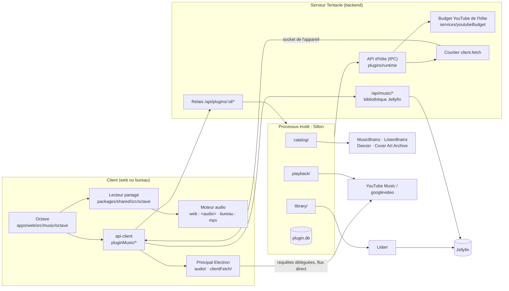
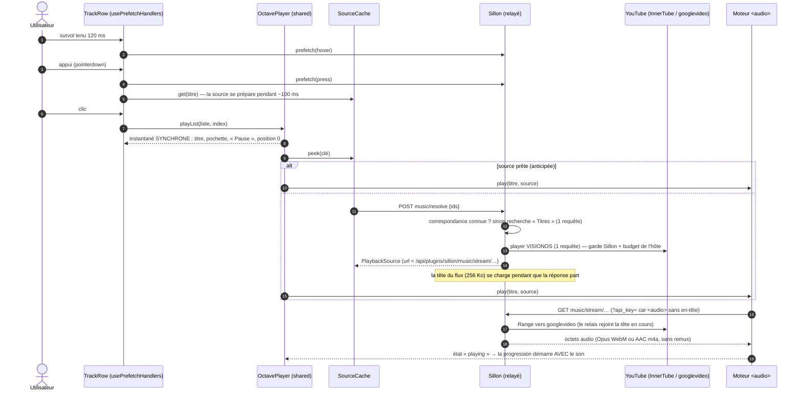
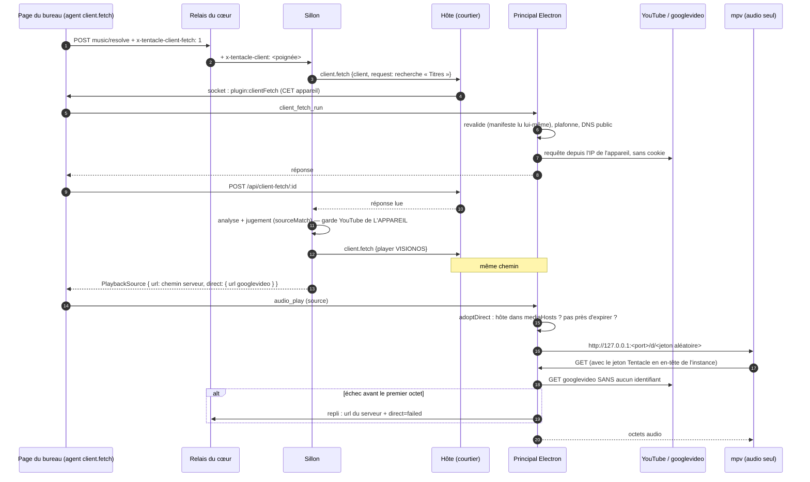
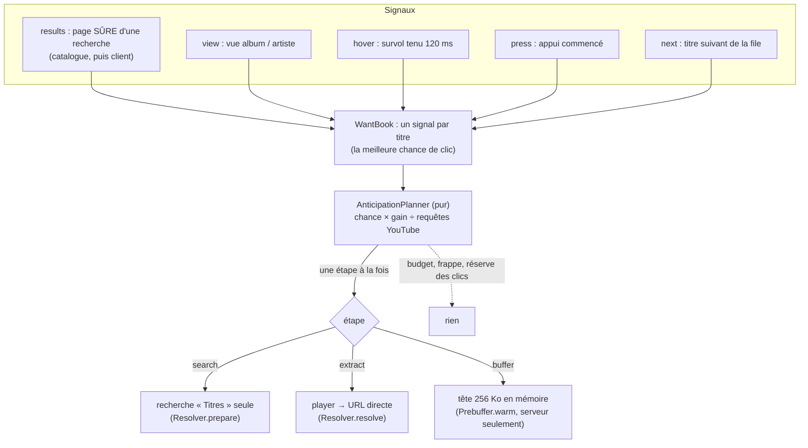
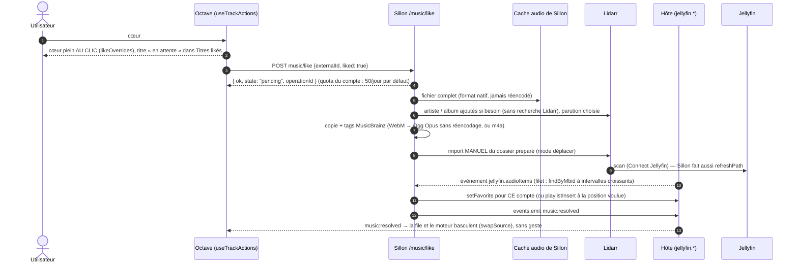

# Octave et Sillon — la cartographie

Ce document dit comment fonctionne, de bout en bout, la musique de Tentacle : **Octave** (le mode musique
du web et du bureau, dans ce dépôt) et **Sillon** (l'extension qui trouve et fait écouter la musique qui
n'est pas encore dans la bibliothèque Jellyfin, dépôt `Tentacle-Plugin-Sillon`). Il s'adresse à trois
lecteurs : quelqu'un qui veut comprendre sans lire le code, un développeur qui arrive, une IA qui reprend
le chantier.

Documents voisins :
- [`CONTRATS.md`](CONTRATS.md) — les contrats, dans le détail (ce document les résume et les relie) ;
- [`LECTEUR.md`](LECTEUR.md) — le lecteur d'Octave (file, moteurs, position, échecs) ;
- [`EXTRACTION.md`](EXTRACTION.md) — où partent les millisecondes d'une extraction yt-dlp ;
- Sillon `docs/ARCHITECTURE.md` — l'intérieur de l'extension (modules, base, caches, sources externes).

État décrit : intégration du 25/10 (Tentacle `53ff77a2c`, Sillon `1920dd7`, branches `feat/music-mode`).
Chaque affirmation a été relue dans le code à ces commits ; ce qui ne l'a pas été est marqué
**« non vérifié »**. Deux parties sont **en cours de refonte** au moment d'écrire (lot « Sillon
recherche ») et le disent en tête de section.

## Sommaire

1. [En une page](#1-en-une-page)
2. [Glossaire](#2-glossaire)
3. [Qui fait quoi](#3-qui-fait-quoi)
4. [Le runtime isolé des extensions et l'API d'hôte](#4-le-runtime-isolé-des-extensions-et-lapi-dhôte)
5. [Les contrats](#5-les-contrats)
6. [Les parcours de bout en bout](#6-les-parcours-de-bout-en-bout)
7. [Pannes et replis](#7-pannes-et-replis)
8. [Invariants — ce qui ne doit jamais arriver](#8-invariants--ce-qui-ne-doit-jamais-arriver)
9. [Pour une IA qui reprend ce code](#9-pour-une-ia-qui-reprend-ce-code)
10. [Ce qui n'a pas été vérifié](#10-ce-qui-na-pas-été-vérifié)

---

## 1. En une page

- **La bibliothèque, c'est Jellyfin.** Le cœur de Tentacle sait lire la musique de Jellyfin : index de
  recherche local (SQLite FTS5), albums, artistes, playlists Jellyfin, favoris Jellyfin (« j'aime » EST le
  favori). Il ne sait **rien** de ce qui est hors bibliothèque.
- **Le hors bibliothèque, c'est une extension.** Le cœur expose cinq points d'extension génériques
  (rechercher, donner une source de lecture, aimer / ajouter à une playlist, lister ce qui est en attente,
  naviguer). Sillon les remplit : il cherche dans **MusicBrainz / ListenBrainz** (le catalogue), trouve la
  piste officielle sur **YouTube Music** (InnerTube, yt-dlp en repli), la fait écouter tout de suite, et la
  fait entrer dans la bibliothèque par **Lidarr** quand on l'aime.
- **Sillon tourne à part.** Son code serveur vit dans un processus Node séparé, sous le modèle de
  permissions de Node : il ne lit ni la base de Tentacle, ni ses secrets, ni la clé Jellyfin. Il ne parle au
  cœur que par une **API d'hôte** à liste fermée, et les clients ne lui parlent qu'à travers un **relais**
  du cœur (`/api/plugins/sillon/*`) qui authentifie le compte.
- **YouTube se ménage.** Une seule adresse IP sert les bandes-annonces ET Sillon : un **budget commun**
  (150 requêtes/h, 20/min, disjoncteur anti-robot partagé) est tenu par le cœur. Sur le **bureau**, Sillon
  fait partir ses requêtes YouTube de l'appareil de l'utilisateur (**requêtes déléguées**), et le flux audio
  est lu **en direct** par l'appareil : cent bureaux ne font pas bloquer le serveur.
- **L'attente se cache.** Le lecteur pose le titre dans la barre au clic, avant toute requête ; l'extension
  **anticipe** (résultats, survol, appui, titre suivant) pour que la source soit souvent prête au clic.

---

## 2. Glossaire

| Terme | Sens |
|---|---|
| **Octave** | Le mode musique de Tentacle (web et bureau Electron seulement). Code : `apps/web/src/music/`, `packages/shared/src/octave/`, `packages/shared/src/music/`. |
| **Sillon** | L'extension musique (dépôt `Tentacle-Plugin-Sillon`, identifiant `sillon`). Serveur : `server/` ; bundle front (admin, « Mes demandes ») : `src/`. |
| **Cœur** | Tentacle sans extension : backend Fastify, web, bureau, api-client, shared. |
| **Hôte / invité** | Le backend de Tentacle (hôte) lance le module serveur d'une extension isolée (invité) dans un processus à part. |
| **API d'hôte** | La liste fermée de méthodes que l'invité peut appeler par IPC (`HOST_METHODS`). |
| **Relais** | La route `/api/plugins/<id>/*` du cœur : authentifie, retire les secrets du client, pose `RELAY_HEADERS`, transmet en flux à la socket de l'invité. |
| **Capacité serveur** | Ce que le CODE du serveur sait faire, déclaré dans `GET /api/config` → `capabilities` ; un client n'affiche rien que le serveur ne déclare (CLAUDE.md, « Capacités du serveur »). |
| **MBID** | Identifiant MusicBrainz (enregistrement = `recording`, parution = `release`, groupe = `release-group`, artiste). |
| **Identifiant externe** | L'identifiant opaque qu'une extension donne à un titre ; chez Sillon `rec:<recording>` ou `rec:<recording>~rel:<release>` (titre vu depuis un album). |
| **Clé de titre** | `jf:<id Jellyfin>` (bibliothèque) ou `ext:<pluginId>:<identifiant externe>` (`packages/shared/src/music/musicKeys.ts`). |
| **Disponibilité** | `library` (dans Jellyfin) · `cache` (fichier complet dans le cache de l'extension) · `pending` (aimé, en cours d'entrée) · `remote` (hors bibliothèque). |
| **Source de lecture** | `PlaybackSource` : où lire un titre, toujours un chemin du serveur Tentacle, plus un éventuel flux `direct` pour l'appareil. |
| **Anticipation** | Préparer une source avant le clic (`music.prefetch` : `results`, `hover`, `press`, `next`). |
| **InnerTube** | L'API interne de YouTube : `search` (client `WEB_REMIX`, YouTube Music), `player` (client `VISIONOS`), `browse` (album). |
| **Piste « Topic »** | Piste audio officielle publiée par l'éditeur (chaîne « Artiste - Topic », description « Auto-generated by YouTube. », type `ATV`). Un clip est `OMV`. |
| **Visiteur anonyme** | Le `visitorData` qu'InnerTube donne à tout navigateur : ni compte ni cookie. Sans lui, YouTube répond « confirm you're not a bot ». |
| **Requête déléguée** | `client.fetch` : l'extension DÉCRIT une requête HTTP, l'appareil qui l'a sollicitée (le bureau) l'exécute depuis sa connexion, l'extension analyse la réponse. |
| **Poignée (handle)** | Identifiant opaque d'un appareil pour une extension (HMAC extension × appareil), posé par le relais dans `x-tentacle-client`. |
| **Flux direct** | `PlaybackSource.direct` : l'URL googlevideo liée à l'IP de l'appareil ; mpv la lit par un relais local 127.0.0.1. |
| **Garde YouTube** | Chez Sillon (`server/playback/youtubeGuard.ts`) : cadence, budgets glissants, disjoncteur — par serveur, et une par appareil délégué. |
| **Page sûre** | Une page de résultats dont la tête ne changera plus guère (`confident`) ; seule une page sûre est montrée et anticipée. |

---

## 3. Qui fait quoi



| Couche | Où | Ce qu'elle sait | Ce qu'elle ne sait pas |
|---|---|---|---|
| **shared** | [`packages/shared/src/music/`](../../packages/shared/src/music/), [`octave/`](../../packages/shared/src/octave/), [`plugins/`](../../packages/shared/src/plugins/) | Les contrats (types, routes, événements, manifeste `music`, runtime, `client.fetch`), la file et le contrôleur de lecture, le cache des sources. Pur : ni React, ni DOM. | Aucune source nommée. |
| **api-client** | [`packages/api-client/src/pluginMusic/`](../../packages/api-client/src/pluginMusic/) | Trouver le fournisseur musique (`findMusicProvider` : la première extension active qui déclare `music`), appeler ses routes (`musicRequests.ts`), fusionner ses pages (`musicSearchMerge.ts`), l'agent des requêtes déléguées. | Le nom de l'extension. |
| **web (Octave)** | [`apps/web/src/music/`](../../apps/web/src/music/) | L'interface (recherche, vues, barre de lecture), les deux moteurs côté page, l'anticipation par gestes. | Rien du hors bibliothèque au-delà du contrat. |
| **bureau** | [`apps/desktop-electron/src/main/audio/`](../../apps/desktop-electron/src/main/audio/), [`clientFetch/`](../../apps/desktop-electron/src/main/clientFetch/) | mpv en audio seul (gapless, sortie exclusive, ReplayGain, bascule à chaud), l'exécution des requêtes déléguées, le relais local des flux directs. | Les règles de Sillon : il exécute ce que le manifeste DÉCLARE, rien d'autre. |
| **backend** | [`apps/backend/src/music/`](../../apps/backend/src/music/), [`plugins/runtime/`](../../apps/backend/src/plugins/runtime/), [`services/youtubeBudget/`](../../apps/backend/src/services/youtubeBudget/) | La musique Jellyfin (`/api/music/*`), le runtime isolé (lancement, relais, API d'hôte, outils), le budget YouTube, le courtier `client.fetch`. | yt-dlp pour la musique : jamais lui-même (seulement prêté à l'extension). |
| **Sillon** | dépôt `Tentacle-Plugin-Sillon` | Catalogue, choix de la source officielle, lecture, anticipation, Lidarr, re-liaison. | La base de Tentacle, ses secrets, la clé Jellyfin. |

**La source de vérité est Jellyfin** : un cœur = un favori Jellyfin du compte, une playlist = une playlist
Jellyfin. Le cœur n'a aucun stockage musical propre hors de son index de recherche.

---

## 4. Le runtime isolé des extensions et l'API d'hôte

### 4.1 Le processus invité

| Quoi | Où | Règle |
|---|---|---|
| Manifeste `runtime` | [`runtimeManifest.ts`](../../apps/backend/src/plugins/runtime/runtimeManifest.ts) | `kind: "isolated"`, `entry` dans le dossier de l'extension, `tools` (liste fermée : `yt-dlp`), `env` (noms simples, jamais `TENTACLE_*`, `NODE_*`, `JELLYFIN_*`, `DATABASE_*`…), `publicRoutes`, `hostApi` (familles `jellyfin.music`, `users`, `events`, `tools`, `client`), `clientFetch`. Un champ mal formé rend le manifeste ENTIER invalide. |
| Lancement | [`guestLaunch.ts`](../../apps/backend/src/plugins/runtime/guestLaunch.ts) | `node --permission` : lecture du dossier de l'extension, écriture de SON dossier de données, ni processus enfant, ni fil de travail, ni module natif ; `--allow-net` sous Node ≥ 25. Environnement RECONSTRUIT : `GUEST_ENV` (`TENTACLE_PLUGIN_ID`, `TENTACLE_PLUGIN_DATA_DIR`, `TENTACLE_PLUGIN_SOCKET`, `TENTACLE_LOCALE`) + les variables déclarées. |
| Vie | [`guestSupervisor.ts`](../../apps/backend/src/plugins/runtime/guestSupervisor.ts) | Prêt quand l'invité envoie `ready` ; relancé s'il meurt (1 s → 60 s, remis à zéro après 60 s de bonne santé) ; arrêt `shutdown` → SIGTERM (5 s) → SIGKILL (2 s). Le relais répond 503 tant qu'il n'est pas prêt. |
| Registre | [`runtimeRegistry.ts`](../../apps/backend/src/plugins/runtime/runtimeRegistry.ts) | Un invité par extension isolée qui sert ; activer / couper prend effet sans redémarrer le serveur ; chaque changement d'une extension musique émet `music:provider`. |
| Côté Sillon | Sillon `server/index.ts`, `server/runtime/hostClient.ts` | Fastify écoute la socket `TENTACLE_PLUGIN_SOCKET` ; une seule voie vers l'hôte : `process.send` (appels avec délai de 15 s par défaut). |

### 4.2 Le relais HTTP

[`relay/relayRoute.ts`](../../apps/backend/src/plugins/runtime/relay/relayRoute.ts),
[`relayHeaders.ts`](../../apps/backend/src/plugins/runtime/relay/relayHeaders.ts),
[`relayQueryAuth.ts`](../../apps/backend/src/plugins/runtime/relay/relayQueryAuth.ts).

- `/api/plugins/<id>/*` (GET, POST, PUT, PATCH, DELETE) **après `requireAuth`**, sauf les `publicRoutes`
  (webhook Lidarr de Sillon, que Sillon authentifie lui-même par son secret).
- Le droit d'usage est vérifié AVANT de joindre l'invité
  ([`accountRights.ts`](../../apps/backend/src/plugins/runtime/accountRights.ts) : administrateur en session
  personnelle, sinon `users.rights` → `canUse`, gardé une minute, refus à l'échec).
- Vers l'invité : `Authorization`, cookies, `x-emby-*`, `x-mediabrowser-token`, tout `x-tentacle-*` venu du
  client et les en-têtes de connexion sont **retirés** ; l'hôte pose `RELAY_HEADERS` (`x-tentacle-user-id`,
  `-user-name`, `-is-admin`, `-session` = `personal | profile | device`, `-locale`, `-request-id`, `-client`).
- Le jeton en paramètre (`?api_key=`) est accepté en GET seulement (un `<audio>` ne pose pas d'en-tête),
  retiré de l'URL relayée, jamais journalisé.
- Corps et réponses **en flux** dans les deux sens ; `Range` transmis ; une requête inactive 120 s est
  coupée ; un client qui part coupe la requête vers l'invité.

### 4.3 L'API d'hôte (liste fermée)

Contrat : [`packages/shared/src/plugins/pluginServerRuntime.ts`](../../packages/shared/src/plugins/pluginServerRuntime.ts)
(miroir backend + Sillon `types/tentacle/`). Porte : [`hostDispatcher.ts`](../../apps/backend/src/plugins/runtime/hostDispatcher.ts)
(méthode connue, famille DÉCLARÉE, paramètres validés par Zod —
[`hostSchemas.ts`](../../apps/backend/src/plugins/runtime/hostSchemas.ts) —, 64 appels en vol au plus ; une
exception devient `failed` sans rien emporter de l'intérieur).

| Méthode | Famille | Ce qu'elle fait | Qui s'en sert chez Sillon |
|---|---|---|---|
| `jellyfin.musicLibrary`, `findByMbid`, `setFavorite`, `playlistInsert`, `playlistEntries`, `usageOf` | `jellyfin.music` | La musique Jellyfin du cœur, au nom d'un compte. | `library/` (favori posé, insertion à une position, instantané avant upgrade). |
| `jellyfin.notifyPath`, `jellyfin.refreshPath` | `jellyfin.music` | Faire voir un fichier à Jellyfin (60 s par défaut, 0,12 s par `refreshPath`). | `library/jellyfinNudge.ts`. |
| `users.rights` | `users` | `exists`, `isAdmin`, `canUse`, `canRequest` d'un compte pour CETTE extension (Jellyfin voit la musique, Famille, intégration allumée). | `catalog/access.ts` (60 s), `library/service.ts` (30 s). |
| `events.emit` | `events` | Émettre `music:resolved` ou `music:pending` à des comptes (`pluginId` posé par l'hôte). | `library/notify.ts`. |
| `tools.info`, `tools.exec`, `tools.spawnWorker`, `tools.stopWorker` | `tools` | yt-dlp du cœur, sur liste blanche de l'ADMINISTRATEUR ([`toolGrants.ts`](../../apps/backend/src/plugins/runtime/tools/toolGrants.ts)) ; arguments filtrés ([`ytDlpPolicy.ts`](../../apps/backend/src/plugins/runtime/tools/ytDlpPolicy.ts)) ; ouvrier persistant au protocole fermé ([`toolWorkers.ts`](../../apps/backend/src/plugins/runtime/tools/toolWorkers.ts), 4 par extension). | `playback/workerPool.ts`, `extractAudio.ts`, `youtube/ytmSearchYtDlp.ts`. |
| `tools.youtubeAdmit`, `tools.youtubeReport` | `tools` | Le budget YouTube UNIQUE de l'hôte (§ 4.4). | `playback/hostYouTubeBudget.ts`. |
| `client.fetch` | `client` | Une requête décrite, exécutée par l'appareil (§ 4.5). | `youtube/clientPort.ts`. |

L'hôte pousse aussi des **événements** à l'invité : `jellyfin.audioItems` (éléments audio vus par
Jellyfin), `jellyfin.state` (`up | restarting | down`), `settings.changed`.

### 4.4 Le budget YouTube de l'hôte

[`services/youtubeBudget/hostYouTubeLedger.ts`](../../apps/backend/src/services/youtubeBudget/hostYouTubeLedger.ts) —
une seule adresse IP sort vers YouTube (bandes-annonces + extensions), l'anti-robot tombe vers ~150
requêtes/h (mesuré le 14/10).

| Limite (`HOST_YOUTUBE_LIMITS`) | Valeur |
|---|---|
| Plafond de l'heure, tout compris | 150 |
| Par minute, tout compris | 20 |
| Une lecture d'extension (`play`) passe tant que le total de l'heure est sous | 140 |
| Une anticipation d'extension (`prefetch`) passe tant que le total est sous | 110 |
| Par extension et par heure | 100 |
| Écart entre deux places accordées à une extension | 250 ms |
| Disjoncteur ouvert : une lecture-sonde d'extension toutes les | 5 min |

Le disjoncteur est **commun** avec les bandes-annonces : un anti-robot vu par l'un arrête l'autre. Sillon a
en plus sa propre garde, consultée AVANT l'hôte (Sillon `docs/ARCHITECTURE.md`, « Budgets et gardes »).

### 4.5 Les requêtes déléguées (`client.fetch`, capacité `plugins.clientFetch`)

Contrat : [`packages/shared/src/plugins/pluginClientFetch.ts`](../../packages/shared/src/plugins/pluginClientFetch.ts)
(miroirs : backend `plugins/runtime/pluginClientFetch.ts`, bureau `main/clientFetch/pluginClientFetch.ts`,
Sillon `types/tentacle/pluginClientFetch.ts`).

- **Manifeste** : `runtime.clientFetch = { hosts, mediaHosts }` + famille `client`. Noms PUBLICS exacts
  (ni IP, ni `localhost`, ni `.local`, `.lan`, `.home`, `.internal`…), au plus 16 ; `mediaHosts` admet
  `*.domaine`. Sillon déclare `music.youtube.com`, `www.youtube.com` et `*.googlevideo.com`. Exposé aux
  clients par `/api/plugins/active` (champ `clientFetch`, seulement si l'intégration est allumée).
- **Annonce** : le bureau pose `x-tentacle-client-fetch: 1` sur ses appels `/api/plugins/*` tant que
  l'agent tourne ([`clientFetchAnnounce.ts`](../../packages/api-client/src/pluginMusic/clientFetchAnnounce.ts)).
  Le web ne s'annonce jamais.
- **Poignée** : le relais pose `x-tentacle-client` = HMAC (extension, appareil) si l'appareil a une socket
  ouverte ([`clientFetchRuntime.ts`](../../apps/backend/src/plugins/runtime/clientFetch/clientFetchRuntime.ts)).
- **Courtier** ([`clientFetchBroker.ts`](../../apps/backend/src/plugins/runtime/clientFetch/clientFetchBroker.ts)) :
  valide la requête, la pousse (`plugin:clientFetch`) sur la socket de CET appareil seulement, attend la
  réponse `POST /api/client-fetch/:id` ([`clientFetchRoute.ts`](../../apps/backend/src/plugins/runtime/clientFetch/clientFetchRoute.ts) :
  acceptée du seul appareil visé). Jamais d'exception pour l'extension : `offline` · `refused` · `timeout` ·
  `budget` · `network` · `tooLarge`.
- **Bureau** : l'agent de la page ([`clientFetchAgent.ts`](../../packages/api-client/src/pluginMusic/clientFetchAgent.ts),
  monté par [`useDesktopClientFetch.ts`](../../apps/web/src/music/octave/clientFetch/useDesktopClientFetch.ts))
  passe le travail au principal (`client_fetch_run`, [`ipc/clientFetch.ts`](../../apps/desktop-electron/src/main/ipc/clientFetch.ts)),
  qui revalide contre le manifeste qu'il lit LUI-MÊME ([`pluginManifests.ts`](../../apps/desktop-electron/src/main/clientFetch/pluginManifests.ts), 5 min),
  plafonne ([`clientFetchQuota.ts`](../../apps/desktop-electron/src/main/clientFetch/clientFetchQuota.ts) : 4 en parallèle,
  30/min, 300/h par extension) et exécute ([`clientFetchRunner.ts`](../../apps/desktop-electron/src/main/clientFetch/clientFetchRunner.ts)) :
  sans cookie, redirections (3 au plus) revalidées une à une, adresses privées refusées DANS la résolution
  DNS ([`safeLookup.ts`](../../apps/desktop-electron/src/main/clientFetch/safeLookup.ts)).
- **Bornes** (`CLIENT_FETCH_LIMITS`) : https seul, 20 en-têtes, corps ≤ 64 Ko, réponse ≤ 2 Mo (1 Mo par
  défaut), délai ≤ 8 s (5 s par défaut).

### 4.6 Les capacités serveur de la musique

[`packages/shared/src/serverCapabilities/serverCapabilities.ts`](../../packages/shared/src/serverCapabilities/serverCapabilities.ts)
— toutes `1.32.0` (la version n'est pas encore livrée ; `versions.json` intact) :

| Clé | Ce qu'elle garde côté clients |
|---|---|
| `music.library` | Le mode Octave lui-même (entrée, routes) — avec `/api/music/status` qui dit une bibliothèque musique visible par le compte ([`useOctaveAvailability.ts`](../../apps/web/src/music/octave/mode/useOctaveAvailability.ts)). |
| `plugins.isolatedRuntime` | Tout le hors bibliothèque : sans elle, `useMusicProvider` rend `null` (aucun résultat, aucun bouton). |
| `music.suggest` | Les suggestions de l'extension pendant la frappe ; sans elle : bibliothèque + recherches récentes. |
| `plugins.clientFetch` | L'agent des requêtes déléguées du bureau ; sans elle : aucune annonce, tout passe par le serveur. |

---

## 5. Les contrats

| Contrat | Fichier (shared, puis miroirs) | Résumé |
|---|---|---|
| Types musique | [`music/musicTypes.ts`](../../packages/shared/src/music/musicTypes.ts) | Titre, album, artiste, playlist, disponibilité, format audio. `artworkUrl` peut être une route de l'extension relayée par le cœur ; le jeton n'accompagne jamais une URL d'un autre hôte. |
| Clés | [`music/musicKeys.ts`](../../packages/shared/src/music/musicKeys.ts) | `jf:` / `ext:<pluginId>:<id>`, MBID. |
| Lecture | [`music/musicPlayback.ts`](../../packages/shared/src/music/musicPlayback.ts) | `PlaybackSource`, port `AudioEnginePort` (voir [`LECTEUR.md`](LECTEUR.md)). |
| Routes du cœur | [`music/musicCoreApi.ts`](../../packages/shared/src/music/musicCoreApi.ts) | `/api/music/status`, `search`, `albums`, `artists`, `home`, `liked`, `favorite/:id`, `playlists…`, `by-mbid`, `source/:id`, `stream/:id`, `artwork/:id`, `playback`. |
| Événements | [`music/musicEvents.ts`](../../packages/shared/src/music/musicEvents.ts) | `music:library`, `music:userdata`, `music:playlist` (cœur, depuis les sockets Jellyfin des comptes), `music:resolved`, `music:pending` (seuls permis à une extension), `music:provider`. |
| Contrat `music` d'extension | [`music/pluginMusicContract.ts`](../../packages/shared/src/music/pluginMusicContract.ts) (miroir backend `routes/pluginMusicMeta.ts`, Sillon `types/tentacle/`) | Voir le tableau suivant. |
| Runtime isolé | [`plugins/pluginServerRuntime.ts`](../../packages/shared/src/plugins/pluginServerRuntime.ts) | § 4. |
| Requêtes déléguées | [`plugins/pluginClientFetch.ts`](../../packages/shared/src/plugins/pluginClientFetch.ts) | § 4.5. |
| Pont audio du bureau | [`apps/desktop-electron/src/main/audio/audioBridgeContract.ts`](../../apps/desktop-electron/src/main/audio/audioBridgeContract.ts) ↔ [`apps/web/src/music/engine/mpv/audioBridgeContract.ts`](../../apps/web/src/music/engine/mpv/audioBridgeContract.ts) | Commandes `audio_*`, événement `audio://event` ; miroir octet pour octet (`audioBridgeMirror.test.ts`). |

**Le contrat `music` du manifeste** (`plugin.json` → `music`, lu par `readPluginMusicManifest` ; `search` et
`resolve` obligatoires, les autres facultatifs ; chemins sous `/api/plugins/<id>`) :

| Champ | Méthode | Réponse | Notes |
|---|---|---|---|
| `search` | GET `?q=&limit=&cursor=&revise=1` | `ExternalMusicSearchPage` | Pages progressives (`complete`, `cursor`). **v2** (`revise=1`) : chaque page porte la liste ENTIÈRE (`replace`), `provisional` tant qu'elle peut changer. Un curseur v2 tient 8 s au plus. Octave ne MONTRE jamais une page `provisional`. |
| `suggest` | GET `?q=&limit=` | `MusicSuggestResponse` | LOCAL seulement (index et caches de l'extension, jamais le réseau). Capacité `music.suggest`. |
| `resolve` | POST `{ ids }` (1 à 20) | `ExternalSourcesResponse` | Une source par identifiant trouvé ; absent = pas de source. **`retry?: { reason: "budget"; afterMs }`** : pas de source PARCE QUE le budget YouTube est atteint (additif : un client d'avant n'y voit qu'une absence). |
| `prefetch` | POST `{ ids, intent }` | 204 | `intent` : `results` · `hover` · `press` · `next`. Jamais bloquant, jamais une erreur. |
| `like`, `playlistAdd` | POST | `ExternalActionOutcome` | Réponse IMMÉDIATE `pending` ; refus dans une liste fermée (`quota`, `forbidden`, `unavailable`, `notFound`, `failed`). |
| `pending` | GET | `PendingMusicResponse` | Les demandes du compte (en cours ET échouées). |
| `played` | POST `{ externalId, completed }` | 204 | Écoute menée au bout (préférence personnelle, option « X écoutes »). |
| `album`, `artist` | GET `<route>/<id>` | `MusicAlbum` avec `tracks` · `MusicArtist` avec `topTracks`, `albums` | Vues hors bibliothèque. |
| `labels` | — | — | Nom de la section par langue (« Pas encore dans la bibliothèque »). |

**`PlaybackSource`** : `url` est TOUJOURS un chemin du serveur Tentacle (`/api/music/stream/…` ou
`/api/plugins/<id>/…`) ; `complete` faux = fichier encore en écriture ; `expiresAt` ; et
**`direct?: { url, expiresAt }`** — un flux que CET appareil lit en direct (https, hôte des `mediaHosts`,
aucun identifiant). À la première erreur, le moteur reprend `url` avec `direct=failed` une fois, pour que
l'extension oublie cette source.

---

## 6. Les parcours de bout en bout

### 6.1 Frappe → suggestions

> **En cours de refonte** (R5 : recherche « façon Apple Music », YouTube Music comme catalogue). Le
> principe « suggestions seulement pendant la frappe » est une décision du lot ; la forme peut changer.

```mermaid
sequenceDiagram
  autonumber
  actor U as Utilisateur
  participant Box as OctaveSearchBox
  participant Sug as useOctaveSuggestions
  participant Core as Backend /api/music/search
  participant Relay as Relais /api/plugins/sillon
  participant S as Sillon /music/suggest
  U->>Box: tape une lettre
  Box->>Sug: brouillon
  Note over Sug: anti-rebond 90 ms, frappe dépassée annulée
  par bibliothèque
    Sug->>Core: GET search?q=…&limit=6
    Core-->>Sug: titres, artistes, albums (index FTS5 local)
  and extension (si capacité music.suggest)
    Sug->>Relay: GET music/suggest?q=…
    Relay->>S: (en-têtes du compte posés)
    S-->>Relay: suggestions (index locaux, vus du compte)
    Relay-->>Sug: MusicSuggestResponse
  end
  Sug->>Box: liste unique (récentes, artistes, titres, albums ; 8 au plus)
  Note over Box: complétion grise après le curseur (⇥ ou →)
```

- Fichiers : [`OctaveSearchBox.tsx`](../../apps/web/src/music/octave/search/OctaveSearchBox.tsx),
  [`useOctaveSuggestions.ts`](../../apps/web/src/music/octave/search/useOctaveSuggestions.ts),
  [`suggestionModel.ts`](../../apps/web/src/music/octave/search/suggestionModel.ts) (3 récentes, 3 artistes,
  4 titres, 2 albums, 8 au total), [`recentMusicSearches.ts`](../../apps/web/src/music/octave/search/recentMusicSearches.ts)
  (`tentacle_octave_recent_searches`, 8), [`useMusicSuggest.ts`](../../packages/api-client/src/pluginMusic/useMusicSuggest.ts).
- Chez Sillon (`server/catalog/suggest.ts`) : ce que CE compte a vu dans ses résultats (mémoire bornée), l'index
  local des artistes connus, l'index local des titres célèbres. **Aucune requête réseau** : ni MusicBrainz, ni
  ListenBrainz, ni YouTube.
- Une suggestion n'est qu'un TEXTE à chercher : la choisir lance la recherche complète, jamais une lecture.

### 6.2 Entrée → résultats

> **En cours de refonte** (R5 reprend la page Recherche et l'assemblage : « meilleur résultat », sections et
> filtres Titres / Albums / Artistes / Playlists, catalogue YouTube Music `server/ytmCatalog/*`). Ce qui suit
> décrit l'intégration du 25/10.

```mermaid
sequenceDiagram
  autonumber
  actor U as Utilisateur
  participant P as Page Recherche (useOctaveSearch, useRevealedResults)
  participant Core as Backend /api/music/search
  participant S as Sillon /music/search (v2)
  participant MB as MusicBrainz / ListenBrainz
  participant Art as Sillon /music/art (cache disque)
  U->>P: Entrée, « Rechercher » ou une suggestion (?q= dans l'adresse)
  par bibliothèque
    P->>Core: GET search?q=…
    Core-->>P: résultats de la bibliothèque
  and extension
    P->>S: GET music/search?q=…&revise=1
    Note over S: cache 24 h ? → page entière aussitôt
    S->>MB: index ListenBrainz, phares, artistes MusicBrainz (1 req/s)
    S-->>P: page 1 (≤ 350 ms ; provisional tant que pas sûre)
    S-->>Art: préchauffe les pochettes de la page calculée
    loop curseur (long-poll ≤ 8 s)
      P->>S: GET …&cursor=…
      S-->>P: liste entière révisée (replace) — la finale : complete
    end
  end
  P->>Art: précharge et DÉCODE les pochettes des premières rangées (budget 250 ms)
  Note over P: révélation d'un BLOC : bibliothèque + page SÛRE + pochettes ;<br/>extension en retard > 1,5 s : la bibliothèque part seule, rangées fantômes
  P->>S: POST music/prefetch {ids: 3 premiers, intent: "results"} (une fois)
```

- Règles de révélation : [`revealModel.ts`](../../apps/web/src/music/octave/search/revealModel.ts)
  (`REVEAL_CAP_MS` 1 500, `ART_BUDGET_MS` 250, 8 premiers titres et 6 premières cartes),
  [`useRevealedResults.ts`](../../apps/web/src/music/octave/search/useRevealedResults.ts) (une section montrée
  ne se réordonne plus, la suite s'ajoute dessous — `stableOrder.ts`), [`SearchResults.tsx`](../../apps/web/src/music/octave/search/SearchResults.tsx)
  (titres d'abord : 8 de la bibliothèque, 10 de l'extension ; puis artistes, albums, playlists).
- Fusion : [`musicSearchMerge.ts`](../../packages/api-client/src/pluginMusic/musicSearchMerge.ts) — chaque
  élément une fois par sa clé, **la bibliothèque gagne** (un titre externe dont le MBID est dans la
  bibliothèque est retiré, aussi d'après `useMusicByMbid`), une page `replace` remplace tout ce qui précède ;
  16 pages au plus ([`useMusicSearch.ts`](../../packages/api-client/src/pluginMusic/useMusicSearch.ts)).
- Annonce à l'extension : [`resultsPrefetch.ts`](../../apps/web/src/music/octave/search/resultsPrefetch.ts)
  — page non provisoire, requête validée, 3 titres, une fois par requête.
- Côté Sillon (détail dans son `ARCHITECTURE.md`) : recherche par étapes (`SearchRun` : rapide, artistes,
  finale), une session par recherche avec curseurs, abandon si personne ne suit (10 s) ou si le curseur est
  annulé (1,5 s de grâce), nouvelle recherche du compte → l'ancienne coupée, plafond de 45 s.

### 6.3 Clic → premier son, sur le web



- Points de passage : [`usePrefetchHandlers.ts`](../../apps/web/src/music/octave/player/usePrefetchHandlers.ts),
  [`octavePlayer.ts`](../../packages/shared/src/octave/octavePlayer.ts), [`sourceCache.ts`](../../packages/shared/src/octave/sourceCache.ts),
  [`musicRequests.ts`](../../packages/api-client/src/pluginMusic/musicRequests.ts) (anticipation dédoublonnée :
  `results` 30 s, `hover` 5 s, `next` 30 s, `press` jamais), [`htmlAudioEngine.ts`](../../apps/web/src/music/engine/html/htmlAudioEngine.ts).
- Chez Sillon : `server/playback/playbackService.ts` (échéance d'un clic : 10 s), `resolver.ts` (passes
  `known` → `music` → `web`, 3 candidats extraits au plus, l'officiel d'abord), `streamRelay.ts`,
  `prebuffer.ts`.
- Le jeton : `<audio>` ne pose pas d'en-tête, le moteur ajoute `api_key` à l'URL **seulement si elle vise le
  serveur Tentacle** (`elementSourceUrl`, [`engineShared.ts`](../../apps/web/src/music/engine/engineShared.ts)).

### 6.4 Clic → premier son, sur le bureau (requêtes déléguées et relais local)



- Fichiers : [`directSources.ts`](../../apps/desktop-electron/src/main/clientFetch/directSources.ts),
  [`directRelay.ts`](../../apps/desktop-electron/src/main/clientFetch/directRelay.ts) (boucle locale seulement,
  jetons de 32 octets, entrées oubliées après 1 h sans lecture ; après le premier octet, une erreur rend 502
  et le moteur redemande la source), [`ipc/audio.ts`](../../apps/desktop-electron/src/main/ipc/audio.ts)
  (`refuseSource` : une source ne vient que du serveur Tentacle réglé).
- Chez Sillon : `server/playback/delegation/*` (transport par appareil, repli au CLIC seulement) et
  `server/youtube/clientPort.ts`. La correspondance titre → vidéo trouvée par un appareil est PARTAGÉE avec sa
  provenance ; l'URL, jamais (elle est liée à l'IP de l'appareil).
- Ce qui part encore du serveur à l'intégration du 25/10 : MusicBrainz / ListenBrainz (phase 2 en pause),
  l'album YouTube Music (voir 6.5), yt-dlp (il ne peut pas tourner sur le bureau), le `visitor_id` d'amorce du
  serveur (une fois par 12 h, pour le web).

### 6.5 Ouvrir un album hors bibliothèque

> **En cours de refonte** (R3 : l'album YouTube Music préparé depuis le bureau — le `YtmAlbumFinder` par
> appareil existe, `clientTransport.ts`, mais `AlbumPreparer` n'emploie encore que celui du serveur).

```mermaid
sequenceDiagram
  autonumber
  actor U as Utilisateur
  participant V as AlbumView
  participant S as Sillon /music/album/:id
  participant MB as MusicBrainz
  participant AP as AlbumPreparer
  participant YT as YouTube Music
  U->>V: clic sur une carte d'album
  V-->>U: en-tête AUSSITÔT (aperçu de la carte, albumPreview.ts)
  V->>S: GET music/album/rel:… (ou rg:…)
  S->>MB: parution et ses pistes (cache 7 j / base)
  S-->>V: MusicAlbum + tracks (ids rec:…~rel:…)
  Note over S: vue album : anticipation de la 1re piste ; pochettes préchauffées
  Note over S,AP: vue TENUE 1 s (une autre vue ou recherche du compte l'annule)
  AP->>AP: fiches de toutes les pistes semées depuis la vue (plus aucune requête catalogue au clic)
  AP->>YT: recherche « Albums » (1 requête) puis browse de l'album (1 requête)
  AP->>AP: appariement (titre + durée ±7 s, ou rang + durée ±3 s) — pistes AUDIO (ATV) seulement
  U->>V: clic sur une piste
  Note over S: clic : attend la préparation en cours ≤ 2 s ;<br/>puis seulement le player (1 requête) — un clip (OMV) passe par la recherche « Titres »
```

- Fichiers : [`AlbumView.tsx`](../../apps/web/src/music/octave/views/AlbumView.tsx),
  [`albumPreview.ts`](../../apps/web/src/music/octave/data/albumPreview.ts), [`useEntityQueries.ts`](../../apps/web/src/music/octave/data/useEntityQueries.ts) ;
  Sillon `server/catalog/routes.ts`, `server/playback/albumPreparer.ts`, `albumMatch.ts`,
  `server/youtube/ytmAlbum*.ts`.
- Un album déjà résolu ne coûte plus rien : recherche et page gardées 7 jours en base (« rien trouvé » :
  1 jour) ; une préparation par album et par heure.

### 6.6 L'anticipation



- Côté client : `results` (3 titres, une fois par requête), `hover`, `press` et `next` (le lecteur demande
  aussi la source lui-même pour `press` et `next` : [`octavePlayer.ts`](../../packages/shared/src/octave/octavePlayer.ts) › `prefetch`, `scheduleNext`).
- Côté Sillon (`server/playback/anticipation/*`) : rien pendant la frappe (stabilisation 300 ms à 1,2 s),
  plafonds par minute (20) et par heure (80), réserve des clics (40), 3 étapes en vol au plus ; une
  préparation n'appelle **jamais** la recherche YouTube de secours ni yt-dlp (`clickOnly.ts`) — seuls le clic
  et l'appui les paient. Sur le bureau, l'anticipation d'un compte va à l'appareil de sa DERNIÈRE requête
  d'interface, sans repli sur le serveur.

### 6.7 Aimer un titre hors bibliothèque → Lidarr → Jellyfin



- Upgrade Lidarr (webhook `POST /api/plugins/sillon/webhooks/lidarr`, en-tête `X-Sillon-Secret`) :
  instantané d'usage AVANT (`jellyfin.usageOf`), nouvel élément attendu, favoris et positions reposés pour
  TOUS les comptes, sans doublon (Sillon `server/library/relink.ts`).
- Côté cœur : [`useTrackActions.ts`](../../apps/web/src/music/octave/actions/useTrackActions.ts),
  [`likeOverrides.ts`](../../apps/web/src/music/octave/actions/likeOverrides.ts),
  [`pendingMerge.ts`](../../packages/shared/src/octave/pendingMerge.ts) (un titre en attente cède sa place dès
  que son MBID ou son élément Jellyfin est là),
  [`octaveResolution.ts`](../../packages/shared/src/octave/octaveResolution.ts),
  [`useOctaveEvents.ts`](../../apps/web/src/music/octave/events/useOctaveEvents.ts).

---

## 7. Pannes et replis

| Panne | Ce qui se passe | Où |
|---|---|---|
| **Budget YouTube atteint** (garde de Sillon ou hôte) | Aucune requête ne part. Au clic : `retry: { reason: "budget", afterMs }` → le lecteur dit « Lecture dans un instant… », réessaie UNE fois (≤ 10 s), sans passer au suivant ni compter l'échec. Une anticipation attend ou renonce. | Sillon `playback/routes.ts`, `noSource.ts` ; cœur [`sourceRetry.ts`](../../packages/shared/src/octave/sourceRetry.ts) |
| **Anti-robot YouTube** (« confirm you're not a bot », 429, page `/sorry`) | Disjoncteur : Sillon suspend 30 min (doublées jusqu'à 4 h, sonde toutes les 5 min) et le signale à l'hôte (disjoncteur COMMUN avec les bandes-annonces). **Jamais** de repli yt-dlp (même IP), jamais de contournement. Sur un appareil délégué : son disjoncteur à lui, le clic repasse par le serveur. | Sillon `youtube/guarded.ts`, `playback/youtubeGuard.ts` |
| **Réponse InnerTube illisible** (format changé) | Repli yt-dlp (recherche ou extraction) — au clic seulement ; une préparation s'arrête. | Sillon `youtube/ytmSearch.ts`, `playerExtractor.ts`, `clickOnly.ts` |
| **Aucune source officielle** | « Rien d'acceptable » retenu 1 h ; toutes les vidéos refusées par yt-dlp : 10 min. Le lecteur affiche l'échec et passe au suivant au bout de 1,5 s — au 3e titre sans source d'affilée, il s'arrête. | Sillon `preparedStore.ts` ; cœur [`failureStreak.ts`](../../packages/shared/src/octave/failureStreak.ts) |
| **Source trop lente** | Passé 10 s, le clic rend « pas de source » ; la résolution continue derrière pour le clic suivant. | Sillon `playbackService.ts` (`CLICK_DEADLINE_MS`) |
| **URL googlevideo refusée** (expirée, 403) | Le relais ré-extrait la même vidéo une fois, puis passe au candidat suivant pour cette lecture. Bureau : repli sur le serveur avant le premier octet (`direct=failed`), 502 après (le moteur redemande). | Sillon `streamRelay.ts` ; bureau `directRelay.ts` |
| **MusicBrainz en panne ou saturé** (503) | La recherche rend ce qu'elle a (index locaux, ListenBrainz) ; une recherche touchée par une panne n'est ni gardée ni apprise ; plafond de 45 s puis résultat définitif. Vue album/artiste : 502 « unavailable », l'interface garde son état. | Sillon `catalog/search.ts`, `catalog/routes.ts` |
| **ListenBrainz sans jeton** | Les « titres phares » d'un artiste non précalculé répondent 401 : repli sur les pistes de ses albums les plus écoutés et sur MusicBrainz. | Sillon `catalog/fallbacks.ts`, README |
| **Bureau coupé, socket fermée, plafond de l'appareil** | `client.fetch` rend `offline` / `budget` / `timeout` ; Sillon reprend sur le serveur **au clic seulement** ; une anticipation n'a pas lieu. | Sillon `delegation/delegating.ts` |
| **Invité mort** | Relancé (1 s → 60 s) ; le relais répond 503 tant qu'il n'est pas prêt. | [`guestSupervisor.ts`](../../apps/backend/src/plugins/runtime/guestSupervisor.ts) |
| **Hôte d'avant** (méthode inconnue) | `forbidden` → Sillon garde sa garde locale seule (budget), `notifyPath` au lieu de `refreshPath`. | Sillon `hostYouTubeBudget.ts`, `jellyfinNudge.ts` |
| **Serveur sans capacité** | Rien ne s'affiche : ni section, ni bouton, ni suggestion de l'extension, ni agent du bureau. | § 4.6 |
| **libmpv absente** (bureau) | Les commandes `audio_*` ne sont pas déclarées : le moteur `<audio>` du web prend le relais. | [`createAudioEngine.ts`](../../apps/web/src/music/engine/createAudioEngine.ts) |

---

## 8. Invariants — ce qui ne doit jamais arriver

1. **Le cœur ne nomme aucune source** et n'a aucune logique hors bibliothèque : il valide une forme, affiche,
   relaie. yt-dlp ne sert jamais la musique depuis le cœur (seulement prêté, sur liste blanche de
   l'administrateur). Les bandes-annonces ne changent pas de comportement.
2. **Jamais une requête YouTube à chaque lettre.** Pendant la frappe : des suggestions locales, rien d'autre.
3. **Jamais une page provisoire à l'écran**, jamais une rangée montrée qui se réordonne sous les yeux.
4. **Musique officielle d'abord** : jamais une reprise, un karaoké, un clip, un « slowed » non demandé à la
   place de la piste officielle ; un clip (OMV) n'est jamais une source d'album.
5. **Le jeton du compte ne part que vers le serveur Tentacle** : ni vers une pochette tierce, ni vers
   googlevideo, ni dans une requête déléguée (`elementSourceUrl`, `refuseSource`, relais local du bureau ;
   tests « garde-fou »).
6. **L'invité n'a ni la base de Tentacle, ni ses secrets, ni la clé Jellyfin** ; il ne reçoit jamais
   `Authorization`, les cookies ni un `x-tentacle-*` du client.
7. **Toute requête YouTube d'une extension passe par une garde** : celle de Sillon puis le budget de l'hôte
   (serveur), ou la garde de l'appareil (bureau). Un refus = aucune requête. Un anti-robot n'est jamais
   contourné (ni rotation d'IP, ni cookie de compte, ni proxy).
8. **Une anticipation ne paie jamais un repli** : ni recherche YouTube de secours, ni yt-dlp, ni le serveur à la
   place d'un appareil délégué.
9. **Le bureau n'exécute que ce que le manifeste DÉCLARE**, relu par lui-même : https, noms publics, aucune
   adresse privée, aucun cookie.
10. **Une correspondance fournie par un appareil ne remplace jamais celle du serveur**, et une URL d'appareil
    ne va jamais dans la base commune.
11. **Rien sans capacité serveur** (`music.library`, `plugins.isolatedRuntime`, `music.suggest`,
    `plugins.clientFetch`) ni sans droit du compte : aucune trace dans l'interface.
12. **Jellyfin fait foi** : aimer = favori Jellyfin ; pas de doublon dans une playlist ; un upgrade Lidarr ne
    perd ni favori ni position.

---

## 9. Pour une IA qui reprend ce code

**Où regarder d'abord**

| Question | Fichier |
|---|---|
| Que peut faire une extension ? | [`pluginServerRuntime.ts`](../../packages/shared/src/plugins/pluginServerRuntime.ts) (`HOST_METHODS`), [`pluginMusicContract.ts`](../../packages/shared/src/music/pluginMusicContract.ts) |
| Comment un client trouve l'extension musique ? | [`musicProvider.ts`](../../packages/api-client/src/pluginMusic/musicProvider.ts), [`useOctaveProvider.ts`](../../apps/web/src/music/octave/mode/useOctaveProvider.ts) |
| Qui décide de ce que montre la recherche ? | [`revealModel.ts`](../../apps/web/src/music/octave/search/revealModel.ts), Sillon `server/catalog/search.ts` |
| Pourquoi ce titre ne joue pas ? | Sillon `server/playback/resolver.ts`, `sourceMatch.ts` ; journal de l'hôte (`[sillon]`) |
| Combien de requêtes YouTube ? | [`hostYouTubeLedger.ts`](../../apps/backend/src/services/youtubeBudget/hostYouTubeLedger.ts), Sillon `server/playback/youtubeGuard.ts` |
| Le bureau délégué | [`pluginClientFetch.ts`](../../packages/shared/src/plugins/pluginClientFetch.ts), `apps/desktop-electron/src/main/clientFetch/`, Sillon `server/playback/delegation/` |

**Pièges déjà payés**

- **Miroirs.** Les contrats se modifient dans `packages/shared`, puis se RECOPIENT octet pour octet dans le
  backend (`*Mirror.test.ts`), le bureau (`audioBridgeContract.ts`, `pluginClientFetch.ts`) et Sillon
  (`types/tentacle/`). Une PR qui ne touche que shared ne rejoue pas les tests miroirs du backend.
- **Un contrat se change par le coordinateur** du lot (route, API d'hôte, contrat `music`, pont du bureau),
  jamais seul ; additif quand c'est possible (un client d'avant doit voir l'ancien comportement).
- **MetaBrainz pénalise une IP** : des bancs en parallèle ont fait couper notre adresse (TLS, puis 503) les
  24 et 25/10. Une seule instance réelle à 1 req/s, sinon rejouer des enregistrements.
- **YouTube** : ~150 extractions rapprochées suffisent à déclencher l'anti-robot (prod comprise). Les bancs
  rejouent des réponses enregistrées.
- **mpv porte le jeton en en-tête de l'INSTANCE** : lui donner une URL d'un autre hôte la ferait partir avec le
  jeton. D'où le relais local 127.0.0.1 pour le flux direct, et `refuseSource`.
- **`<audio>` ne publie pas la position tout seul** : le moteur web doit la pousser (`timeupdate`), sinon la
  barre reste à 0:00 pendant que le son joue (défaut R2-01, corrigé).
- **Une file de titres injouables défilait jusqu'au bout** et épuisait le plafond de l'hôte (20/min) : d'où
  l'arrêt au 3e échec d'affilée et le contrat `retry`.
- **L'iframe d'une extension n'a pas `allow-forms`** : aucun `<form>` dans un bundle d'extension (Sillon
  `src/ui/ActionForm.tsx` envoie au clic et à Entrée).
- **300 lignes au plus par fichier**, code en anglais, commentaires en français, aucun « téléchargement » dans
  un texte visible (règles de CLAUDE.md).

---

## 10. Ce qui n'a pas été vérifié

- Le comportement réel sous **Windows et Linux** (CoreAudio est macOS seul ; relais local et DNS du bureau
  sont du Node pur, non lancés hors macOS).
- Les mesures citées (latences, nombres de requêtes) viennent des rapports des lots (`OCTAVE-RAPPORT.md`,
  `SILLON-VITESSE-RAPPORT.md`, rapports R1 à R4 du lot « Sillon recherche ») : elles n'ont pas été refaites
  pour ce document.
- La refonte de la recherche (R5) et l'album depuis le bureau (R3) : décrits « en cours », à mettre à jour sur
  l'intégration finale.
