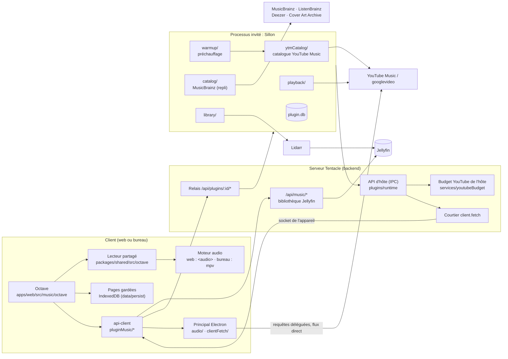
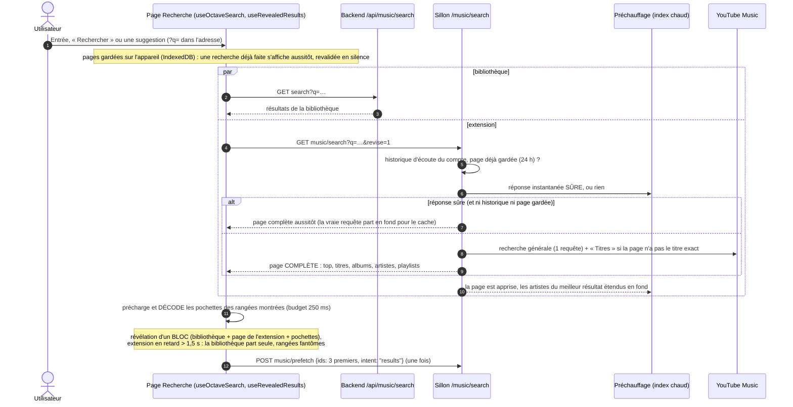
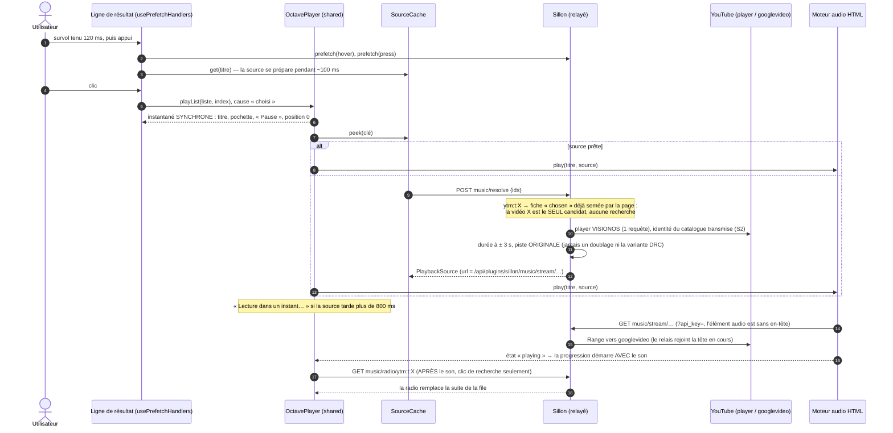
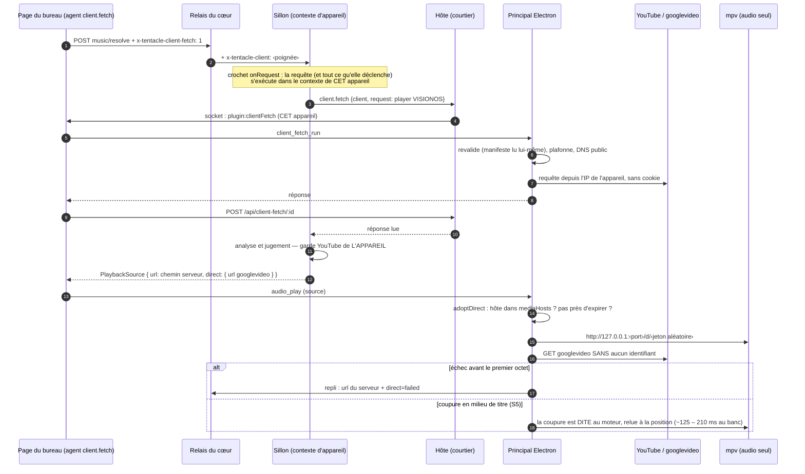
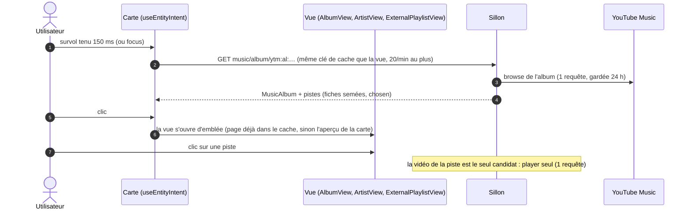
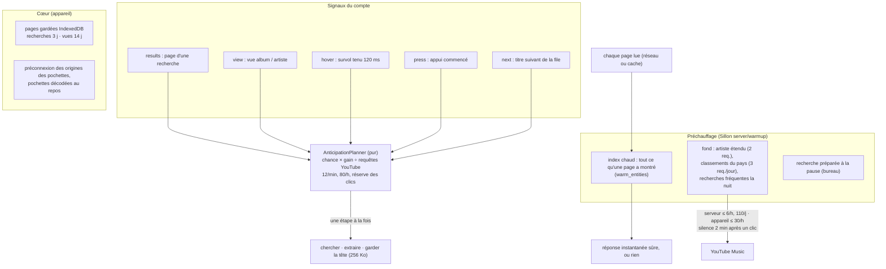
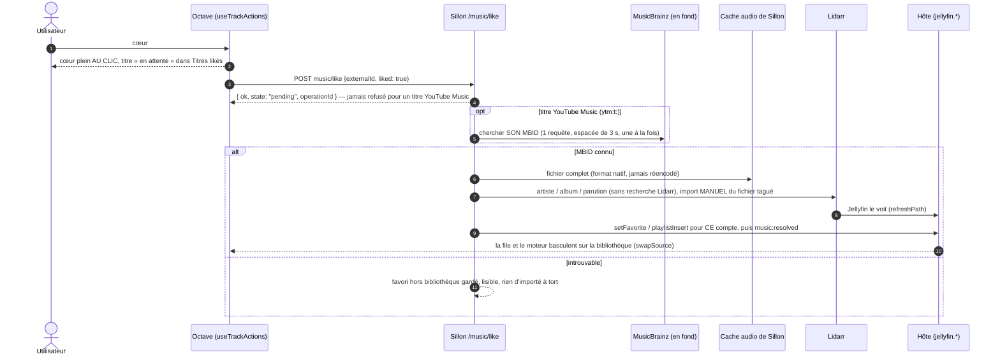

# Octave et Sillon — la cartographie

Ce document dit comment fonctionne, de bout en bout, la musique de Tentacle : **Octave** (le mode musique
du web et du bureau, dans ce dépôt) et **Sillon** (l'extension qui trouve et fait écouter la musique qui
n'est pas encore dans la bibliothèque Jellyfin, dépôt `Tentacle-Plugin-Sillon`). Il s'adresse à trois
lecteurs : quelqu'un qui veut comprendre sans lire le code, un développeur qui arrive, une IA qui reprend
le chantier.

Documents voisins :
- [`CONTRATS.md`](CONTRATS.md) — les contrats, dans le détail (ce document les résume et les relie) ;
- [`LECTEUR.md`](LECTEUR.md) — le lecteur d'Octave (file, moteurs, position, échecs, radio) ;
- [`EXTRACTION.md`](EXTRACTION.md) — où partent les millisecondes d'une extraction yt-dlp ;
- Sillon `docs/ARCHITECTURE.md` — l'intérieur de l'extension (modules, base, caches, sources externes).

État décrit : **intégration finale du lot « Sillon recherche »** (25/10 — Tentacle `1dbd4fc4d`, Sillon
`bb4c542`, branches `feat/music-mode`). Chaque affirmation a été relue dans le code à ces commits ; ce qui ne
l'a pas été est marqué **« non vérifié »**. Les mesures citées viennent des rapports du lot et sont dites
comme telles.

## Sommaire

1. [En une page](#1-en-une-page)
2. [Glossaire](#2-glossaire)
3. [Qui fait quoi](#3-qui-fait-quoi)
4. [Le runtime isolé des extensions et l'API d'hôte](#4-le-runtime-isolé-des-extensions-et-lapi-dhôte)
5. [Les contrats](#5-les-contrats)
6. [Les parcours de bout en bout](#6-les-parcours-de-bout-en-bout)
7. [Pannes et replis](#7-pannes-et-replis)
8. [Invariants — ce qui ne doit jamais arriver](#8-invariants--ce-qui-ne-doit-jamais-arriver)
9. [Les décisions qui ont façonné l'ensemble](#9-les-décisions-qui-ont-façonné-lensemble)
10. [Pour une IA qui reprend ce code](#10-pour-une-ia-qui-reprend-ce-code)
11. [Ce qui reste ouvert, et ce qui n'a pas été vérifié](#11-ce-qui-reste-ouvert-et-ce-qui-na-pas-été-vérifié)

---

## 1. En une page

- **La bibliothèque, c'est Jellyfin.** Le cœur de Tentacle sait lire la musique de Jellyfin : index de
  recherche local (SQLite FTS5), albums, artistes, playlists Jellyfin, favoris Jellyfin (« j'aime » EST le
  favori). Il ne sait **rien** de ce qui est hors bibliothèque.
- **Le hors bibliothèque, c'est une extension.** Le cœur expose des points d'extension génériques
  (rechercher, suggérer, donner une source de lecture, une radio, aimer, lister ce qui est en attente…).
  Sillon les remplit : sa recherche part chez **YouTube Music** (catalogue : une requête, meilleur résultat,
  titres, albums, artistes, playlists), sa lecture joue la vidéo touchée par le client `player` VISIONOS
  (yt-dlp de Tentacle en repli), et un titre aimé entre dans la bibliothèque par **Lidarr**. MusicBrainz /
  ListenBrainz restent le catalogue de REPLI et l'identité des titres à importer.
- **Sillon tourne à part.** Son code serveur vit dans un processus Node séparé, sous le modèle de
  permissions de Node : il ne lit ni la base de Tentacle, ni ses secrets, ni la clé Jellyfin. Il ne parle au
  cœur que par une **API d'hôte** à liste fermée, et les clients ne lui parlent qu'à travers un **relais**
  du cœur (`/api/plugins/sillon/*`) qui authentifie le compte.
- **YouTube se ménage.** Une seule adresse IP sert les bandes-annonces ET Sillon : un **budget commun**
  (150 requêtes/h, 20/min dont 12 au plus pour le fond, disjoncteur anti-robot partagé) est tenu par le cœur.
  Sur le **bureau**, TOUTES les requêtes YouTube d'un compte (recherche, album, artiste, playlist, radio,
  lecture, préchauffage) partent de l'appareil (**requêtes déléguées**), et le flux audio est lu **en direct**
  par l'appareil : cent bureaux ne font pas bloquer le serveur.
- **L'attente se cache.** Le lecteur pose le titre dans la barre au clic, avant toute requête ; un **titre
  choisi n'est jamais sauté** (« Réessayer » s'il ne peut pas être lu) ; la suite d'un clic de recherche est
  la **radio** de YouTube Music, sans fin ; un **préchauffage** apprend les pages déjà lues (index chaud), étend
  les artistes en fond, prépare la recherche à la pause de frappe (bureau) et garde les pages sur l'appareil
  (IndexedDB).

---

## 2. Glossaire

| Terme | Sens |
|---|---|
| **Octave** | Le mode musique de Tentacle (web et bureau Electron seulement). Code : `apps/web/src/music/`, `packages/shared/src/octave/`, `packages/shared/src/music/`. |
| **Sillon** | L'extension musique (dépôt `Tentacle-Plugin-Sillon`, identifiant `sillon`). Serveur : `server/` ; bundle front (admin, « Mes demandes ») : `src/`. |
| **Cœur** | Tentacle sans extension : backend Fastify, web, bureau, api-client, shared. |
| **Hôte / invité** | Le backend de Tentacle (hôte) lance le module serveur d'une extension isolée (invité) dans un processus à part. |
| **API d'hôte** | La liste fermée de méthodes que l'invité peut appeler par IPC (`HOST_METHODS`). |
| **Relais** | La route `/api/plugins/<id>/*` du cœur : authentifie, retire les secrets du client, pose `RELAY_HEADERS`, transmet en flux à la socket de l'invité. |
| **Capacité serveur** | Ce que le CODE du serveur sait faire, déclaré dans `GET /api/config` → `capabilities` ; un client n'affiche rien que le serveur ne déclare (CLAUDE.md, « Capacités du serveur »). |
| **Catalogue YouTube Music** | La recherche et les pages (album, artiste, playlist, radio) de Sillon lues chez YouTube Music (InnerTube `WEB_REMIX`, visiteur anonyme) : `server/ytmCatalog/`. Le catalogue d'avant (MusicBrainz / ListenBrainz, `server/catalog/`) sert de REPLI. |
| **Meilleur résultat** | La grande carte en tête d'une recherche (`top` : un titre, un album, un artiste ou une playlist), choisie par l'extension d'après l'ordre de YouTube Music. |
| **Puce (filtre)** | Tout · Titres · Albums · Artistes · Playlists ; une puce = UNE requête au clic quand l'extension sait servir une liste seule (`searchKinds`). |
| **Radio** | Ce que YouTube Music enchaîne après un titre (`next` sur `RDAMVM<videoId>`), sans fin (jeton `cursor`) : la suite d'un clic dans les résultats de recherche. |
| **MBID** | Identifiant MusicBrainz (enregistrement, parution, groupe, artiste). |
| **Identifiant externe** | L'identifiant opaque qu'une extension donne à un élément. Sillon : `ytm:t:<videoId>`, `ytm:al:<MPREb_…>`, `ytm:ar:<UC…>`, `ytm:pl:<id>` (YouTube Music) ; `rec:<recording>[~rel:<release>]`, `rel:`, `rg:`, `art:` (MusicBrainz, repli). |
| **Clé synthétique** | La clé de lecture d'un `ytm:t:` côté Sillon : un UUID version 5 tiré de la vidéo (jamais égal à un MBID, qui est v4) ; la pile de lecture de Sillon reste indexée « par enregistrement ». Jamais rendue au cœur. |
| **Clé de titre** | `jf:<id Jellyfin>` (bibliothèque) ou `ext:<pluginId>:<identifiant externe>` (`packages/shared/src/music/musicKeys.ts`). |
| **Disponibilité** | `library` (dans Jellyfin) · `cache` (fichier complet chez l'extension) · `pending` (aimé, en cours d'entrée) · `remote` (hors bibliothèque). |
| **Source de lecture** | `PlaybackSource` : où lire un titre, toujours un chemin du serveur Tentacle, plus un éventuel flux `direct` pour l'appareil. |
| **Titre choisi / enchaîné** | La CAUSE d'un démarrage (`startCause.ts`) : choisi par l'utilisateur (clic, Suivant, Précédent, « Réessayer »), ou enchaîné par la file (fin du titre d'avant). |
| **Fiche `chosen`** | La fiche d'un titre dont l'identité vient du catalogue (la vidéo touchée) : sa vidéo est le SEUL candidat au clic (S1). |
| **Anticipation** | Préparer une source avant le clic (`music.prefetch` : `results`, `hover`, `press`, `next`). |
| **Préchauffage** | `server/warmup/` (Sillon) et `apps/web/src/music/octave/data/persist/` (cœur) : index chaud, expansion d'artiste, classements, recherche préparée, pages gardées sur l'appareil. |
| **InnerTube** | L'API interne de YouTube : `search`, `browse`, `next` (client `WEB_REMIX`, YouTube Music), `player` (client `VISIONOS`). |
| **Piste ATV / clip OMV** | Piste audio de l'éditeur (« Auto-generated by YouTube. ») / clip officiel. |
| **Visiteur anonyme** | Le `visitorData` qu'InnerTube donne à tout navigateur : ni compte ni cookie ; un pour le serveur, un par appareil délégué. |
| **Requête déléguée** | `client.fetch` : l'extension DÉCRIT une requête HTTP, l'appareil qui l'a sollicitée (le bureau) l'exécute depuis sa connexion, l'extension analyse la réponse. |
| **Poignée (handle)** | Identifiant opaque d'un appareil pour une extension (HMAC extension × appareil), posé par le relais dans `x-tentacle-client`. |
| **Contexte d'appareil** | Chez Sillon (`server/runtime/deviceContext.ts`) : la requête qui porte une poignée s'exécute, avec tout ce qu'elle déclenche, dans le contexte de cet appareil (son port HTTP, sa garde, son visiteur). |
| **Cache strict** | `ProvenancedCache` de Sillon : une page rapportée par un appareil reste au compte jusqu'à ce qu'une réponse concordante du serveur ou d'un AUTRE compte la confirme. |
| **Flux direct** | `PlaybackSource.direct` : l'URL googlevideo liée à l'IP de l'appareil ; mpv la lit par un relais local 127.0.0.1. |
| **Garde YouTube** | Chez Sillon (`server/playback/youtubeGuard.ts`) : cadence, budgets glissants, rangs de départ (geste avant fond), disjoncteur — une pour le serveur, une par appareil délégué. |

---

## 3. Qui fait quoi



| Couche | Où | Ce qu'elle sait | Ce qu'elle ne sait pas |
|---|---|---|---|
| **shared** | [`packages/shared/src/music/`](../../packages/shared/src/music/), [`octave/`](../../packages/shared/src/octave/), [`plugins/`](../../packages/shared/src/plugins/) | Les contrats (types, routes, événements, manifeste `music`, runtime, `client.fetch`), la file, le contrôleur de lecture, le cache des sources, la cause d'un démarrage. Pur : ni React, ni DOM. | Aucune source nommée. |
| **api-client** | [`packages/api-client/src/pluginMusic/`](../../packages/api-client/src/pluginMusic/) | Trouver le fournisseur musique (`findMusicProvider` : la première extension active qui déclare `music`), appeler ses routes (`musicRequests.ts` : sources, anticipation, gestes, vues, radio), fusionner ses pages (`musicSearchMerge.ts`), l'agent des requêtes déléguées. | Le nom de l'extension. |
| **web (Octave)** | [`apps/web/src/music/`](../../apps/web/src/music/) | L'interface (recherche façon Apple Music, vues, barre de lecture), les deux moteurs côté page, l'anticipation par gestes, la radio d'un clic de recherche, les pages gardées sur l'appareil. | Rien du hors bibliothèque au-delà du contrat. |
| **bureau** | [`apps/desktop-electron/src/main/audio/`](../../apps/desktop-electron/src/main/audio/), [`clientFetch/`](../../apps/desktop-electron/src/main/clientFetch/) | mpv en audio seul (gapless, sortie exclusive, ReplayGain, bascule à chaud, reprise d'une coupure), l'exécution des requêtes déléguées, le relais local des flux directs. | Les règles de Sillon : il exécute ce que le manifeste DÉCLARE, rien d'autre. |
| **backend** | [`apps/backend/src/music/`](../../apps/backend/src/music/), [`plugins/runtime/`](../../apps/backend/src/plugins/runtime/), [`services/youtubeBudget/`](../../apps/backend/src/services/youtubeBudget/) | La musique Jellyfin (`/api/music/*`), le runtime isolé (lancement, relais, API d'hôte, outils), le budget YouTube, le courtier `client.fetch`. | yt-dlp pour la musique : jamais lui-même (seulement prêté à l'extension). |
| **Sillon** | dépôt `Tentacle-Plugin-Sillon` | Catalogue YouTube Music et MusicBrainz, préchauffage, lecture (choix et extraction de la source, radio), délégation au bureau, Lidarr, re-liaison. | La base de Tentacle, ses secrets, la clé Jellyfin. |

**La source de vérité est Jellyfin** : un cœur = un favori Jellyfin du compte, une playlist = une playlist
Jellyfin. Le cœur n'a aucun stockage musical propre hors de son index de recherche (et des pages gardées sur
l'appareil, qui ne sont qu'un cache).

---

## 4. Le runtime isolé des extensions et l'API d'hôte

### 4.1 Le processus invité

| Quoi | Où | Règle |
|---|---|---|
| Manifeste `runtime` | [`runtimeManifest.ts`](../../apps/backend/src/plugins/runtime/runtimeManifest.ts) | `kind: "isolated"`, `entry` dans le dossier de l'extension, `tools` (liste fermée : `yt-dlp`), `env` (noms simples, jamais `TENTACLE_*`, `NODE_*`, `JELLYFIN_*`, `DATABASE_*`…), `publicRoutes`, `hostApi` (familles `jellyfin.music`, `users`, `events`, `tools`, `client`), `clientFetch`. Un champ mal formé rend le manifeste ENTIER invalide. |
| Lancement | [`guestLaunch.ts`](../../apps/backend/src/plugins/runtime/guestLaunch.ts) | `node --permission` : lecture du dossier de l'extension, écriture de SON dossier de données, ni processus enfant, ni fil de travail, ni module natif ; `--allow-net` sous Node ≥ 25. Environnement RECONSTRUIT : `GUEST_ENV` + les variables déclarées. |
| Vie | [`guestSupervisor.ts`](../../apps/backend/src/plugins/runtime/guestSupervisor.ts) | Prêt quand l'invité envoie `ready` ; relancé s'il meurt (1 s → 60 s, remis à zéro après 60 s de bonne santé) ; arrêt `shutdown` → SIGTERM (5 s) → SIGKILL (2 s). Le relais répond 503 tant qu'il n'est pas prêt. |
| Registre | [`runtimeRegistry.ts`](../../apps/backend/src/plugins/runtime/runtimeRegistry.ts) | Un invité par extension isolée qui sert ; activer / couper prend effet sans redémarrer le serveur ; chaque changement d'une extension musique émet `music:provider`. |
| Côté Sillon | Sillon `server/index.ts`, `server/runtime/hostClient.ts` | Fastify écoute la socket `TENTACLE_PLUGIN_SOCKET` ; une seule voie vers l'hôte : `process.send` (appels avec délai de 15 s par défaut). |

### 4.2 Le relais HTTP

[`relay/relayRoute.ts`](../../apps/backend/src/plugins/runtime/relay/relayRoute.ts),
[`relayHeaders.ts`](../../apps/backend/src/plugins/runtime/relay/relayHeaders.ts),
[`relayQueryAuth.ts`](../../apps/backend/src/plugins/runtime/relay/relayQueryAuth.ts).

- `/api/plugins/<id>/*` (GET, POST, PUT, PATCH, DELETE) **après `requireAuth`**, sauf les `publicRoutes`
  (webhook Lidarr de Sillon, que Sillon authentifie lui-même par son secret).
- Le droit d'usage est vérifié AVANT de joindre l'invité
  ([`accountRights.ts`](../../apps/backend/src/plugins/runtime/accountRights.ts) : administrateur en session
  personnelle, sinon `users.rights` → `canUse`, gardé une minute, refus à l'échec).
- Vers l'invité : `Authorization`, cookies, `x-emby-*`, `x-mediabrowser-token`, tout `x-tentacle-*` venu du
  client et les en-têtes de connexion sont **retirés** ; l'hôte pose `RELAY_HEADERS` (`x-tentacle-user-id`,
  `-user-name`, `-is-admin`, `-session` = `personal | profile | device`, `-locale`, `-request-id`, `-client`).
- Le jeton en paramètre (`?api_key=`) est accepté en GET seulement (un `<audio>` ne pose pas d'en-tête),
  retiré de l'URL relayée, jamais journalisé.
- Corps et réponses **en flux** dans les deux sens ; `Range` transmis ; une requête inactive 120 s est
  coupée ; un client qui part coupe la requête vers l'invité.

### 4.3 L'API d'hôte (liste fermée)

Contrat : [`packages/shared/src/plugins/pluginServerRuntime.ts`](../../packages/shared/src/plugins/pluginServerRuntime.ts)
(miroir backend + Sillon `types/tentacle/`). Porte : [`hostDispatcher.ts`](../../apps/backend/src/plugins/runtime/hostDispatcher.ts)
(méthode connue, famille DÉCLARÉE, paramètres validés par Zod —
[`hostSchemas.ts`](../../apps/backend/src/plugins/runtime/hostSchemas.ts) —, 64 appels en vol au plus ; une
exception devient `failed` sans rien emporter de l'intérieur).

| Méthode | Famille | Ce qu'elle fait | Qui s'en sert chez Sillon |
|---|---|---|---|
| `jellyfin.musicLibrary`, `findByMbid`, `setFavorite`, `playlistInsert`, `playlistEntries`, `usageOf` | `jellyfin.music` | La musique Jellyfin du cœur, au nom d'un compte. | `library/` (favori posé, insertion à une position, instantané avant upgrade). |
| `jellyfin.notifyPath`, `jellyfin.refreshPath` | `jellyfin.music` | Faire voir un fichier à Jellyfin (60 s par défaut, 0,12 s par `refreshPath`). | `library/jellyfinNudge.ts`. |
| `users.rights` | `users` | `exists`, `isAdmin`, `canUse`, `canRequest` d'un compte pour CETTE extension. | `catalog/access.ts` (60 s), `library/service.ts` (30 s). |
| `events.emit` | `events` | Émettre `music:resolved` ou `music:pending` à des comptes (`pluginId` posé par l'hôte). | `library/notify.ts`. |
| `tools.info`, `tools.exec`, `tools.spawnWorker`, `tools.stopWorker` | `tools` | yt-dlp du cœur, sur liste blanche de l'ADMINISTRATEUR ([`toolGrants.ts`](../../apps/backend/src/plugins/runtime/tools/toolGrants.ts)) ; arguments filtrés ([`ytDlpPolicy.ts`](../../apps/backend/src/plugins/runtime/tools/ytDlpPolicy.ts)) ; ouvrier persistant au protocole fermé ([`toolWorkers.ts`](../../apps/backend/src/plugins/runtime/tools/toolWorkers.ts), 4 par extension). | `playback/workerPool.ts`, `extractAudio.ts`, `youtube/ytmSearchYtDlp.ts`. |
| `tools.youtubeAdmit`, `tools.youtubeReport` | `tools` | Le budget YouTube UNIQUE de l'hôte (§ 4.4). | `playback/hostYouTubeBudget.ts`. |
| `client.fetch` | `client` | Une requête décrite, exécutée par l'appareil (§ 4.5). | `youtube/clientPort.ts`. |

L'hôte pousse aussi des **événements** à l'invité : `jellyfin.audioItems`, `jellyfin.state`
(`up | restarting | down`), `settings.changed`.

### 4.4 Le budget YouTube de l'hôte

[`services/youtubeBudget/hostYouTubeLedger.ts`](../../apps/backend/src/services/youtubeBudget/hostYouTubeLedger.ts) —
une seule adresse IP sort vers YouTube (bandes-annonces + extensions), l'anti-robot tombe vers ~150
requêtes/h (mesuré le 14/10).

| Limite (`HOST_YOUTUBE_LIMITS`) | Valeur |
|---|---|
| Plafond de l'heure, tout compris | 150 |
| Par minute, tout compris | 20 |
| Une anticipation d'extension n'est admise que sous ce total de la minute (8 places restent aux gestes et aux bandes-annonces) | 12 |
| Une lecture d'extension (`play`) passe tant que le total de l'heure est sous | 140 |
| Une anticipation d'extension (`prefetch`) passe tant que le total de l'heure est sous | 110 |
| Par extension et par heure | 100 |
| Écart entre deux places accordées à une extension | 250 ms |
| Disjoncteur ouvert : une lecture-sonde d'extension toutes les | 5 min |

Le disjoncteur est **commun** avec les bandes-annonces : un anti-robot vu par l'un arrête l'autre. Sillon a
en plus sa propre garde, consultée AVANT l'hôte, qui fait partir les gestes avant le fond (Sillon
`docs/ARCHITECTURE.md`, « Budgets et gardes »). Un appareil délégué n'est jamais compté ici : il a SA garde.

### 4.5 Les requêtes déléguées (`client.fetch`, capacité `plugins.clientFetch`)

Contrat : [`packages/shared/src/plugins/pluginClientFetch.ts`](../../packages/shared/src/plugins/pluginClientFetch.ts)
(miroirs : backend `plugins/runtime/pluginClientFetch.ts`, bureau `main/clientFetch/pluginClientFetch.ts`,
Sillon `types/tentacle/pluginClientFetch.ts`).

- **Manifeste** : `runtime.clientFetch = { hosts, mediaHosts }` + famille `client`. Noms PUBLICS exacts
  (ni IP, ni `localhost`, ni `.local`, `.lan`, `.home`, `.internal`…), au plus 16 ; `mediaHosts` admet
  `*.domaine`. Sillon déclare `music.youtube.com`, `www.youtube.com`, `youtubei.googleapis.com` (variante
  VISIONOS 1.04, coupée par défaut) et `*.googlevideo.com`. Exposé aux clients par `/api/plugins/active`.
- **Annonce** : le bureau pose `x-tentacle-client-fetch: 1` sur ses appels `/api/plugins/*` tant que
  l'agent tourne ([`clientFetchAnnounce.ts`](../../packages/api-client/src/pluginMusic/clientFetchAnnounce.ts)).
  Le web ne s'annonce jamais.
- **Poignée** : le relais pose `x-tentacle-client` = HMAC (extension, appareil) si l'appareil a une socket
  ouverte ([`clientFetchRuntime.ts`](../../apps/backend/src/plugins/runtime/clientFetch/clientFetchRuntime.ts)).
- **Courtier** ([`clientFetchBroker.ts`](../../apps/backend/src/plugins/runtime/clientFetch/clientFetchBroker.ts)) :
  valide la requête, la pousse (`plugin:clientFetch`) sur la socket de CET appareil seulement, attend la
  réponse `POST /api/client-fetch/:id` ([`clientFetchRoute.ts`](../../apps/backend/src/plugins/runtime/clientFetch/clientFetchRoute.ts) :
  acceptée du seul appareil visé). Jamais d'exception pour l'extension : `offline` · `refused` · `timeout` ·
  `budget` · `network` · `tooLarge`.
- **Bureau** : l'agent de la page ([`clientFetchAgent.ts`](../../packages/api-client/src/pluginMusic/clientFetchAgent.ts),
  monté par [`useDesktopClientFetch.ts`](../../apps/web/src/music/octave/clientFetch/useDesktopClientFetch.ts))
  passe le travail au principal (`client_fetch_run`, [`ipc/clientFetch.ts`](../../apps/desktop-electron/src/main/ipc/clientFetch.ts)),
  qui revalide contre le manifeste qu'il lit LUI-MÊME ([`pluginManifests.ts`](../../apps/desktop-electron/src/main/clientFetch/pluginManifests.ts), 5 min),
  plafonne ([`clientFetchQuota.ts`](../../apps/desktop-electron/src/main/clientFetch/clientFetchQuota.ts) : 4 en parallèle,
  30/min, 300/h par extension) et exécute ([`clientFetchRunner.ts`](../../apps/desktop-electron/src/main/clientFetch/clientFetchRunner.ts)) :
  sans cookie, redirections (3 au plus) revalidées une à une, adresses privées refusées DANS la résolution
  DNS ([`safeLookup.ts`](../../apps/desktop-electron/src/main/clientFetch/safeLookup.ts)).
- **Bornes** (`CLIENT_FETCH_LIMITS`) : https seul, 20 en-têtes, corps ≤ 64 Ko, réponse ≤ 2 Mo (1 Mo par
  défaut), délai ≤ 8 s (5 s par défaut).
- **Chez Sillon** : le contexte d'appareil (§ 6.4) fait partir de l'appareil la recherche, les pages, la
  radio, la lecture et le préchauffage de ce compte ; seul le résultat ANALYSÉ par le serveur entre dans un
  cache, et une page d'appareil reste au compte tant qu'un autre ne la confirme pas (cache strict).

### 4.6 Les capacités serveur de la musique

[`packages/shared/src/serverCapabilities/serverCapabilities.ts`](../../packages/shared/src/serverCapabilities/serverCapabilities.ts)
— toutes `1.40.0` (version pas encore livrée ; `versions.json` intact) :

| Clé | Ce qu'elle garde côté clients |
|---|---|
| `music.library` | Le mode Octave lui-même — avec `/api/music/status` qui dit une bibliothèque musique visible par le compte ([`useOctaveAvailability.ts`](../../apps/web/src/music/octave/mode/useOctaveAvailability.ts)). |
| `plugins.isolatedRuntime` | Tout le hors bibliothèque : sans elle, `useMusicProvider` rend `null`. |
| `music.suggest` | Les suggestions de l'extension pendant la frappe ; sans elle : bibliothèque + recherches récentes. |
| `plugins.clientFetch` | L'agent des requêtes déléguées du bureau ; sans elle : aucune annonce, tout passe par le serveur. |

Les nouveautés du contrat `music` (meilleur résultat, playlists, `searchKinds`, `radio`, `typingPause`,
`intent`) n'ont PAS de capacité : elles traversent le relais telles quelles, un serveur d'avant ignore les
clés de manifeste qu'il ne connaît pas (lecture fermée), un client d'avant les ignore.

---

## 5. Les contrats

| Contrat | Fichier (shared, puis miroirs) | Résumé |
|---|---|---|
| Types musique | [`music/musicTypes.ts`](../../packages/shared/src/music/musicTypes.ts) | Titre, album, artiste, playlist, disponibilité, format audio. `artworkUrl` peut être une route de l'extension relayée par le cœur ou une adresse https publique ; le jeton n'accompagne jamais une URL d'un autre hôte. |
| Clés | [`music/musicKeys.ts`](../../packages/shared/src/music/musicKeys.ts) | `jf:` / `ext:<pluginId>:<id>`, MBID. |
| Lecture | [`music/musicPlayback.ts`](../../packages/shared/src/music/musicPlayback.ts) | `PlaybackSource`, port `AudioEnginePort` (voir [`LECTEUR.md`](LECTEUR.md)). |
| Routes du cœur | [`music/musicCoreApi.ts`](../../packages/shared/src/music/musicCoreApi.ts) | `/api/music/status`, `search`, `albums`, `artists`, `home`, `liked`, `favorite/:id`, `playlists…`, `by-mbid`, `match`, `source/:id`, `stream/:id`, `artwork/:id`, `playback`. |
| Événements | [`music/musicEvents.ts`](../../packages/shared/src/music/musicEvents.ts) | `music:library`, `music:userdata`, `music:playlist` (cœur), `music:resolved`, `music:pending` (seuls permis à une extension), `music:provider`. |
| Contrat `music` d'extension | [`music/pluginMusicContract.ts`](../../packages/shared/src/music/pluginMusicContract.ts) (miroir backend `routes/pluginMusicMeta.ts`, Sillon `types/tentacle/`) | Voir le tableau suivant. |
| Runtime isolé | [`plugins/pluginServerRuntime.ts`](../../packages/shared/src/plugins/pluginServerRuntime.ts) | § 4. |
| Requêtes déléguées | [`plugins/pluginClientFetch.ts`](../../packages/shared/src/plugins/pluginClientFetch.ts) | § 4.5. |
| Pont audio du bureau | [`apps/desktop-electron/src/main/audio/audioBridgeContract.ts`](../../apps/desktop-electron/src/main/audio/audioBridgeContract.ts) ↔ [`apps/web/src/music/engine/mpv/audioBridgeContract.ts`](../../apps/web/src/music/engine/mpv/audioBridgeContract.ts) | Commandes `audio_*`, événement `audio://event` ; miroir octet pour octet (`audioBridgeMirror.test.ts`). |

**Le contrat `music` du manifeste** (`plugin.json` → `music`, lu par `readPluginMusicManifest` ; `search` et
`resolve` obligatoires, les autres facultatifs ; chemins sous `/api/plugins/<id>`) :

| Champ | Méthode | Réponse | Notes |
|---|---|---|---|
| `search` | GET `?q=&limit=&cursor=&revise=1&kind=` | `ExternalMusicSearchPage` | Pages progressives (`complete`, `cursor`), v2 `replace` / `provisional` (Octave ne montre jamais une page `provisional`). **Additifs du 25/10** : `top` (`ExternalMusicTop` : `track` · `album` · `artist` · `playlist`, avec au plus 3 titres à lire depuis sa carte ; absent = aucune mise en avant, `null` = il n'y en a pas) et `playlists` (`ExternalMusicPlaylist`, hors bibliothèque) ; `kind=tracks|albums|artists|playlists` → une page où seule cette liste est remplie. Sillon rend sa page YouTube Music COMPLÈTE d'un coup (ni curseur, ni révision). |
| `searchKinds` | — | — | Liste FERMÉE des listes que `search` sait rendre seules : une puce de filtre = UNE requête au clic. Absente : l'interface filtre la page « Tout » sans requête. |
| `suggest` | GET `?q=&limit=` | `MusicSuggestResponse` | LOCAL seulement (index et caches, jamais le réseau). Capacité `music.suggest`. |
| `typingPause` | POST `{ q }` | 202 | Pause de frappe, BUREAU seulement : l'extension PRÉPARE la recherche depuis l'appareil ; rien n'est affiché ni attendu avant la validation. |
| `resolve` | POST `ExternalSourcesRequest` `{ ids, intent? }` | `ExternalSourcesResponse` | `intent` : `"next"` (le lecteur PRÉCHARGE le suivant : du fond), `"retry"` (« Réessayer » : un geste qui ignore les échecs retenus) ; absent = un geste (un clic). Réponse : une source par identifiant trouvé ; `retry?: { reason: "budget"; afterMs }` quand le budget YouTube refuse. |
| `prefetch` | POST `{ ids, intent }` | 204 | `intent` : `results` · `hover` · `press` · `next`. Jamais bloquant. |
| `radio` | GET `<radio>/<externalId>[?cursor=]` | `ExternalMusicRadio` `{ tracks, cursor? }` | Ce que la source enchaîne après le titre, sans lui, pour la SUITE d'un clic de recherche, demandée APRÈS le premier son. Sans fin : `cursor` (absent ou `null` = la fin) ; une page suivante peut redire des titres, la file les écarte. |
| `like`, `playlistAdd` | POST | `ExternalActionOutcome` | Réponse IMMÉDIATE `pending` ; refus dans une liste fermée. Chez Sillon, un « j'aime » d'un titre YouTube Music n'est JAMAIS refusé. |
| `pending` | GET | `PendingMusicResponse` | Les demandes du compte (en cours ET échouées). |
| `played` | POST `{ externalId, completed }` | 204 | Écoute menée au bout (historique d'écoute par compte). |
| `album`, `artist`, `playlist` | GET `<route>/<id>` | `MusicAlbum` · `MusicArtist` · `ExternalMusicPlaylist` (avec `tracks`) | Vues hors bibliothèque. |
| `labels` | — | — | Nom de la section par langue. |

**`PlaybackSource`** : `url` est TOUJOURS un chemin du serveur Tentacle ; `complete` faux = fichier encore en
écriture ; `expiresAt` ; et **`direct?: { url, expiresAt }`** — un flux que CET appareil lit en direct (https,
hôte des `mediaHosts`, aucun identifiant). À la première erreur, le moteur reprend `url` avec `direct=failed`
une fois.

**« Dans la bibliothèque » — une règle, partout** (25/10, retour de Damien : un album entier dans Jellyfin dont
les titres restaient « hors bibliothèque ») : un titre ou un album d'ailleurs que la bibliothèque du compte a est
montré et JOUÉ comme celui de la bibliothèque. La règle est UNE, pure, dans le contrat
([`musicLibraryMatch.ts`](../../packages/shared/src/music/musicLibraryMatch.ts), recopiée dans le backend) :
MBID d'enregistrement (de parution, de groupe pour un album) s'ils sont là, sinon titre de BASE (sans « feat. »,
« from … », « Remastered » ; une version live ou remix reste distincte) + un artiste commun (MBID, ou nom, crédits
découpés) + durée à ± 2 s ; une compilation que Jellyfin crédite à « Various Artists » vaut l'artiste si l'ALBUM
est le même ; dans un album reconnu, un titre l'est par son titre ou sa place (disque, piste), à ± 2 s. Un
homonyme n'est jamais pris. Elle s'applique :
- dans le cœur, par **`POST /api/music/match`** (capacité `music.libraryMatch`) — l'index local seul (FTS sur le
  nom, MBID), aucune requête à Jellyfin ni à l'extension, droits du compte ; un album rendu `full` (tous ses titres
  dans CET album) ou `partial` ([`matchViews.ts`](../../apps/backend/src/music/view/matchViews.ts)) ;
- côté client par `useMusicLibraryMatch` (api-client, en cache, relu à `music:library` et `music:resolved` : un
  import Lidarr bascule sans recharger), dans la vue album d'ailleurs (entier → la vue de la bibliothèque la
  remplace ; en partie → titres présents basculés, « 5 titres sur 8 dans la bibliothèque »), la vue artiste
  d'ailleurs, la playlist d'ailleurs, la recherche (attendue par la révélation : rien ne bascule sous les yeux) et
  la FILE ([`library/`](../../apps/web/src/music/octave/library/), bascule de `applyResolution`) ;
- contre les résultats de la même recherche, sans requête, par
  [`libraryTwins.ts`](../../apps/web/src/music/octave/search/libraryTwins.ts) (la même règle).
Marque : dans une liste qui mêle, l'icône bibliothèque (ton de réussite, mot pour les lecteurs d'écran) ; sur une
carte d'album, une pastille au repos dans le coin haut gauche (« En partie » si partiel), jamais au centre.
Relevé de l'album de Damien (copie de sa base, cache de Sillon) : 8/8 reconnus en 5 ms, dont « Daj Mi Jeszcze
Jedna Szanse » ≠ « Da mi jeszce jedna szanse » (par sa place et sa durée).

---

## 6. Les parcours de bout en bout

### 6.1 Frappe → suggestions (et, au bureau, recherche préparée)

```mermaid
sequenceDiagram
  autonumber
  actor U as Utilisateur
  participant Box as OctaveSearchBox
  participant Sug as useOctaveSuggestions
  participant Core as Backend /api/music/search
  participant S as Sillon
  participant YT as YouTube Music (depuis le bureau)
  U->>Box: tape une lettre
  Box->>Sug: brouillon
  Note over Sug: anti-rebond 90 ms, frappe dépassée annulée
  par bibliothèque
    Sug->>Core: GET search?q=…&limit=6
    Core-->>Sug: titres, artistes, albums (index FTS5 local)
  and extension (capacité music.suggest)
    Sug->>S: GET music/suggest?q=… (relayé)
    S-->>Sug: suggestions LOCALES (vus du compte, index locaux)
  end
  Sug->>Box: liste unique (récentes, artistes, titres, albums, 8 au plus)
  opt bureau seulement : la barre se tait 600 ms, au moins 3 caractères
    Box->>S: POST music/warm/typing {q}
    S->>YT: recherche générale, depuis l'appareil, en priorité de fond (une en vol par compte)
    S-->>S: page gardée au compte, RIEN d'affiché
  end
```

- Fichiers : [`OctaveSearchBox.tsx`](../../apps/web/src/music/octave/search/OctaveSearchBox.tsx),
  [`useOctaveSuggestions.ts`](../../apps/web/src/music/octave/search/useOctaveSuggestions.ts),
  [`suggestionModel.ts`](../../apps/web/src/music/octave/search/suggestionModel.ts),
  [`recentMusicSearches.ts`](../../apps/web/src/music/octave/search/recentMusicSearches.ts)
  (`tentacle_octave_recent_searches`, 8), [`useMusicSuggest.ts`](../../packages/api-client/src/pluginMusic/useMusicSuggest.ts),
  [`typingPause.ts`](../../apps/web/src/music/octave/data/typingPause.ts) (600 ms, 3 caractères, jamais deux fois
  le même texte ; Entrée annule la pause en cours ; rien sur le web ni sans la route).
- Chez Sillon : `server/catalog/suggest.ts` (aucune requête réseau) ; `server/warmup/typingPrep.ts` (jamais sans
  contexte d'appareil ; une en vol par compte, la suivante annule l'autre ; 10/min et 120/h par appareil ; à
  Entrée, la recherche validée trouve la page dans le cache du catalogue ou rejoint la même demande en vol ; une
  recherche préparée ne compte jamais comme validée).

### 6.2 Entrée → résultats (recherche façon Apple Music)



- **Côté serveur** (Sillon `server/catalog/routes.ts` → `server/ytmCatalog/ytmCatalogRouting.ts`) : la recherche
  validée part chez YouTube Music, sauf réglage d'administration « Catalogue de la recherche » = MusicBrainz
  (ou `SILLON_SEARCH_CATALOG=musicbrainz`). Refus de la garde (budget, anti-robot), forme inconnue, panne :
  la recherche MusicBrainz d'avant reprend (journal une fois par minute). Le meilleur résultat suit l'ordre de
  YouTube Music, sauf : un clip cède à sa piste audio, une version non demandée cède au titre exact, l'album
  d'un artiste cède au titre nommé ; jamais un titre deux fois ; ce que YouTube Music grise n'est jamais montré.
- **Côté client** : [`searchLayout.ts`](../../apps/web/src/music/octave/search/searchLayout.ts) (meilleur résultat,
  remplacé par son jumeau de bibliothèque s'il y en a un ; 6 titres à côté ; puis titres — la bibliothèque
  d'abord —, albums, artistes, playlists), [`TopResultCard.tsx`](../../apps/web/src/music/octave/search/TopResultCard.tsx),
  [`SearchAllView.tsx`](../../apps/web/src/music/octave/search/SearchAllView.tsx),
  [`SearchFilters.tsx`](../../apps/web/src/music/octave/search/SearchFilters.tsx) (puce dans l'adresse, `?f=`,
  sans entrée d'historique), [`useKindResults.ts`](../../apps/web/src/music/octave/search/useKindResults.ts)
  (une requête au clic d'une puce si l'extension déclare `searchKinds`, sinon la page « Tout » filtrée),
  [`revealModel.ts`](../../apps/web/src/music/octave/search/revealModel.ts) (`REVEAL_CAP_MS` 1 500,
  `ART_BUDGET_MS` 250 ; pochette absente retenue une minute, son repli dessiné d'emblée), playlists hors
  bibliothèque en carte ([`ExternalPlaylistCard.tsx`](../../apps/web/src/music/octave/search/ExternalPlaylistCard.tsx),
  vue `/octave/mix/:id`), lecture d'un geste depuis une carte ([`useTopPlayback.ts`](../../apps/web/src/music/octave/search/useTopPlayback.ts)).
- **Pochettes** : celles de YouTube Music sont des adresses https publiques, à la taille de l'usage (120 px
  pour une ligne, 360 px pour une carte, 16:9 sans bandes pour un clip) — jamais avec le jeton ; celles du
  catalogue MusicBrainz passent par le cache disque de Sillon (`/music/art/…`).
- **Mesures** (rapport R5, réseau réel, instance neuve) : 1re recherche 379 – 764 ms, médiane 426 ms (avant :
  0,35 à 32 s) ; déjà gardée : 3 – 75 ms, 0 requête ; réponse de l'index chaud : p50 3 ms (rapport R7).

### 6.3 Clic → premier son, sur le web



- Points de passage : [`usePrefetchHandlers.ts`](../../apps/web/src/music/octave/player/usePrefetchHandlers.ts),
  [`octavePlayer.ts`](../../packages/shared/src/octave/octavePlayer.ts), [`startCause.ts`](../../packages/shared/src/octave/startCause.ts),
  [`sourceCache.ts`](../../packages/shared/src/octave/sourceCache.ts), [`sourceRetry.ts`](../../packages/shared/src/octave/sourceRetry.ts),
  [`searchRadio.ts`](../../apps/web/src/music/octave/player/searchRadio.ts), [`musicRequests.ts`](../../packages/api-client/src/pluginMusic/musicRequests.ts),
  [`htmlAudioEngine.ts`](../../apps/web/src/music/engine/html/htmlAudioEngine.ts).
- Chez Sillon : `server/ytmCatalog/ytmBriefs.ts` (fiches et clé synthétique), `server/playback/chosenSource.ts`
  (S1), `resolver.ts`, `audioVariants.ts` (G1, G5), `youtube/playerExtractor.ts`, `streamRelay.ts`,
  `prebuffer.ts`. Un ancien identifiant `rec:` (catalogue MusicBrainz) passe encore par la recherche « Titres »
  (passes `known` → `music` → `web`).
- **Mesures** (rapports R5 et R2) : clic → premier octet 100 – 248 ms (8 sur 9, réseau réel) ; passer d'un titre
  prêt à l'autre : web 41 – 149 ms, bureau 20 – 88 ms.
- Le jeton : `<audio>` ne pose pas d'en-tête, le moteur ajoute `api_key` **seulement si l'adresse vise le
  serveur Tentacle** (`elementSourceUrl`, [`engineShared.ts`](../../apps/web/src/music/engine/engineShared.ts)).

### 6.4 Clic → premier son, sur le bureau (contexte d'appareil et relais local)



- **Tout part de l'appareil** pour un compte de bureau : la recherche validée et les puces, les vues d'album,
  d'artiste et de playlist, la radio, l'extraction (`player`), et le préchauffage de ce compte (sur l'appareil
  de sa dernière requête d'interface, `deviceOf`). Sillon `server/runtime/deviceContext.ts`,
  `server/playback/delegation/*`, `server/ytmCatalog/ytmCatalogRouting.ts` (`viaBest`).
- **Repli** : un bureau qui ne répond plus (`ClientUnavailable` : parti, délai, refus de l'hôte) → le serveur
  reprend UNE fois, pour un GESTE seulement (clic, recherche validée, vue ouverte, radio d'un clic) ; jamais pour
  le fond ; jamais sur un refus de la garde de l'appareil (un anti-robot vu depuis son adresse, repris depuis
  celle du serveur, serait un contournement).
- **Caches partagés** : une page du catalogue rapportée par un appareil reste à SON compte jusqu'à une réponse
  concordante (5 premiers identifiants, même ordre) du serveur ou d'un AUTRE compte (cache strict) ; une
  correspondance titre → vidéo d'appareil ne remplace jamais celle du serveur ; une URL d'appareil ne va jamais
  en base commune.
- Côté cœur : [`directSources.ts`](../../apps/desktop-electron/src/main/clientFetch/directSources.ts),
  [`directRelay.ts`](../../apps/desktop-electron/src/main/clientFetch/directRelay.ts),
  [`cutRecovery.ts`](../../apps/desktop-electron/src/main/audio/cutRecovery.ts),
  [`audioEngineEnds.ts`](../../apps/desktop-electron/src/main/audio/audioEngineEnds.ts),
  [`ipc/audio.ts`](../../apps/desktop-electron/src/main/ipc/audio.ts) (`refuseSource`).
- Ce qui part encore du serveur pour un bureau : yt-dlp (il ne peut pas tourner sur le bureau : un titre que le
  lecteur direct refuse), MusicBrainz / ListenBrainz (catalogue de repli ; la « phase 2 » par l'appareil est en
  pause), le `visitor_id` d'amorce du serveur (une fois par 12 h, pour le web).
- **Mesures** (rapport R3, passe réelle) : recherche validée depuis le bureau 549 ms, album 207 ms, serveur à
  0 requête YouTube ; froid au clic 694 ms (contre 712 par le serveur).

### 6.5 Ouvrir un album, un artiste ou une playlist



- Fichiers : [`entityIntent.ts`](../../apps/web/src/music/octave/data/entityIntent.ts),
  [`useEntityQueries.ts`](../../apps/web/src/music/octave/data/useEntityQueries.ts),
  [`albumPreview.ts`](../../apps/web/src/music/octave/data/albumPreview.ts),
  [`useExternalPlaylist.ts`](../../apps/web/src/music/octave/data/useExternalPlaylist.ts),
  [`ExternalPlaylistView.tsx`](../../apps/web/src/music/octave/views/ExternalPlaylistView.tsx) ;
  Sillon `server/ytmCatalog/ytmViews.ts`, `ytmPages.ts`, `youtube/ytmAlbum*.ts`.
- Un album, un artiste ou une playlist ne déclenche jamais de « Albums » + `browse` au clic pour un identifiant
  YouTube Music : sa page DIT ses pistes et leurs vidéos. Pour un ancien identifiant MusicBrainz (`rel:`, `rg:`),
  la préparation d'album d'avant tient : vue TENUE 1 s, puis « Albums » + `browse` apparié aux pistes
  MusicBrainz (Sillon `server/playback/albumPreparer.ts`, `albumMatch.ts`, `albumViews.ts`).
- Une vue album ou artiste anticipe aussi sa 1re piste ; un compte qui quitte le sujet (recherche, autre vue)
  fait sortir son fond de la file de la garde.

### 6.6 L'anticipation et le préchauffage



- **Anticipation** (Sillon `server/playback/anticipation/*`) : rien pendant la frappe, plafonds 12/min (la part
  que la minute de l'hôte laisse au fond) et 80/h, 40 de l'heure gardées aux clics, 3 étapes en vol ; une
  préparation n'appelle **jamais** la recherche YouTube de secours ni yt-dlp (`clickOnly.ts`). Le préchargement
  du suivant passe après les gestes (`intent: "next"`) ; rien du suivant ne se prépare avant le premier son du
  titre courant (L1).
- **Préchauffage** (Sillon `server/warmup/*`) : l'index chaud apprend toute page déjà lue (0 requête) ; une
  recherche validée étend en fond les artistes de son meilleur résultat (page d'artiste + « tous ses titres »),
  une écoute étend l'artiste du titre ; les classements des pays du serveur sont relus une fois par jour ; les
  recherches que PLUSIEURS comptes valident sont refaites la nuit (2 h – 5 h) juste avant d'expirer. La réponse
  instantanée n'est donnée que SÛRE (« titre artiste » d'un artiste connu, nom d'artiste seul, titre écouté par
  le compte ou écrasant) — sinon la recherche réseau tranche.
- **Côté cœur** (R7, étendu au lot « Octave droits », D6) : [`octaveCachePolicy.ts`](../../apps/web/src/music/octave/data/persist/octaveCachePolicy.ts)
  (recherches finies seulement, 3 jours ; vues d'ailleurs ET pages de la bibliothèque — accueil, statut, playlists,
  albums, artistes, titres likés — 14 jours ; rangé PAR IDENTITÉ serveur + compte (profil compris), jamais rendu à
  une autre, 4 identités au plus, 150 pages et 6 Mo chacune ; effacé à la déconnexion),
  [`octaveCacheStore.ts`](../../apps/web/src/music/octave/data/persist/octaveCacheStore.ts) (IndexedDB
  `tentacle_octave_cache` ; tout échec = stockage vide, Octave marche comme avant),
  [`OctaveCacheBoundary.tsx`](../../apps/web/src/music/octave/data/persist/OctaveCacheBoundary.tsx) (pages
  rendues au cache de requêtes au montage, 200 ms au plus d'attente),
  [`artworkWarm.ts`](../../apps/web/src/music/octave/data/persist/artworkWarm.ts) (24 pochettes décodées au
  repos, 4 origines préconnectées, sans hôte nommé dans le cœur).
- **Lancement en Octave** (D6) : règle pure [`octaveLaunch.ts`](../../apps/web/src/music/octave/mode/octaveLaunch.ts),
  décidée au chargement ([`octaveLaunchStore.ts`](../../apps/web/src/music/octave/mode/octaveLaunchStore.ts) ; miroir
  de disponibilité `tentacle_octave_launch`, qui n'apprend que des réponses). La lecture IndexedDB part avec le module
  ([`octaveCacheBoot.ts`](../../apps/web/src/music/octave/cache/octaveCacheBoot.ts)) ; `main.tsx` attend l'un et
  l'autre au plus 350 ms et rend les pages au cache AVANT le premier rendu
  ([`octaveCacheHydration.ts`](../../apps/web/src/music/octave/cache/octaveCacheHydration.ts)). On arrive sur la page
  quittée (`tentacle_octave_page`, défilement rejoué avant la peinture par un `ResizeObserver`) avec le dernier titre
  et la file EN PAUSE (`tentacle_octave_player`, `octaveResume.ts` de shared : rien de chargé, « Lecture » repart à la
  position). Jusqu'à la première image de Tentacle : ni « Qui regarde ? » (l'identité gardée, ou la feuille du code
  PIN ; seule la sécurité garde le sélecteur), ni recouvrement de démarrage, ni requête des films, ni relecture du
  cache de Tentacle (au repos, ou dès que Tentacle en a besoin). Pochettes : le cache HTTP du navigateur (cache disque
  de Chromium au bureau), `private, max-age=1 an, immutable` + étiquette dans l'adresse.

### 6.7 Aimer un titre hors bibliothèque → Lidarr → Jellyfin



- Aimer un titre (comme l'écouter jusqu'au bout) le met en tête de la recherche de CE compte — l'historique
  d'écoute par compte (Sillon `server/ytmCatalog/ytmPersonal.ts`, `catalog/personal.ts`), jamais partagé.
- Upgrade Lidarr (webhook `POST /api/plugins/sillon/webhooks/lidarr`, `X-Sillon-Secret`) : favoris et positions
  reposés pour TOUS les comptes, sans doublon (Sillon `server/library/relink.ts`).
- Côté cœur : [`useTrackActions.ts`](../../apps/web/src/music/octave/actions/useTrackActions.ts),
  [`likeOverrides.ts`](../../apps/web/src/music/octave/actions/likeOverrides.ts),
  [`pendingMerge.ts`](../../packages/shared/src/octave/pendingMerge.ts),
  [`octaveResolution.ts`](../../packages/shared/src/octave/octaveResolution.ts),
  [`useOctaveEvents.ts`](../../apps/web/src/music/octave/events/useOctaveEvents.ts).

---

## 7. Pannes et replis

| Panne | Ce qui se passe | Où |
|---|---|---|
| **Budget YouTube atteint** | Aucune requête ne part. Recherche : catalogue MusicBrainz d'avant. Clic : `retry: { reason: "budget", afterMs }` → « Lecture dans un instant… », jusqu'à 3 nouveaux essais (≤ 10 s chacun) pour un titre choisi, 1 pour un enchaînement, sans compter l'échec. Fond : remis à plus tard (la voie de préchauffage figée 1 h). | Sillon `playback/routes.ts`, `noSource.ts`, `warmup/warmScheduler.ts` ; cœur [`sourceRetry.ts`](../../packages/shared/src/octave/sourceRetry.ts) |
| **Anti-robot YouTube** | Disjoncteur (Sillon : 30 min doublées jusqu'à 4 h, sonde toutes les 5 min ; hôte : commun avec les bandes-annonces ; préchauffage : 24 h). Jamais de repli yt-dlp, jamais le serveur à la place d'un appareil bloqué. | Sillon `youtube/guarded.ts`, `playback/youtubeGuard.ts` |
| **Réponse InnerTube illisible** (format changé) | Catalogue : `YtmParseError` → recherche MusicBrainz ; lecture : repli yt-dlp au clic seulement ; variante VISIONOS en échec STRUCTUREL → la suivante de l'échelle (si activée). | Sillon `ytmCatalog/*`, `youtube/playerExtractor.ts`, `visionOsVariants.ts` |
| **Titre choisi sans source** | Il RESTE dans la barre (`phase: "error"`), message « ne peut pas être lu pour l'instant » et « Réessayer » (que Lecture / Pause déclenche aussi) ; jamais sauté. Seul un enchaînement passe au suivant, au plus deux fois d'affilée. | cœur [`octavePlayer.ts`](../../packages/shared/src/octave/octavePlayer.ts), [`failureStreak.ts`](../../packages/shared/src/octave/failureStreak.ts) |
| **Source trop lente** | « Lecture dans un instant… » dès 800 ms ; passé 10 s, le serveur rend « pas de source » (la résolution continue pour le clic suivant). | cœur `sourceRetry.ts` (`SLOW_START_MS`) ; Sillon `playbackService.ts` (`CLICK_DEADLINE_MS`) |
| **URL googlevideo refusée ou coupée** | Serveur : ré-extraction une fois, puis candidat suivant. Bureau : repli sur le serveur avant le premier octet (`direct=failed`) ; coupure en milieu de titre DITE au moteur et relue à la position (3 fois au plus par titre, sinon la fin est tenue pour vraie). | Sillon `streamRelay.ts` ; bureau `directRelay.ts`, `cutRecovery.ts` |
| **MusicBrainz en panne ou saturé** | Hors du chemin chaud depuis le catalogue YouTube Music. Repli de recherche dégradé (index locaux, ListenBrainz) ; une recherche touchée par une panne n'est ni gardée ni apprise ; vue par identifiant MusicBrainz : 502. « J'aime » d'un titre YouTube Music : favori gardé, MBID cherché plus tard. | Sillon `catalog/search.ts`, `ytmCatalog/ytmLike.ts` |
| **ListenBrainz refuse sans jeton** | Après 3 refus 401 de suite, le point d'API est laissé de côté une heure ; un lot de plus de 100 identifiants est découpé (sinon 502). | Sillon `catalog/lbRefusals.ts`, `lbBatch.ts` |
| **Bureau coupé, socket fermée, plafond de l'appareil** | `client.fetch` rend `offline` / `budget` / `timeout` ; le serveur reprend une fois pour un geste ; le fond n'a pas lieu. | Sillon `delegation/delegating.ts`, `ytmCatalogRouting.ts` |
| **Stockage IndexedDB indisponible** (navigation privée, quota) | Stockage vide : Octave marche comme sans pages gardées. | cœur `octaveCacheStore.ts` |
| **Invité mort** | Relancé (1 s → 60 s) ; le relais répond 503 tant qu'il n'est pas prêt. | [`guestSupervisor.ts`](../../apps/backend/src/plugins/runtime/guestSupervisor.ts) |
| **Hôte ou client d'avant** | Méthode inconnue → Sillon garde sa garde locale seule ; clés de manifeste nouvelles ignorées ; `top`, `playlists`, `retry`, `intent`, `cursor` ignorés sans erreur (le meilleur résultat est AUSSI en tête de sa section). | Sillon `hostYouTubeBudget.ts` ; contrat additif |
| **Serveur sans capacité** | Rien ne s'affiche : ni section, ni bouton, ni suggestion de l'extension, ni agent du bureau. | § 4.6 |
| **libmpv absente** (bureau) | Le moteur `<audio>` du web prend le relais. | [`createAudioEngine.ts`](../../apps/web/src/music/engine/createAudioEngine.ts) |

---

## 8. Invariants — ce qui ne doit jamais arriver

1. **Le cœur ne nomme aucune source** et n'a aucune logique hors bibliothèque : il valide une forme, affiche,
   relaie. yt-dlp ne sert jamais la musique depuis le cœur. Les bandes-annonces ne changent pas de comportement.
2. **Jamais une requête YouTube à chaque lettre** : pendant la frappe, des suggestions locales ; au bureau, une
   seule recherche préparée à la PAUSE, cachée.
3. **Jamais une page provisoire à l'écran**, jamais une rangée montrée qui se réordonne sous les yeux.
4. **Un titre choisi n'est jamais sauté** ; seul l'enchaînement de la file passe au suivant, au plus deux fois
   d'affilée.
5. **Le titre touché se joue tel quel** (S1) : pas de recherche ni de « meilleure vidéo » au clic d'un titre du
   catalogue ; et jamais une piste doublée, d'audiodescription ou à dynamique compressée quand l'originale existe.
6. **Officiel d'abord dans ce qu'on PROPOSE** : la piste audio avant le clip en tête, le titre exact avant une
   version non demandée, rien de ce que YouTube Music grise.
7. **Le jeton du compte ne part que vers le serveur Tentacle** : ni pochette tierce, ni googlevideo, ni requête
   déléguée (`elementSourceUrl`, `refuseSource`, relais local du bureau).
8. **L'invité n'a ni la base de Tentacle, ni ses secrets, ni la clé Jellyfin** ; il ne reçoit jamais
   `Authorization`, les cookies ni un `x-tentacle-*` du client.
9. **Toute requête YouTube d'une extension passe une garde** (serveur : Sillon puis l'hôte ; appareil : la
   sienne) ; un refus = aucune requête ; un anti-robot n'est jamais contourné ; un geste part avant le fond.
10. **Le fond ne paie jamais un repli** : ni recherche de secours, ni yt-dlp, ni le serveur à la place d'un
    appareil.
11. **Le bureau n'exécute que ce que le manifeste DÉCLARE**, relu par lui-même : https, noms publics, aucune
    adresse privée, aucun cookie.
12. **Une réponse d'appareil n'est jamais vue par un autre compte sans confirmation**, ne remplace jamais une
    réponse du serveur, et une URL d'appareil ne va jamais en base commune.
13. **Rien sans capacité serveur ni sans droit du compte** : aucune trace dans l'interface.
14. **Jellyfin fait foi** : aimer = favori Jellyfin ; pas de doublon dans une playlist ; un upgrade Lidarr ne
    perd ni favori ni position ; rien n'est importé sans MBID.

---

## 9. Les décisions qui ont façonné l'ensemble

Décisions du lot « Sillon recherche » (24-25/10), tenues dans `DECISIONS.md` et les rapports des axes
(dossier du lot, hors dépôts) ; elles expliquent la forme du code.

| Décision | Pourquoi | Où elle se lit |
|---|---|---|
| **Suggestions seulement pendant la frappe**, recherche à la validation | 35 – 43 recherches complètes pour 20 lettres, résultats qui défilaient. | page Recherche, `music.suggest` |
| **YouTube Music est le catalogue de la recherche**, MusicBrainz en repli (réglage d'administration) | une requête (~430 ms) contre 1 req/s chez MusicBrainz et jusqu'à 32 s ; MusicBrainz a coupé notre adresse deux fois pendant le lot. | Sillon `ytmCatalog/` |
| **Clé de lecture synthétique** (UUID v5 de la vidéo) | garder une pile de lecture indexée par enregistrement sans jamais inventer de MBID. | Sillon `ytmBriefs.ts` |
| **« J'aime » jamais refusé** ; MBID cherché en fond, Lidarr seulement s'il est trouvé | un titre YouTube Music n'a pas de MBID au clic. | Sillon `ytmLike.ts` |
| **Requêtes YouTube depuis le bureau**, cache partagé STRICT | cent utilisateurs ne doivent pas faire bloquer le serveur ; une page forgée ne doit jamais atteindre un autre compte. | Sillon `delegation/`, `runtime/` |
| **Jouer le titre touché (S1)**, identité du catalogue au lecteur direct (S2) | l'écart avec les clients open source était « autour du clic » (étude R8). | Sillon `chosenSource.ts`, `playerExtractor.ts` |
| **La suite d'un clic de recherche = la radio**, après le premier son, sans fin (S3, G3) | « les autres résultats » sont des homonymes et des reprises : cascades d'échecs. | cœur `searchRadio.ts`, Sillon `ytmRadio.ts` |
| **Un titre choisi n'est jamais sauté**, « Réessayer » | « je veux lire CE titre ». | cœur `startCause.ts`, `octavePlayer.ts` |
| **Les gestes avant le fond** (rangs de la garde, 12/min de fond) | la 2e recherche après un album attendait le 9e créneau YouTube. | Sillon `youtubeGuard.ts`, cœur `hostYouTubeLedger.ts` |
| **Préchauffage** : réponse instantanée SÛRE ou rien ; recherche préparée à la pause, bureau seulement | un meilleur résultat faux ne se corrige plus (la page ne réordonne jamais) ; le web n'a pas d'appareil à qui faire payer la requête. | Sillon `warmup/`, cœur `data/persist/`, `typingPause.ts` |
| **Piste originale avant tout débit** (G1, G5) | relevé réel : le flux au plus haut débit était un doublage. | Sillon `audioVariants.ts` |
| **Coupure en milieu de titre dite au moteur** (S5) | mpv ne finit pas le fichier sur une coupure : il attendait, muet, pour toujours. | bureau `cutRecovery.ts`, `directRelay.ts` |
| **Variantes VISIONOS 1.04 et 0.1 codées mais COUPÉES** (S6) | valeurs relevées chez d'autres clients, non mesurées chez nous. | Sillon `visionOsVariants.ts` |
| **Non** : PoToken (plan C), contrepartie audio d'un clip, phase 2 MusicBrainz par l'appareil | risque élevé ; mesuré inexistant pour un visiteur anonyme ; MusicBrainz n'est plus sur les chemins chauds. | rapports R8, R5, R3 |

---

## 10. Pour une IA qui reprend ce code

**Où regarder d'abord**

| Question | Fichier |
|---|---|
| Que peut faire une extension ? | [`pluginServerRuntime.ts`](../../packages/shared/src/plugins/pluginServerRuntime.ts) (`HOST_METHODS`), [`pluginMusicContract.ts`](../../packages/shared/src/music/pluginMusicContract.ts) |
| Comment un client trouve l'extension musique ? | [`musicProvider.ts`](../../packages/api-client/src/pluginMusic/musicProvider.ts), [`useOctaveProvider.ts`](../../apps/web/src/music/octave/mode/useOctaveProvider.ts) |
| Qui décide de ce que montre la recherche ? | [`searchLayout.ts`](../../apps/web/src/music/octave/search/searchLayout.ts), [`revealModel.ts`](../../apps/web/src/music/octave/search/revealModel.ts), Sillon `server/ytmCatalog/bestResult.ts` |
| Pourquoi ce titre ne joue pas ? | Sillon `server/playback/resolver.ts`, `chosenSource.ts`, `sourceMatch.ts` ; journal de l'hôte (`[sillon]`), `SILLON_DEBUG` pour la chronologie des files |
| Combien de requêtes YouTube ? | [`hostYouTubeLedger.ts`](../../apps/backend/src/services/youtubeBudget/hostYouTubeLedger.ts), Sillon `server/playback/youtubeGuard.ts`, `warmup/warmScheduler.ts` |
| Le bureau délégué | [`pluginClientFetch.ts`](../../packages/shared/src/plugins/pluginClientFetch.ts), `apps/desktop-electron/src/main/clientFetch/`, Sillon `server/runtime/deviceContext.ts`, `server/playback/delegation/` |

**Pièges déjà payés**

- **Miroirs.** Les contrats se modifient dans `packages/shared`, puis se RECOPIENT octet pour octet dans le
  backend (`*Mirror.test.ts`), le bureau et Sillon (`types/tentacle/`). Une PR qui ne touche que shared ne
  rejoue pas les tests miroirs du backend.
- **Un contrat se change ADDITIF**, par le coordinateur du lot ; un client ou un serveur d'avant doit voir
  l'ancien comportement (ex. `top` est AUSSI en tête de sa section).
- **Contexte asynchrone** : un travail de fond armé pendant la requête d'un bureau tourne « au nom » de ce
  bureau ; le fond du préchauffage s'exécute donc sous `runAsServer` et passe sa voie par son port.
- **MetaBrainz pénalise une IP** (coupée les 24 et 25/10) : une seule instance réelle à 1 req/s, sinon rejouer.
- **YouTube** : ~150 extractions rapprochées suffisent à déclencher l'anti-robot (prod comprise). Les bancs
  rejouent des réponses enregistrées ; aucune requête ne part sans le budget d'équipe.
- **mpv porte le jeton en en-tête de l'INSTANCE** : lui donner une URL d'un autre hôte la ferait partir avec le
  jeton. D'où le relais local 127.0.0.1 et `refuseSource`.
- **`<audio>` ne publie pas la position tout seul** (barre restée à 0:00, corrigé) ; **une file de titres
  injouables défilait** et épuisait le plafond de l'hôte (arrêt, puis règle du titre choisi).
- **Le flux au plus haut débit peut être un doublage** : trier d'abord par piste originale.
- **L'iframe d'une extension n'a pas `allow-forms`** : aucun `<form>` dans un bundle d'extension.
- **300 lignes au plus par fichier**, code en anglais, commentaires en français, aucun « téléchargement » dans
  un texte visible (règles de CLAUDE.md).

---

## 11. Ce qui reste ouvert, et ce qui n'a pas été vérifié

**Ouvert à l'intégration finale** (rapports des axes)
- **S6** : les variantes VISIONOS 1.04 et 0.1 attendent un banc court réel (`SILLON_VISIONOS_VARIANTS`, 1.02 seule
  par défaut).
- **S5 en réel** : validé sur banc (vraie libmpv, coupure simulée) ; le cas réel au bureau (vraie URL googlevideo
  coupée) reste à jouer.
- **L3** (deux suivants préchauffés au bureau), **L4** (requêtes googlevideo à la manière de l'appli YouTube) :
  non faits. **Plan C** (PoToken) : refusé, gardé comme assurance.
- **Phase 2 MusicBrainz / ListenBrainz par l'appareil** : codée, en pause (à rouvrir si la file MusicBrainz du
  serveur dépasse 2 s au p95 en charge réelle).
- **Fiches d'une page d'appareil** : partagées tout de suite (la clé vient de la vidéo, une page forgée ne fait
  jamais jouer une autre vidéo ; le titre affiché pourrait être faux jusqu'à la prochaine vraie page) — limite
  connue, non fermée.
- **Historique d'écoute dans la réponse instantanée** : le préchauffage ne reçoit pas les écoutes du compte
  (`personalPlays`) ; l'historique passe AVANT lui côté catalogue, sans effet visible connu.
- **Justesse** : 17 / 20 au n° 1 sur la playlist de recette (rejeu) ; un album célèbre absent de la page
  générale de YouTube Music ne peut pas sortir en tête ; recette complète de la playlist et liste des
  introuvables : à finir (testeur R4).
- Le cache audio du serveur ne se remplit pas pendant une écoute directe au bureau.

**Non vérifié**
- Le comportement réel sous **Windows et Linux** (macOS seul).
- Le cache IndexedDB d'Octave dans un vrai navigateur ou dans Electron (tests avec un faux IndexedDB).
- Le rendu réel des diagrammes de ce document (contrôlés à la main).
- Les mesures citées : reprises des rapports, non refaites pour ce document.
