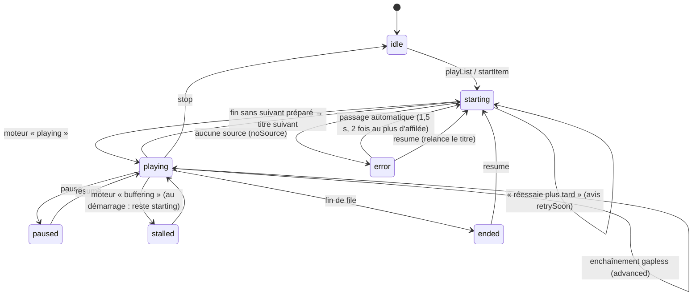
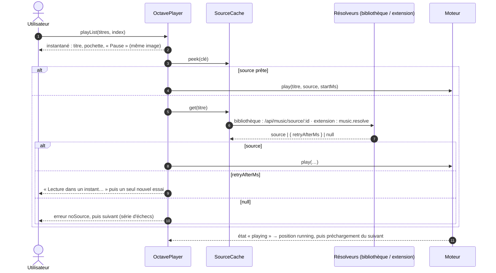
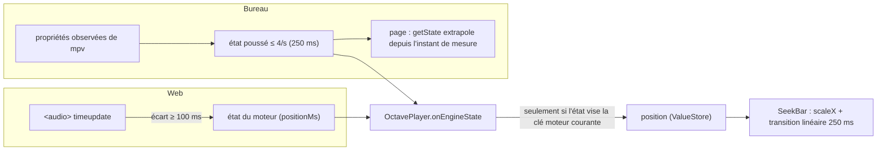

# Le lecteur d'Octave

Comment Octave joue un titre — de la bibliothèque Jellyfin ou hors bibliothèque (extension) — sur le web
et sur le bureau : la file, le contrôleur, les deux moteurs audio, la position affichée, les échecs, le
préchargement et la sécurité du jeton. La carte d'ensemble (recherche, extension, budgets) est dans
[`CARTOGRAPHIE.md`](CARTOGRAPHIE.md) ; les contrats dans [`CONTRATS.md`](CONTRATS.md).

État décrit : intégration du 25/10, 02:35 (Tentacle `886182f61` ; le lecteur n'a pas changé depuis `53ff77a2c`). Chaque affirmation a été relue dans le code ; ce
qui ne l'a pas été est marqué **« non vérifié »**.

## Sommaire

1. [En une page](#1-en-une-page)
2. [Glossaire](#2-glossaire)
3. [Les pièces et leur rangement](#3-les-pièces-et-leur-rangement)
4. [L'état et la file (shared `octave/*`)](#4-létat-et-la-file-shared-octave)
5. [D'un clic au son](#5-dun-clic-au-son)
6. [Les moteurs audio](#6-les-moteurs-audio)
7. [Position et compteur](#7-position-et-compteur)
8. [Échecs : série, « réessaie plus tard », source expirée](#8-échecs--série--réessaie-plus-tard--source-expirée)
9. [Préchargement et enchaînement](#9-préchargement-et-enchaînement)
10. [Titre aimé qui entre dans la bibliothèque : la bascule à chaud](#10-titre-aimé-qui-entre-dans-la-bibliothèque--la-bascule-à-chaud)
11. [Rapports d'écoute](#11-rapports-découte)
12. [Sécurité du jeton](#12-sécurité-du-jeton)
13. [Invariants](#13-invariants)
14. [Pour une IA qui reprend ce code](#14-pour-une-ia-qui-reprend-ce-code)
15. [Ce qui n'a pas été vérifié](#15-ce-qui-na-pas-été-vérifié)

---

## 1. En une page

- **Deux étages.** Le **contrôleur** ([`OctavePlayer`](../../packages/shared/src/octave/octavePlayer.ts),
  logique pure partagée) tient la file, l'état affiché et la position ; le **moteur**
  (`AudioEnginePort`) ne connaît que le titre COURANT et le SUIVANT. Le web joue par `<audio>` ; le bureau par
  une instance mpv en audio seul dans le processus principal d'Electron.
- **L'attente est invisible.** Au clic, le titre, la pochette et « Pause » s'affichent dans la même image,
  avant toute requête ; la progression reste à zéro et ne démarre qu'AVEC le son.
- **Les sources se gardent.** Une source demandée une fois (par l'anticipation, souvent) est prête au clic
  (`SourceCache.peek`) : le moteur part dans le tour même du clic.
- **On ne défile pas dans le vide.** Un titre sans source est signalé puis passé ; au 3e d'affilée, le lecteur
  s'arrête. Si l'extension dit « mon budget est atteint », le lecteur dit « Lecture dans un instant… » et
  réessaie une fois, sans passer au suivant.
- **Le jeton ne part que vers le serveur Tentacle.** Jamais vers une pochette tierce, jamais vers googlevideo —
  sur le bureau, le flux direct passe par un relais local qui ne transmet aucun identifiant.

---

## 2. Glossaire

| Terme | Sens |
|---|---|
| **Contrôleur** | `OctavePlayer` : file, instantané, position ; il appelle le moteur. |
| **Moteur** | Une implémentation d'`AudioEnginePort` ([`musicPlayback.ts`](../../packages/shared/src/music/musicPlayback.ts)) : `HtmlAudioEngine` (web) ou le moteur mpv (bureau). |
| **Instantané** | `PlayerSnapshot` : titre courant, phase, file, volume, origine, format, erreur, avis. Change rarement. |
| **Position** | `PositionState` : `positionMs`, `durationMs`, `running`. Change plusieurs fois par seconde ; seule la barre de progression la suit. |
| **Phase** | `idle` · `starting` · `playing` · `paused` · `stalled` · `ended` · `error` ([`playerState.ts`](../../packages/shared/src/octave/playerState.ts)). |
| **Entrée de file** | `QueueItem` : un titre + un `uid` propre (un même titre peut être deux fois dans la file). |
| **Clé moteur** | La clé de titre que le moteur connaît pour une entrée (`engineKeys`) ; elle survit à une résolution (un titre externe devenu titre de la bibliothèque garde la clé déjà donnée au moteur). |
| **Source** | `PlaybackSource` : `url` (chemin du serveur), `complete`, `sizeBytes`, `durationMs`, `format`, `replayGain`, `expiresAt`, `direct?`. |
| **Gapless** | Enchaînement sans blanc entre deux titres. Promis par mpv, pas par `<audio>`. |
| **Bascule à chaud** | `swapSource` : changer la source d'un titre (cache → bibliothèque, URL expirée) à la même position, sans coupure audible. |
| **Fin provisoire** | La fin d'un fichier encore en écriture (`complete: false`) : à relire, pas à prendre pour la vraie fin. |

---

## 3. Les pièces et leur rangement

| Pièce | Fichier | Rôle |
|---|---|---|
| Contrôleur | [`packages/shared/src/octave/octavePlayer.ts`](../../packages/shared/src/octave/octavePlayer.ts) | Lancer, transport, préchargement du suivant, écoute du moteur. |
| Gestes de file | [`octaveQueueActions.ts`](../../packages/shared/src/octave/octaveQueueActions.ts) | Aléatoire, répétition, « Lire ensuite », retrait, déplacement, saut — puis redire le suivant au moteur. |
| File (pure) | [`queueModel.ts`](../../packages/shared/src/octave/queueModel.ts) | `items` (ordre de lecture), `original` (ordre du contexte, pour sortir de l'aléatoire), `cursor`, `shuffle`, `repeat` (`off` · `all` · `one`). « Précédent » après 3 s = redémarrer le titre (`RESTART_THRESHOLD_MS`). |
| État | [`playerState.ts`](../../packages/shared/src/octave/playerState.ts) | Instantané, position, `ValueStore`. |
| Sources | [`sourceCache.ts`](../../packages/shared/src/octave/sourceCache.ts) | Sources connues par clé ; demande en vol partagée ; expirée 10 s avant `expiresAt`. |
| Échecs | [`failureStreak.ts`](../../packages/shared/src/octave/failureStreak.ts), [`sourceRetry.ts`](../../packages/shared/src/octave/sourceRetry.ts) | Série de titres sans source ; « réessaie plus tard ». |
| Résolution | [`octaveResolution.ts`](../../packages/shared/src/octave/octaveResolution.ts) | `music:resolved` → file et moteur basculés ; `needSource` → source redemandée. |
| Rapports | [`playbackReports.ts`](../../packages/shared/src/octave/playbackReports.ts) | Jellyfin (start, progress, pause, stop) ; extension (`played`, au bout). |
| Montage React | [`apps/web/src/music/octave/player/OctavePlayerProvider.tsx`](../../apps/web/src/music/octave/player/OctavePlayerProvider.tsx) | Branche les sources (bibliothèque : `fetchMusicSource` ; extension : `resolveMusicSource`), les rapports, l'anticipation ; sélecteurs `usePlayerSelector`, `usePlayerPosition`. |
| Moteur, côté page | [`apps/web/src/music/engine/`](../../apps/web/src/music/engine/) | `AudioEngineProvider` (un moteur par application, redémarré à un changement de compte, de jeton ou de serveur), `createAudioEngine` (mpv si la coquille le déclare, sinon `<audio>`), `html/*`, `mpv/*`. |
| Moteur natif | [`apps/desktop-electron/src/main/audio/`](../../apps/desktop-electron/src/main/audio/) | Instance mpv audio seul, sa liste, son état, ses sorties, ReplayGain, fin provisoire, préchauffage. |
| Commandes du bureau | [`apps/desktop-electron/src/main/ipc/audio.ts`](../../apps/desktop-electron/src/main/ipc/audio.ts) | `audio_*` (validées par Zod), événement `audio://event` ; contrat [`audioBridgeContract.ts`](../../apps/desktop-electron/src/main/audio/audioBridgeContract.ts) (miroir de [`apps/web/src/music/engine/mpv/audioBridgeContract.ts`](../../apps/web/src/music/engine/mpv/audioBridgeContract.ts)). |
| Interface | [`apps/web/src/music/octave/shell/`](../../apps/web/src/music/octave/shell/) | `PlayerBar`, `SeekBar`, `Transport`, `VolumeControl`, `QueuePanel`, `NowPlayingSheet`. |

Le lecteur vit avec le mode : monté en entrant dans Octave, démonté en le quittant (la musique s'arrête en
sortant). Le volume survit d'une session à l'autre (`tentacle_octave_volume`, préférence d'appareil — clé de
stockage : elle ne se renomme jamais).

---

## 4. L'état et la file (shared `octave/*`)

- L'instantané est émis de façon **synchrone** au clic (`startItem`, étape 1) : titre, pochette, `wantsPlay`,
  phase `starting`, durée et format connus du titre ; la position est posée à `startMs` avec `running: false`.
- Chaque lancement porte un **jeton** (`playToken`) : une source qui arrive pour un titre déjà quitté est
  ignorée — un clic rapide sur un autre titre ne fait jamais jouer l'ancien.
- La traduction moteur → phase est `enginePhase` ([`playerState.ts`](../../packages/shared/src/octave/playerState.ts)) ;
  un état du moteur qui ne vise pas la clé moteur courante est ignoré.

---

## 5. D'un clic au son

- Quelle source pour quel titre (`SourceCache.resolve`) : titre de la bibliothèque → `library(jellyfinId)` ;
  titre d'extension → `external(track)` (seulement si l'extension est le fournisseur en service,
  `isFromProvider`) ; sinon aucune.
- L'anticipation par gestes ([`usePrefetchHandlers.ts`](../../apps/web/src/music/octave/player/usePrefetchHandlers.ts)) :
  survol ou focus tenu 120 ms → `hover` ; appui commencé (mousedown, touchstart, pointerdown) → `press`. Pour
  `press` et `next`, le contrôleur DEMANDE aussi la source lui-même (`OctavePlayer.prefetch`) : elle est
  souvent prête quand le clic arrive (~100 ms plus tard).
- Lire un album ou une playlist depuis sa carte sans l'ouvrir : ses titres se lisent dès le SURVOL de la carte
  ([`useCollectionPlayback.ts`](../../apps/web/src/music/octave/actions/useCollectionPlayback.ts)).

---

## 6. Les moteurs audio

### 6.1 Le choix

[`createAudioEngine.ts`](../../apps/web/src/music/engine/createAudioEngine.ts) : le moteur natif si la coquille
du bureau déclare ses commandes (`supportsNativeAudio()`), `<audio>` partout ailleurs — le web, et le bureau
sans libmpv (Linux sans la bibliothèque). Un moteur natif qui refuse de démarrer retombe sur `<audio>`, et le
journal le dit. L'interface ne lit que `capabilities` : elle n'affiche que ce qui est vrai.

| | Web (`<audio>`) | Bureau (mpv) |
|---|---|---|
| Gapless | Non promis (`gapless: false`) : le suivant préchargé démarre un peu AVANT la fin du courant, de la latence de démarrage mesurée, pour remplacer le blanc par un chevauchement de quelques ms. | Oui : `gapless-audio=weak` + `prefetch-playlist=yes` (bit pour bit au banc). `weak` et jamais `yes` : `yes` rééchantillonnerait tout au format du PREMIER titre. |
| Sortie exclusive | Non. | Oui : `audio-exclusive` (CoreAudio hog mode et format physique suivi sur macOS ; WASAPI exclusif ; PipeWire / ALSA `hw:`) — Windows et Linux **non vérifiés**. |
| ReplayGain | D'après les valeurs de la SOURCE seulement, gain positif impossible (plafond 0 dB). | Valeurs de la source par `volume-gain` (−30 à +12 dB), sinon étiquettes du fichier lues par mpv avec garde d'écrêtage ; posé PAR FICHIER (le gain change à la frontière exacte). « auto » = gain d'album quand on écoute un album dans l'ordre, du titre sinon. |
| Bascule à chaud | Deux éléments et un fondu à puissance constante de 40 ms (8 pas de 5 ms) ; la nouvelle source ouverte muette 0,6 s devant ([`htmlSwap.ts`](../../apps/web/src/music/engine/html/htmlSwap.ts)). En pause : remplacement sans fondu. | Fin du fichier courant posée à un instant T un peu devant (1,5 s), nouvelle source insérée juste après en EDL qui COMMENCE à T : sans blanc, à l'échantillon près. Jamais `start=T` sur l'entrée (saut = 230 à 310 ms de trou mesurés). |
| Fichier qui grandit | Lu tel quel par le navigateur. | Reconnexion ffmpeg sur fin prématurée ; si ffmpeg abandonne, le moteur relit à la position (§ 9). Le suivant est RETENU hors de mpv tant que le courant est incomplet. |
| Codecs | Sondés par `canPlayType` ([`htmlRules.ts`](../../apps/web/src/music/engine/html/htmlRules.ts)). | Liste des décodeurs de mpv ([`audioFormat.ts`](../../apps/desktop-electron/src/main/audio/audioFormat.ts)). |

### 6.2 Le moteur web

[`htmlAudioEngine.ts`](../../apps/web/src/music/engine/html/htmlAudioEngine.ts) — trois « cases »
([`htmlSlot.ts`](../../apps/web/src/music/engine/html/htmlSlot.ts)) : le courant, le suivant préchargé
(`preload="auto"`), la source de bascule. À moins de 1,5 s de la fin du courant (`ARM_BEFORE_END_S`), le
départ du suivant est programmé ; l'ancien finit seul ses dernières millisecondes puis est libéré. Le moteur ne
dépend pas du DOM : il reçoit une fabrique d'éléments (`MediaElementLike`), que les tests et le banc remplacent.

### 6.3 Le moteur du bureau

Côté page, [`mpvAudioEngine.ts`](../../apps/web/src/music/engine/mpv/mpvAudioEngine.ts) ne décide rien : il
traduit vers les commandes `audio_*` et tient l'état visible. Dans le principal :

| Fichier | Rôle |
|---|---|
| [`audioMpv.ts`](../../apps/desktop-electron/src/main/audio/audioMpv.ts) | Une instance mpv À PART pour la musique, sur la même libmpv que la vidéo, sans fenêtre (`vo=null`, `vid=no`, `audio-display=no`). Rien de bloquant sur le fil principal : commandes et lectures asynchrones, file d'évènements vidée sans attendre. Arrêt par `quit` puis `mpv_destroy` à l'évènement d'arrêt (jamais `mpv_terminate_destroy` d'un bloc : jusqu'à 1,5 s de fil tenu, mesuré). |
| [`audioQueue.ts`](../../apps/desktop-electron/src/main/audio/audioQueue.ts) | Le modèle de la liste mpv, toujours `[ en cours, (bascule), (suivant) ]` ; chaque geste rend les commandes à envoyer. |
| [`audioEngine.ts`](../../apps/desktop-electron/src/main/audio/audioEngine.ts) | Le moteur : état poussé à la page au plus toutes les 250 ms (`STATE_INTERVAL_MS`), avance de bascule 1,5 s, `needSource` quand une source expire dans moins de 60 s. |
| [`audioOptions.ts`](../../apps/desktop-electron/src/main/audio/audioOptions.ts) | Options de l'instance (cache 48 Mio en avant, 16 Mio en arrière, 20 s de lecture anticipée, délai réseau 15 s) et de chaque fichier. |
| [`audioSources.ts`](../../apps/desktop-electron/src/main/audio/audioSources.ts) | `refuseSource` : une source n'est acceptée que du serveur Tentacle réglé, en http(s) (§ 12). |
| [`coreAudioScan.ts`](../../apps/desktop-electron/src/main/audio/coreAudioScan.ts), [`outputWarmup.ts`](../../apps/desktop-electron/src/main/audio/outputWarmup.ts) | Le palier de ~2 s du premier son payé AVANT le premier clic : recensement des composants CoreAudio au lancement du bureau (hors fil principal, sans ouvrir de flux), puis 50 ms de silence numérique joués à la naissance de l'instance. |
| [`partialSource.ts`](../../apps/desktop-electron/src/main/audio/partialSource.ts) | Vraie fin ou fin provisoire d'un fichier en écriture (§ 9). |
| [`../clientFetch/directSources.ts`](../../apps/desktop-electron/src/main/clientFetch/directSources.ts), [`directRelay.ts`](../../apps/desktop-electron/src/main/clientFetch/directRelay.ts) | Le flux direct d'une extension (§ 12). |

---

## 7. Position et compteur

- **La progression démarre AVEC le son** : `running` ne passe à vrai que quand le moteur dit `playing`
  ([`octavePlayer.ts`](../../packages/shared/src/octave/octavePlayer.ts) › `onEngineState`). Avant, la
  position reste à la valeur de départ.
- **Le web doit publier la position** : le moteur `<audio>` la pousse sur `timeupdate`, dès qu'elle a bougé de
  100 ms (`POSITION_STEP_MS`). Sans cela, la barre restait à 0:00 pendant que le son jouait (défaut R2-01 du
  25/10, corrigé par `ae397a429`).
- **Le bureau extrapole** : entre deux états du principal, `getState` de la page ajoute le temps écoulé depuis
  la mesure (`extrapolatedPosition`, [`engineShared.ts`](../../apps/web/src/music/engine/engineShared.ts)) —
  seulement en lecture, jamais au-delà de la durée.
- **La barre** ([`SeekBar.tsx`](../../apps/web/src/music/octave/shell/SeekBar.tsx)) est la SEULE à suivre la
  position (sélecteur à part) ; son remplissage est une ÉCHELLE (`scaleX`), lissée par une transition
  linéaire de 250 ms pendant la lecture (`octave.css`, coupée avec le mouvement réduit). Pendant un glissé,
  elle suit le doigt ; le moteur ne reçoit le saut qu'au relâcher. Le commentaire d'`AudioEngineProvider.tsx`
  parle d'une relecture par `requestAnimationFrame` : la barre d'Octave ne s'en sert pas (relevé ici).
- **La durée** : celle du titre, puis celle de la source, puis celle que le moteur mesure.

---

## 8. Échecs : série, « réessaie plus tard », source expirée

| Cas | Réaction | Fichier |
|---|---|---|
| **Aucune source** (l'extension ou la bibliothèque n'en rend pas) | Phase `error`, erreur `noSource` affichée, passage au suivant au bout de 1,5 s (`skipDelayMs`) — **au 3e titre sans source d'affilée, plus de passage automatique** : l'utilisateur décide (`MAX_SKIPS_IN_ROW = 3`). La série repart de zéro au premier son, à un geste (`next`, `playList`). | [`failureStreak.ts`](../../packages/shared/src/octave/failureStreak.ts), `OctavePlayer.failCurrent` |
| **« Réessaie plus tard »** (`retry: { reason: "budget", afterMs }` de `music.resolve`) | Le titre reste ; avis `retrySoon` (« Lecture dans un instant… ») ; UN nouvel essai après `afterMs` borné à 10 s (`RETRY_MAX_WAIT_MS`) ; sans passer au suivant ni compter l'essai dans la série ; rien si l'utilisateur a changé de titre. Un second « réessaie » ne relance rien. | [`sourceRetry.ts`](../../packages/shared/src/octave/sourceRetry.ts), [`sourceCache.ts`](../../packages/shared/src/octave/sourceCache.ts) (`takeRetryHint`) |
| **Source près d'expirer, ou refusée** | Le moteur émet `needSource` ; le contrôleur oublie la source, la redemande et la bascule à chaud sous la même clé moteur. Bureau : `needSource` dès 60 s avant `expiresAt`. | [`octaveResolution.ts`](../../packages/shared/src/octave/octaveResolution.ts) › `refreshEngineSource` |
| **Erreur du moteur** | Phase `error`, erreur `engine`. | `OctavePlayer.onEngineState` |
| **Côté extension** | Sillon a ses propres bornes (un clic attend sa source 10 s au plus, puis « pas de source » ; URL refusée → ré-extraction une fois, puis candidat suivant). | Sillon `docs/ARCHITECTURE.md` |

---

## 9. Préchargement et enchaînement

- **Le suivant attend que le courant SONNE** : `scheduleNext` ne part qu'au premier état `playing` du titre
  courant (`nextAfterStart`). Préchargé plus tôt, il disputait au courant l'ouverture dans mpv (mesuré).
- `scheduleNext` annonce aussi le suivant à l'extension (`prefetch("next")`) et lui demande sa source ; il la
  donne au moteur par `setNext` dès qu'elle est là.
- **Enchaînement fait par le moteur** (`advanced`) : la file avance d'une entrée sans relancer le moteur, le
  compteur repart de 0, le suivant d'après est préparé.
- **Fin sans suivant préparé** (source arrivée trop tard) : `ended` du moteur → le contrôleur démarre le
  suivant lui-même (`onEnded`).
- **Fichier en écriture, bureau** : ffmpeg se reconnecte sur une fin prématurée
  (`reconnect=1,reconnect_streamed=1,reconnect_on_network_error=1,reconnect_delay_max=2` — jamais
  `reconnect_at_eof`, qui bouclait sur la VRAIE fin) ; s'il abandonne, une fin est tenue pour vraie à moins
  de 1,5 s de la durée connue, sinon le moteur relit à la position, 4 fois au plus (après 250, 600, 1 200,
  2 500 ms) ([`partialSource.ts`](../../apps/desktop-electron/src/main/audio/partialSource.ts)).

---

## 10. Titre aimé qui entre dans la bibliothèque : la bascule à chaud

Quand l'extension annonce `music:resolved` (le titre aimé a son élément Jellyfin), sans geste de
l'utilisateur ([`applyResolution`](../../packages/shared/src/octave/octaveResolution.ts), branché par
[`useOctaveEvents.ts`](../../apps/web/src/music/octave/events/useOctaveEvents.ts)) :

1. toutes les entrées de la file pour ce titre deviennent le titre de la bibliothèque, à leur place ;
2. le titre COURANT et le SUIVANT préchargé basculent leur source à chaud (`swapSource`), à la même position,
   sous la clé que le moteur connaît déjà ; la barre dit la nouvelle origine et le vrai format.

Sur le bureau, la bascule cache → bibliothèque du même fichier est sans blanc (§ 6.1).

---

## 11. Rapports d'écoute

[`playbackReports.ts`](../../packages/shared/src/octave/playbackReports.ts) :

- **Titre de la bibliothèque** → Jellyfin par `/api/music/playback` : `start` au premier son, `progress`
  toutes les 15 s au plus, `pause`, `stop` (avec `completed`).
- **Titre hors bibliothèque** → l'extension (`music.played`) **seulement au bout** : écouté à 90 % au moins de
  sa durée. Chez Sillon, c'est ce qui nourrit la préférence personnelle du compte et l'option « X écoutes ».

---

## 12. Sécurité du jeton

| Où | Règle | Fichier |
|---|---|---|
| Contrat | `PlaybackSource.url` est TOUJOURS un chemin du serveur Tentacle ; le moteur y ajoute l'authentification comme pour la vidéo. | [`musicPlayback.ts`](../../packages/shared/src/music/musicPlayback.ts) |
| Web | `<audio>` et `` ne posent pas d'en-tête : session par cookie → adresse telle quelle ; sinon `api_key` ajouté **seulement si l'adresse vise le serveur Tentacle** (un chemin, ou l'origine exacte de la base de l'API ou de la page ; jamais `//hôte/…`). Une pochette d'un autre hôte ou un flux googlevideo ne reçoivent jamais le jeton (fuite relevée le 25/10 : il partait chez coverartarchive.org). | [`engineShared.ts`](../../apps/web/src/music/engine/engineShared.ts) › `elementSourceUrl`, `isServerAddress` |
| Relais du cœur | `?api_key=` accepté en GET seulement, retiré de l'URL relayée, jamais journalisé. | [`relayQueryAuth.ts`](../../apps/backend/src/plugins/runtime/relay/relayQueryAuth.ts) |
| Bureau | Le jeton est un en-tête de l'INSTANCE mpv (`http-header-fields` : `X-Emby-Token`), posé sur TOUTES ses requêtes. D'où `refuseSource` : une source ne vient que du serveur Tentacle réglé au démarrage, en http(s) — jamais `file://`, `lavfi://`, `av://`, ni un autre hôte. Figé par un test « garde-fou » (`98849221f`). | [`audioSources.ts`](../../apps/desktop-electron/src/main/audio/audioSources.ts), [`ipc/audio.ts`](../../apps/desktop-electron/src/main/ipc/audio.ts) |
| Flux direct (bureau) | Adopté seulement si l'hôte est dans les `mediaHosts` que l'extension DÉCLARE (lus par le principal lui-même), en https, et pas à moins de 30 s de l'expiration. mpv ne reçoit que `http://127.0.0.1:<port>/d/<jeton aléatoire de 32 octets>` ; le principal tire googlevideo SANS aucun identifiant (ni `X-Emby-Token`, ni `Authorization`, ni cookie, ni `api_key`). Repli sur `url` (le serveur, avec ses en-têtes) avant le premier octet, en signalant `direct=failed` ; 502 après. Entrées oubliées après 1 h sans lecture. | [`directSources.ts`](../../apps/desktop-electron/src/main/clientFetch/directSources.ts), [`directRelay.ts`](../../apps/desktop-electron/src/main/clientFetch/directRelay.ts) |

---

## 13. Invariants

1. Le moteur ne connaît que le courant et le suivant ; la file vit dans le contrôleur.
2. La barre se met à jour AVANT le son ; la progression ne court qu'AVEC le son.
3. Une source arrivée pour un titre quitté ne joue jamais (`playToken`).
4. Jamais de défilement automatique au-delà de deux titres sans source d'affilée.
5. Un « réessaie plus tard » n'est jamais compté comme un échec ni ne fait passer au suivant ; un seul nouvel
   essai, borné à 10 s.
6. Le jeton ne part que vers le serveur Tentacle — ni pochette tierce, ni googlevideo, ni une source
   `file://` / `lavfi://` sur le bureau.
7. Le suivant n'est jamais donné à mpv tant que le courant est un fichier incomplet (sa fin provisoire ferait
   passer au suivant au milieu d'une chanson).
8. Rien de bloquant sur le fil principal d'Electron (commandes mpv asynchrones, recensement CoreAudio hors fil).

---

## 14. Pour une IA qui reprend ce code

**Où regarder d'abord** : [`octavePlayer.ts`](../../packages/shared/src/octave/octavePlayer.ts) (tout le
déroulé), puis le moteur de la plateforme ([`htmlAudioEngine.ts`](../../apps/web/src/music/engine/html/htmlAudioEngine.ts)
ou [`audioEngine.ts`](../../apps/desktop-electron/src/main/audio/audioEngine.ts) + [`audioQueue.ts`](../../apps/desktop-electron/src/main/audio/audioQueue.ts)).
Les tests sont la meilleure documentation des cas limites : `octavePlayer.test.ts`, `queueModel.test.ts`,
`sourceRetry.test.ts` (shared), `htmlAudioEngine.test.ts` (web), `audioQueue.test.ts`, `audioRules.test.ts`
(bureau).

**Pièges payés**

- **Miroir du pont audio** : `audioBridgeContract.ts` existe deux fois (bureau et web), octet pour octet
  (`audioBridgeMirror.test.ts`) ; on modifie le bureau puis on recopie.
- **mpv et le jeton** : toute nouvelle origine admise par `refuseSource` enverrait le jeton à cet hôte.
  Passer par un relais local, comme pour le flux direct.
- **`gapless-audio=yes`** rééchantillonne au format du premier titre ; **`start=T`** sur une entrée est un saut
  (trou audible) ; **`reconnect_at_eof`** boucle sur la vraie fin. Les trois sont documentés dans
  [`audioOptions.ts`](../../apps/desktop-electron/src/main/audio/audioOptions.ts) et [`audioQueue.ts`](../../apps/desktop-electron/src/main/audio/audioQueue.ts).
- **Premier son à froid sur macOS** : le recensement CoreAudio (~2 s) se paie au lancement, jamais au premier
  clic ; ne pas déplacer `coreAudioScan` sur le chemin du clic.
- **Mesurer un premier son** : la sortie audio du Mac, capot fermé, se réveille en ~2 s ; un banc Chrome sans
  tête se lance avec `--disable-audio-output` (relevé du lot, défaut R2-02).
- **Le web n'a pas de gapless** : ne pas promettre plus que `capabilities` ne dit.

---

## 15. Ce qui n'a pas été vérifié

- Sortie exclusive et comportement du moteur mpv sous **Windows (WASAPI)** et **Linux (PipeWire, ALSA)** :
  code et tests purs seulement.
- Quand exactement mpv ou le navigateur annoncent « buffering » (la règle de phase, elle, est vérifiée :
  `enginePhase`) n'a pas été observé en réel pour ce document.
- Les mesures citées (gapless bit pour bit, ~2 s du recensement, 230 à 310 ms d'un saut) viennent des rapports
  des lots Octave et « Sillon vitesse » ; elles n'ont pas été refaites ici.
