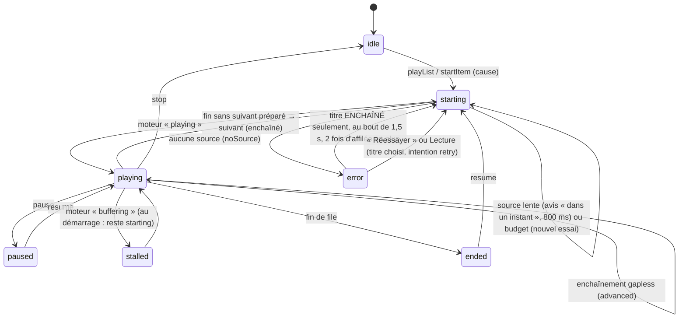
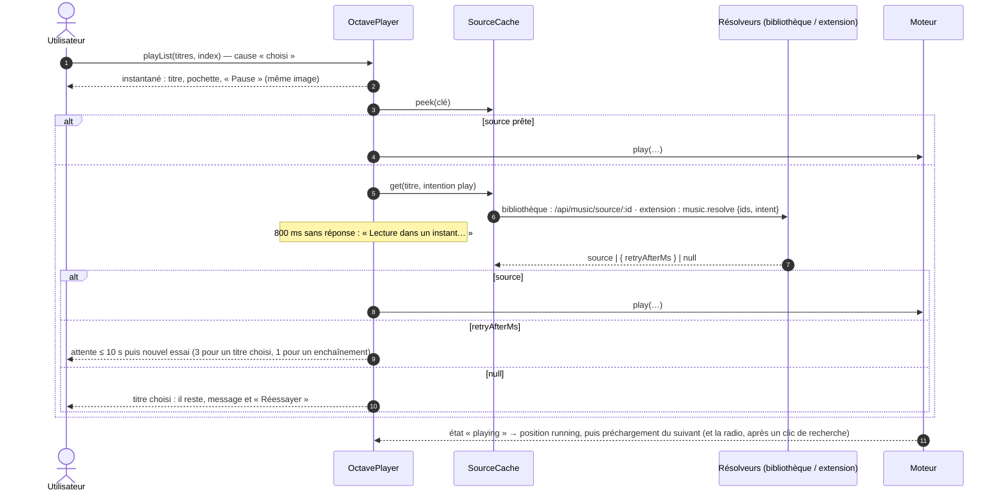
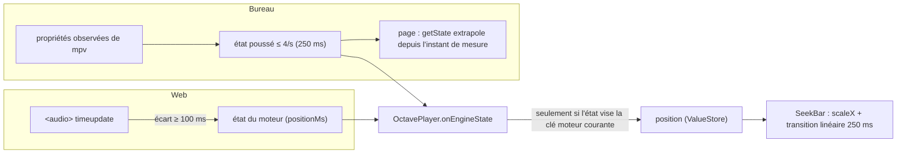
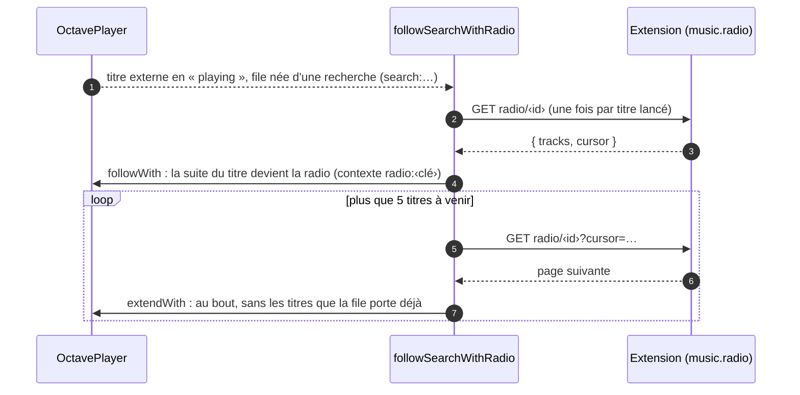

# Le lecteur d'Octave

Comment Octave joue un titre — de la bibliothèque Jellyfin ou hors bibliothèque (extension) — sur le web
et sur le bureau : la file, le contrôleur, les deux moteurs audio, la position affichée, les échecs, la radio,
le préchargement et la sécurité du jeton. La carte d'ensemble (recherche, extension, budgets) est dans
[`CARTOGRAPHIE.md`](CARTOGRAPHIE.md) ; les contrats dans [`CONTRATS.md`](CONTRATS.md).

État décrit : **intégration finale du lot « Sillon recherche »** (25/10 — Tentacle `1dbd4fc4d`). Chaque
affirmation a été relue dans le code ; ce qui ne l'a pas été est marqué **« non vérifié »**.

## Sommaire

1. [En une page](#1-en-une-page)
2. [Glossaire](#2-glossaire)
3. [Les pièces et leur rangement](#3-les-pièces-et-leur-rangement)
4. [L'état et la file (shared `octave/*`)](#4-létat-et-la-file-shared-octave)
5. [D'un clic au son](#5-dun-clic-au-son)
6. [Les moteurs audio](#6-les-moteurs-audio)
7. [Position et compteur](#7-position-et-compteur)
8. [Échecs : titre choisi, enchaînement, « Réessayer », budget](#8-échecs--titre-choisi-enchaînement--réessayer--budget)
9. [Préchargement et enchaînement](#9-préchargement-et-enchaînement)
10. [La radio d'un clic de recherche](#10-la-radio-dun-clic-de-recherche)
11. [Titre aimé qui entre dans la bibliothèque : la bascule à chaud](#11-titre-aimé-qui-entre-dans-la-bibliothèque--la-bascule-à-chaud)
12. [Rapports d'écoute](#12-rapports-découte)
13. [Sécurité du jeton](#13-sécurité-du-jeton)
14. [Invariants](#14-invariants)
15. [Pour une IA qui reprend ce code](#15-pour-une-ia-qui-reprend-ce-code)
16. [Ce qui reste ouvert, et ce qui n'a pas été vérifié](#16-ce-qui-reste-ouvert-et-ce-qui-na-pas-été-vérifié)

---

## 1. En une page

- **Deux étages.** Le **contrôleur** ([`OctavePlayer`](../../packages/shared/src/octave/octavePlayer.ts),
  logique pure partagée) tient la file, l'état affiché et la position ; le **moteur**
  (`AudioEnginePort`) ne connaît que le titre COURANT et le SUIVANT. Le web joue par `<audio>` ; le bureau par
  une instance mpv en audio seul dans le processus principal d'Electron.
- **L'attente est invisible.** Au clic, le titre, la pochette et « Pause » s'affichent dans la même image,
  avant toute requête ; la progression reste à zéro et ne démarre qu'AVEC le son. Si la source tarde plus de
  800 ms, « Lecture dans un instant… ».
- **Les sources se gardent.** Une source demandée une fois (par l'anticipation, souvent) est prête au clic
  (`SourceCache.peek`) : le moteur part dans le tour même du clic.
- **Un titre choisi n'est jamais sauté.** S'il ne peut pas être lu, il reste dans la barre avec un message et
  « Réessayer ». Seul l'ENCHAÎNEMENT de la file passe au suivant, au plus deux fois d'affilée. Si l'extension
  dit « mon budget est atteint », le lecteur attend et réessaie, sans compter l'échec.
- **La suite d'un clic de recherche est la radio** du titre (YouTube Music), demandée après le premier son, et
  sans fin.
- **Le jeton ne part que vers le serveur Tentacle.** Jamais vers une pochette tierce, jamais vers googlevideo —
  sur le bureau, le flux direct passe par un relais local qui ne transmet aucun identifiant.

---

## 2. Glossaire

| Terme | Sens |
|---|---|
| **Contrôleur** | `OctavePlayer` : file, instantané, position ; il appelle le moteur. |
| **Moteur** | Une implémentation d'`AudioEnginePort` ([`musicPlayback.ts`](../../packages/shared/src/music/musicPlayback.ts)) : `HtmlAudioEngine` (web) ou le moteur mpv (bureau). |
| **Instantané** | `PlayerSnapshot` : titre courant, phase, file, volume, origine, format, erreur, avis. Change rarement. |
| **Position** | `PositionState` : `positionMs`, `durationMs`, `running`. Change plusieurs fois par seconde ; seule la barre de progression la suit. |
| **Phase** | `idle` · `starting` · `playing` · `paused` · `stalled` · `ended` · `error` ([`playerState.ts`](../../packages/shared/src/octave/playerState.ts)). |
| **Cause d'un démarrage** | `chosen` (l'utilisateur l'a choisi : clic dans une liste ou la file, Suivant, Précédent, reprise, « Réessayer ») ou `chained` (la file l'enchaîne : fin du précédent) — [`startCause.ts`](../../packages/shared/src/octave/startCause.ts). |
| **Intention d'une source** | `play` (un geste), `next` (le préchargement du suivant : du fond), `retry` (« Réessayer » : l'extension refait tout) — [`sourceCache.ts`](../../packages/shared/src/octave/sourceCache.ts). |
| **Entrée de file** | `QueueItem` : un titre + un `uid` propre (un même titre peut être deux fois dans la file). |
| **Contexte de file** | `contextId` : d'où vient la file (`search:…`, un album, une playlist, `radio:<clé>`). |
| **Clé moteur** | La clé de titre que le moteur connaît pour une entrée (`engineKeys`) ; elle survit à une résolution. |
| **Source** | `PlaybackSource` : `url` (chemin du serveur), `complete`, `sizeBytes`, `durationMs`, `format`, `replayGain`, `expiresAt`, `direct?`. |
| **Gapless** | Enchaînement sans blanc entre deux titres. Promis par mpv, pas par `<audio>`. |
| **Bascule à chaud** | `swapSource` : changer la source d'un titre (cache → bibliothèque, URL expirée) à la même position, sans coupure audible. |
| **Fin provisoire / coupure** | La fin d'un fichier encore en écriture (`complete: false`), ou un flux qui s'arrête bien avant sa durée : à relire, pas à prendre pour la vraie fin. |

---

## 3. Les pièces et leur rangement

| Pièce | Fichier | Rôle |
|---|---|---|
| Contrôleur | [`packages/shared/src/octave/octavePlayer.ts`](../../packages/shared/src/octave/octavePlayer.ts) | Lancer (avec sa cause), transport, préchargement du suivant, écoute du moteur. |
| Cause | [`startCause.ts`](../../packages/shared/src/octave/startCause.ts) | `chosen` / `chained`, `CHOSEN_BUDGET_TRIES` (3). |
| Gestes de file | [`octaveQueueActions.ts`](../../packages/shared/src/octave/octaveQueueActions.ts) | Aléatoire, répétition, « Lire ensuite », retrait, déplacement, saut, « Réessayer » (`retry`), la radio (`followWith`, `extendWith`) — puis redire le suivant au moteur. |
| File (pure) | [`queueModel.ts`](../../packages/shared/src/octave/queueModel.ts) | `items` (ordre de lecture), `original` (ordre du contexte), `cursor`, `shuffle`, `repeat` (`off` · `all` · `one`), `contextId`. « Précédent » après 3 s = redémarrer le titre (`RESTART_THRESHOLD_MS`). |
| État | [`playerState.ts`](../../packages/shared/src/octave/playerState.ts) | Instantané, position, `ValueStore`. |
| Sources | [`sourceCache.ts`](../../packages/shared/src/octave/sourceCache.ts) | Sources connues par clé ; demande en vol partagée (un geste sur un titre qu'on préchargeait le redemande comme un geste) ; expirée 10 s avant `expiresAt`. |
| Attente et échecs | [`sourceRetry.ts`](../../packages/shared/src/octave/sourceRetry.ts), [`failureStreak.ts`](../../packages/shared/src/octave/failureStreak.ts) | « Lecture dans un instant… » à 800 ms, nouveaux essais sur « réessaie plus tard », série d'échecs de l'enchaînement. |
| Résolution | [`octaveResolution.ts`](../../packages/shared/src/octave/octaveResolution.ts) | `music:resolved` → file et moteur basculés ; `needSource` → source redemandée. |
| Rapports | [`playbackReports.ts`](../../packages/shared/src/octave/playbackReports.ts) | Jellyfin (start, progress, pause, stop) ; extension (`played`, au bout). |
| Radio | [`apps/web/src/music/octave/player/searchRadio.ts`](../../apps/web/src/music/octave/player/searchRadio.ts) | La suite d'un clic de recherche (§ 10). |
| Montage React | [`OctavePlayerProvider.tsx`](../../apps/web/src/music/octave/player/OctavePlayerProvider.tsx) | Branche les sources (bibliothèque : `fetchMusicSource` ; extension : `resolveMusicSource` avec l'intention), les rapports, l'anticipation, la radio ; sélecteurs `usePlayerSelector`, `usePlayerPosition`. |
| Moteur, côté page | [`apps/web/src/music/engine/`](../../apps/web/src/music/engine/) | `AudioEngineProvider` (un moteur par application, redémarré à un changement de compte, de jeton ou de serveur), `createAudioEngine` (mpv si la coquille le déclare, sinon `<audio>`), `html/*`, `mpv/*`. |
| Moteur natif | [`apps/desktop-electron/src/main/audio/`](../../apps/desktop-electron/src/main/audio/) | Instance mpv audio seul, sa liste, son état, ses sorties, ReplayGain, fins de fichier (vraie, provisoire, coupure), préchauffage de la sortie. |
| Commandes du bureau | [`apps/desktop-electron/src/main/ipc/audio.ts`](../../apps/desktop-electron/src/main/ipc/audio.ts) | `audio_*` (validées par Zod), événement `audio://event` ; contrat [`audioBridgeContract.ts`](../../apps/desktop-electron/src/main/audio/audioBridgeContract.ts) (miroir de [`apps/web/src/music/engine/mpv/audioBridgeContract.ts`](../../apps/web/src/music/engine/mpv/audioBridgeContract.ts)). |
| Interface | [`apps/web/src/music/octave/shell/`](../../apps/web/src/music/octave/shell/) | `PlayerBar`, `SeekBar`, `Transport`, `VolumeControl`, `QueuePanel`, `NowPlayingSheet`, `NowPlayingInfo` (message et « Réessayer »). |

Le lecteur vit avec le mode : monté en entrant dans Octave, démonté en le quittant. Le volume survit d'une
session à l'autre (`tentacle_octave_volume`, préférence d'appareil — clé de stockage : elle ne se renomme
jamais).

---

## 4. L'état et la file (shared `octave/*`)

- L'instantané est émis de façon **synchrone** au clic (`startItem`) : titre, pochette, `wantsPlay`, phase
  `starting`, durée et format connus du titre ; la position est posée à `startMs` avec `running: false`.
- Chaque lancement porte un **jeton** (`playToken`) : une source qui arrive pour un titre déjà quitté est
  ignorée — un clic rapide sur un autre titre ne fait jamais jouer l'ancien.
- La traduction moteur → phase est `enginePhase` ([`playerState.ts`](../../packages/shared/src/octave/playerState.ts)) ;
  un état du moteur qui ne vise pas la clé moteur courante est ignoré.
- **En erreur, rien ne « joue »** : `wantsPlay: false`, et le bouton Lecture vaut « Réessayer ».

---

## 5. D'un clic au son

- Quelle source pour quel titre (`SourceCache.resolve`) : titre de la bibliothèque → `library(jellyfinId)` ;
  titre d'extension → `external(track, intent)` (seulement si l'extension est le fournisseur en service,
  `isFromProvider`) ; sinon aucune.
- Côté extension (Sillon), un titre du catalogue YouTube Music arrive avec sa fiche « choisie » déjà semée par
  la page : sa vidéo est le SEUL candidat, une seule requête `player` (voir la carte, § 6.3).
- L'anticipation par gestes ([`usePrefetchHandlers.ts`](../../apps/web/src/music/octave/player/usePrefetchHandlers.ts)) :
  survol ou focus tenu 120 ms → `hover` ; appui commencé (mousedown, touchstart, pointerdown) → `press`. Pour
  `press` et `next`, le contrôleur DEMANDE aussi la source lui-même (`OctavePlayer.prefetch`).
- Lire un album ou une playlist depuis sa carte sans l'ouvrir : ses titres se lisent dès le SURVOL de la carte
  ([`useCollectionPlayback.ts`](../../apps/web/src/music/octave/actions/useCollectionPlayback.ts),
  [`useTopPlayback.ts`](../../apps/web/src/music/octave/search/useTopPlayback.ts) pour le meilleur résultat et
  les collections hors bibliothèque).

---

## 6. Les moteurs audio

### 6.1 Le choix

[`createAudioEngine.ts`](../../apps/web/src/music/engine/createAudioEngine.ts) : le moteur natif si la coquille
du bureau déclare ses commandes (`supportsNativeAudio()`), `<audio>` partout ailleurs — le web, et le bureau
sans libmpv (Linux sans la bibliothèque). Un moteur natif qui refuse de démarrer retombe sur `<audio>`, et le
journal le dit. L'interface ne lit que `capabilities` : elle n'affiche que ce qui est vrai.

| | Web (`<audio>`) | Bureau (mpv) |
|---|---|---|
| Gapless | Non promis (`gapless: false`) : le suivant préchargé démarre un peu AVANT la fin du courant, de la latence de démarrage mesurée. | Oui : `gapless-audio=weak` + `prefetch-playlist=yes` (bit pour bit au banc). `weak` et jamais `yes` : `yes` rééchantillonnerait tout au format du PREMIER titre. |
| Sortie exclusive | Non. | Oui : `audio-exclusive` (CoreAudio hog mode et format physique suivi sur macOS ; WASAPI exclusif ; PipeWire / ALSA `hw:`) — Windows et Linux **non vérifiés**. |
| ReplayGain | D'après les valeurs de la SOURCE seulement, gain positif impossible (plafond 0 dB). | Valeurs de la source par `volume-gain` (−30 à +12 dB), sinon étiquettes du fichier lues par mpv avec garde d'écrêtage ; posé PAR FICHIER. « auto » = gain d'album quand on écoute un album dans l'ordre, du titre sinon. |
| Bascule à chaud | Deux éléments et un fondu à puissance constante de 40 ms ; la nouvelle source ouverte muette 0,6 s devant ([`htmlSwap.ts`](../../apps/web/src/music/engine/html/htmlSwap.ts)). En pause : remplacement sans fondu. | Fin du fichier courant posée à un instant T un peu devant (1,5 s), nouvelle source insérée juste après en EDL qui COMMENCE à T : sans blanc. Jamais `start=T` sur l'entrée (saut = 230 à 310 ms de trou mesurés). |
| Fichier qui grandit | Lu tel quel par le navigateur. | Reconnexion ffmpeg sur fin prématurée ; si ffmpeg abandonne, le moteur relit à la position (§ 9). Le suivant est RETENU hors de mpv tant que le courant est incomplet. |
| Coupure en milieu de titre | — (l'élément signale une erreur, le contrôleur redemande la source). | Relue à la position (§ 9) : la coupure d'un flux direct est DITE au moteur par le relais local. |
| Codecs | Sondés par `canPlayType` ([`htmlRules.ts`](../../apps/web/src/music/engine/html/htmlRules.ts)). | Liste des décodeurs de mpv ([`audioFormat.ts`](../../apps/desktop-electron/src/main/audio/audioFormat.ts)). |

### 6.2 Le moteur web

[`htmlAudioEngine.ts`](../../apps/web/src/music/engine/html/htmlAudioEngine.ts) — trois « cases »
([`htmlSlot.ts`](../../apps/web/src/music/engine/html/htmlSlot.ts)) : le courant, le suivant préchargé
(`preload="auto"`), la source de bascule. À moins de 1,5 s de la fin du courant (`ARM_BEFORE_END_S`), le
départ du suivant est programmé ; l'ancien finit seul ses dernières millisecondes puis est libéré. Le moteur ne
dépend pas du DOM : il reçoit une fabrique d'éléments (`MediaElementLike`).

### 6.3 Le moteur du bureau

Côté page, [`mpvAudioEngine.ts`](../../apps/web/src/music/engine/mpv/mpvAudioEngine.ts) ne décide rien : il
traduit vers les commandes `audio_*` et tient l'état visible. Dans le principal :

| Fichier | Rôle |
|---|---|
| [`audioMpv.ts`](../../apps/desktop-electron/src/main/audio/audioMpv.ts) | Une instance mpv À PART pour la musique, sur la même libmpv que la vidéo, sans fenêtre. Rien de bloquant sur le fil principal ; arrêt par `quit` puis `mpv_destroy` à l'évènement d'arrêt. |
| [`audioQueue.ts`](../../apps/desktop-electron/src/main/audio/audioQueue.ts) | Le modèle de la liste mpv, toujours `[ en cours, (bascule), (suivant) ]`. |
| [`audioEngine.ts`](../../apps/desktop-electron/src/main/audio/audioEngine.ts) | Le moteur : état poussé à la page au plus toutes les 250 ms, avance de bascule 1,5 s, `needSource` quand une source expire dans moins de 60 s. |
| [`audioEngineEnds.ts`](../../apps/desktop-electron/src/main/audio/audioEngineEnds.ts), [`cutRecovery.ts`](../../apps/desktop-electron/src/main/audio/cutRecovery.ts), [`partialSource.ts`](../../apps/desktop-electron/src/main/audio/partialSource.ts) | Les fins de fichier : vraie fin, fin provisoire d'un fichier qui grandit, coupure en milieu de titre (§ 9). |
| [`audioOptions.ts`](../../apps/desktop-electron/src/main/audio/audioOptions.ts) | Options de l'instance (cache 48 Mio en avant, 16 Mio en arrière, 20 s de lecture anticipée, délai réseau 15 s) et de chaque fichier. |
| [`audioSources.ts`](../../apps/desktop-electron/src/main/audio/audioSources.ts) | `refuseSource` : une source n'est acceptée que du serveur Tentacle réglé, en http(s) (§ 13). |
| [`coreAudioScan.ts`](../../apps/desktop-electron/src/main/audio/coreAudioScan.ts), [`outputWarmup.ts`](../../apps/desktop-electron/src/main/audio/outputWarmup.ts) | Le palier de ~2 s du premier son payé AVANT le premier clic : recensement CoreAudio au lancement du bureau, puis 50 ms de silence numérique à la naissance de l'instance. |
| [`../clientFetch/directSources.ts`](../../apps/desktop-electron/src/main/clientFetch/directSources.ts), [`directRelay.ts`](../../apps/desktop-electron/src/main/clientFetch/directRelay.ts) | Le flux direct d'une extension (§ 13). |

### 6.4 La transition douce (fondu enchaîné)

Réglage de l'APPAREIL, dans les Réglages d'Octave (« Lecture › Transition douce ») :
`tentacle_octave_crossfade` (ms ; 0 = coupée, le défaut ; 2 à 12 s, 6 s quand on l'allume —
[`crossfadeSetting.ts`](../../apps/web/src/music/engine/crossfadeSetting.ts)). Le fournisseur du moteur le passe au port
(`setCrossfade`, OPTIONNEL : un moteur qui ne le connaît pas enchaîne comme avant). Aucune capacité serveur.

**La règle** ([`crossfadeRules.ts`](../../apps/web/src/music/engine/crossfadeRules.ts), décidée par la PAGE pour les
deux moteurs) :
- seulement entre deux titres ENCHAÎNÉS par la file : un geste (Suivant, un titre choisi, « Précédent ») coupe ;
  une file finie s'arrête sur la fin du titre ;
- jamais à l'intérieur d'un album écouté dans l'ordre (le titre suivant du même disque, ou le premier du disque
  suivant ; numéros inconnus dans un même album : tenu pour enchaîné) — il s'enchaîne sans blanc, comme mixé ;
- la durée se plie aux titres : un tiers du plus court au plus, rien sous une seconde ;
- courbes à PUISSANCE CONSTANTE (cos / sin : cos² + sin² = 1) ; le suivant démarre AVANT la fin du courant ;
- le titre COURANT bascule à MI-FONDU (`advanced`) : la barre, la file, la déclaration aux sessions et les rapports
  d'écoute passent au suivant quand les deux s'entendent autant. Le titre qui part est rapporté « écouté au bout »
  (`onAdvanced` rapporte sa durée) : `played` et la fin Jellyfin restent justes.

| | Web (`<audio>`) | Bureau (mpv) |
|---|---|---|
| Comment | Deux éléments ; leurs volumes menés toutes les 10 ms, sur l'horloge du titre qui ARRIVE ([`htmlCrossfade.ts`](../../apps/web/src/music/engine/html/htmlCrossfade.ts)). | Deux instances mpv derrière UN moteur ([`crossfadeDecks.ts`](../../apps/desktop-electron/src/main/audio/crossfadeDecks.ts)) : le suivant chargé EN PAUSE sur la réserve, sa courbe d'entrée dans les options de SON fichier ; la courbe de sortie posée par `af-command` ; gains = filtre lavfi `volume` sur le TEMPS DU FLUX ([`crossfadeFilter.ts`](../../apps/desktop-electron/src/main/audio/crossfadeFilter.ts)). |
| Pause pendant un fondu | Les deux s'arrêtent ; l'horloge du suivant mène : les courbes reprennent où elles étaient. | Idem (courbes sur le flux, minuteries en temps de lecture, [`crossfadeRun.ts`](../../apps/desktop-electron/src/main/audio/crossfadeRun.ts)). |
| Saut pendant un fondu | Avant la mi-fondu : le suivant redevient préchargé (muet, à 0), le courant reprend son volume. Après : le titre parti se tait. | Idem ; un saut dans la courbe d'entrée d'un titre entré en fondu le RELIT à la cible sans elle (un saut reconstruit la chaîne depuis son texte, mesuré). |
| Geste | Le titre quitté est lâché : Chrome adoucit lui-même l'arrêt (~40 ms, aucun clic mesuré). | Le titre quitté sort en 150 ms (gains pas à pas) pendant que le nouveau part sur l'autre instance. |
| Bascule de source pendant un fondu | Attend la fin du fondu. | Idem. |
| Jamais | — | En mode exclusif (une sortie exclusive n'a qu'un flux) : la réserve n'existe pas, enchaînement d'avant. |

**Mesures** (26/10, lot « Octave ambiances », M2) — bancs `apps/web/bench/audio-engine/crossfade.mjs` (Chrome sans
tête, le mélange enregistré par AudioWorklet) et `apps/desktop-electron/bench/audio/crossfadeScenarios.mts` (vraie
libmpv, sortie `null` cadencée) : fondus de 2, 6 et 12 s à ±0,09 s de la durée voulue ; puissance totale constante
à ±0,02 dB (web, 6-12 s) et ±0,02 à ±0,24 dB (bureau) ; aucun blanc ; énergie au-dessus de 4 kHz au niveau de la
lecture stable (web) et à −86 dB sous le ton (filtre mpv, sortie PCM) : aucun clic. Bureau : suivant calé à 7-18 ms
de la courbe de sortie.

---

## 7. Position et compteur

- **La progression démarre AVEC le son** : `running` ne passe à vrai que quand le moteur dit `playing`.
- **Le web doit publier la position** : le moteur `<audio>` la pousse sur `timeupdate`, dès qu'elle a bougé de
  100 ms (`POSITION_STEP_MS`). Sans cela, la barre restait à 0:00 pendant que le son jouait (défaut R2-01,
  corrigé).
- **Le bureau extrapole** entre deux états du principal (`extrapolatedPosition`,
  [`engineShared.ts`](../../apps/web/src/music/engine/engineShared.ts)) — seulement en lecture, jamais au-delà
  de la durée.
- **La barre** ([`SeekBar.tsx`](../../apps/web/src/music/octave/shell/SeekBar.tsx)) est la SEULE à suivre la
  position ; son remplissage est une ÉCHELLE (`scaleX`), lissée par une transition linéaire de 250 ms pendant
  la lecture (`octave.css`, coupée avec le mouvement réduit). Le commentaire d'`AudioEngineProvider.tsx` parle
  d'une relecture par `requestAnimationFrame` : la barre d'Octave ne s'en sert pas.
- **La durée** : celle du titre, puis celle de la source, puis celle que le moteur mesure.

---

## 8. Échecs : titre choisi, enchaînement, « Réessayer », budget

| Cas | Réaction | Fichier |
|---|---|---|
| **Titre CHOISI sans source** | Phase `error`, `wantsPlay: false`, message « Ce titre ne peut pas être lu pour l'instant » et « Réessayer » ; **il reste**, jamais de passage automatique. Suivant et Précédent sont des CHOIX : un Suivant sur un titre injouable s'y arrête aussi. | [`octavePlayer.ts`](../../packages/shared/src/octave/octavePlayer.ts) › `failCurrent`, [`NowPlayingInfo.tsx`](../../apps/web/src/music/octave/shell/NowPlayingInfo.tsx) |
| **Titre ENCHAÎNÉ sans source** | Message, puis passage au suivant au bout de 1,5 s — au 3e titre sans source d'affilée, plus de passage (`MAX_SKIPS_IN_ROW = 3`). La série repart de zéro au premier son ou à un geste. | [`failureStreak.ts`](../../packages/shared/src/octave/failureStreak.ts) |
| **« Réessayer »** (bouton, ou Lecture sur un titre en erreur) | La source est oubliée, le titre relancé comme un choix avec l'intention `retry` : l'extension le traite en geste et ignore les échecs qu'elle avait retenus (sinon elle répondrait de sa mémoire « rien d'acceptable »). | [`octaveQueueActions.ts`](../../packages/shared/src/octave/octaveQueueActions.ts) › `retry` |
| **Source lente** | « Lecture dans un instant… » dès 800 ms (`SLOW_START_MS`) — un titre que le lecteur rapide refuse (âge, « made for kids ») passe par le repli lent de l'extension, 2 à 4 s. | [`sourceRetry.ts`](../../packages/shared/src/octave/sourceRetry.ts) › `waitForSource` |
| **« Réessaie plus tard »** (`retry: { reason: "budget", afterMs }`) | Le titre reste, l'avis aussi ; nouvel essai après `afterMs` (borné à 10 s) : jusqu'à 3 pour un titre choisi (`CHOSEN_BUDGET_TRIES`), 1 pour un enchaînement ; jamais compté dans la série d'échecs ; rien si l'utilisateur a changé de titre. | [`sourceRetry.ts`](../../packages/shared/src/octave/sourceRetry.ts), [`sourceCache.ts`](../../packages/shared/src/octave/sourceCache.ts) (`takeRetryHint`) |
| **Source près d'expirer, ou refusée** | Le moteur émet `needSource` ; le contrôleur oublie la source, la redemande et la bascule à chaud sous la même clé moteur. | [`octaveResolution.ts`](../../packages/shared/src/octave/octaveResolution.ts) › `refreshEngineSource` |
| **Erreur du moteur** | Phase `error`, erreur `engine`. | `OctavePlayer.onEngineState` |
| **Côté extension** | Sillon a ses propres bornes (un clic attend sa source 10 s au plus ; URL refusée → ré-extraction une fois, puis candidat suivant). | Sillon `docs/ARCHITECTURE.md` |

---

## 9. Préchargement et enchaînement

- **Rien du suivant avant le premier son du courant** (L1) : `scheduleNext` ne part qu'au premier état
  `playing` (`nextAfterStart`). Préchargé plus tôt, il disputait au courant l'ouverture dans mpv (mesuré).
- `scheduleNext` annonce le suivant à l'extension (`prefetch("next")`) et lui demande sa source avec
  l'intention **`next`** : l'extension la fait passer APRÈS les gestes ; un clic sur ce titre pendant ce temps
  le redemande comme un geste, et l'extension promeut la résolution en cours.
- **Enchaînement fait par le moteur** (`advanced`) : la file avance d'une entrée sans relancer le moteur, le
  compteur repart de 0, le suivant d'après est préparé.
- **Fin sans suivant préparé** : `ended` du moteur → le contrôleur démarre le suivant lui-même, cause
  `chained`.
- **Fichier en écriture, bureau** : ffmpeg se reconnecte sur une fin prématurée (jamais `reconnect_at_eof`, qui
  bouclait sur la VRAIE fin) ; s'il abandonne, une fin est tenue pour vraie à moins de 1,5 s de la durée
  connue, sinon le moteur relit à la position, 4 fois au plus (après 250, 600, 1 200, 2 500 ms)
  ([`partialSource.ts`](../../apps/desktop-electron/src/main/audio/partialSource.ts)).
- **Coupure en milieu de titre, bureau** (S5) : une source d'extension qui s'arrête plus de 2 s avant sa durée
  est relue AUSSITÔT à la position (le relais local lit alors le serveur) ; la coupure d'un flux direct est
  DITE par le relais au moteur (`sourceCut`), sans attendre que mpv abandonne — au banc, mpv restait muet pour
  toujours ; au-delà de 3 coupures sur un titre, la fin est tenue pour vraie
  ([`cutRecovery.ts`](../../apps/desktop-electron/src/main/audio/cutRecovery.ts),
  [`audioEngineEnds.ts`](../../apps/desktop-electron/src/main/audio/audioEngineEnds.ts)). Mesuré au banc (vraie
  libmpv, coupure simulée) : son repris en ~125 à 210 ms.

---

## 10. La radio d'un clic de recherche

[`searchRadio.ts`](../../apps/web/src/music/octave/player/searchRadio.ts) (S3 et G3 du lot) :

- **Seulement pour une file née d'une recherche** (`search:`) et un titre de l'extension qui déclare `radio` ;
  album, playlist et artiste gardent leur liste. Sans radio (extension d'avant, échec, liste vide) : la file
  d'avant, telle quelle.
- **Jamais avant le premier son** du titre (rien ne lui dispute son ouverture) ; une réponse arrivée après un
  changement de titre ne touche pas la nouvelle file (`followWith` ne fait rien si l'entrée n'est plus la
  courante).
- **Sans fin** : à `RADIO_REFILL_AT` (5) titres de la fin, la page suivante ; une demande en vol à la fois ;
  une page qui ne redit que des titres connus passe à la suivante ; une panne garde son jeton et réessaie au
  titre suivant ; `RADIO_MISSES_MAX` (3) ratés de suite arrêtent la radio — jamais une boucle de requêtes.
- Les doublons sont écartés contre TOUTE la file, déjà écoutés compris (`queueModel.ts` › `extendWith`).

---

## 11. Titre aimé qui entre dans la bibliothèque : la bascule à chaud

Quand l'extension annonce `music:resolved` (le titre aimé a son élément Jellyfin), sans geste de
l'utilisateur ([`applyResolution`](../../packages/shared/src/octave/octaveResolution.ts), branché par
[`useOctaveEvents.ts`](../../apps/web/src/music/octave/events/useOctaveEvents.ts)) :

1. toutes les entrées de la file pour ce titre deviennent le titre de la bibliothèque, à leur place ;
2. le titre COURANT et le SUIVANT préchargé basculent leur source à chaud (`swapSource`), à la même position,
   sous la clé que le moteur connaît déjà ; la barre dit la nouvelle origine et le vrai format.

Sur le bureau, la bascule cache → bibliothèque du même fichier est sans blanc (§ 6.1).

---

## 12. Rapports d'écoute

[`playbackReports.ts`](../../packages/shared/src/octave/playbackReports.ts) :

- **Titre de la bibliothèque** → Jellyfin par `/api/music/playback` : `start` au premier son, `progress`
  toutes les 15 s au plus, `pause`, `stop` (avec `completed`).
- **Titre hors bibliothèque** → l'extension (`music.played`) **seulement au bout** : écouté à 90 % au moins de
  sa durée. Chez Sillon, c'est ce qui nourrit l'historique d'écoute du compte (le titre passe en tête de SA
  recherche) et l'option « X écoutes ».

---

## 13. Sécurité du jeton

| Où | Règle | Fichier |
|---|---|---|
| Contrat | `PlaybackSource.url` est TOUJOURS un chemin du serveur Tentacle ; le moteur y ajoute l'authentification comme pour la vidéo. | [`musicPlayback.ts`](../../packages/shared/src/music/musicPlayback.ts) |
| Web | `<audio>` et `` ne posent pas d'en-tête : session par cookie → adresse telle quelle ; sinon `api_key` ajouté **seulement si l'adresse vise le serveur Tentacle** (un chemin, ou l'origine exacte de la base de l'API ou de la page ; jamais `//hôte/…`). Une pochette d'un autre hôte (YouTube Music, Cover Art Archive) ou un flux googlevideo ne reçoivent jamais le jeton. | [`engineShared.ts`](../../apps/web/src/music/engine/engineShared.ts) › `elementSourceUrl`, `isServerAddress` |
| Relais du cœur | `?api_key=` accepté en GET seulement, retiré de l'URL relayée, jamais journalisé. | [`relayQueryAuth.ts`](../../apps/backend/src/plugins/runtime/relay/relayQueryAuth.ts) |
| Bureau | Le jeton est un en-tête de l'INSTANCE mpv (`http-header-fields` : `X-Emby-Token`), posé sur TOUTES ses requêtes. D'où `refuseSource` : une source ne vient que du serveur Tentacle réglé au démarrage, en http(s) — jamais `file://`, `lavfi://`, `av://`, ni un autre hôte. Figé par un test « garde-fou ». | [`audioSources.ts`](../../apps/desktop-electron/src/main/audio/audioSources.ts), [`ipc/audio.ts`](../../apps/desktop-electron/src/main/ipc/audio.ts) |
| Flux direct (bureau) | Adopté seulement si l'hôte est dans les `mediaHosts` que l'extension DÉCLARE (lus par le principal lui-même), en https, et pas à moins de 30 s de l'expiration. mpv ne reçoit que `http://127.0.0.1:<port>/d/<jeton aléatoire de 32 octets>` ; le principal tire googlevideo SANS aucun identifiant. Repli sur `url` (le serveur) avant le premier octet, `direct=failed` signalé. Après, la lecture en cours reçoit 502 — jamais la suite d'un fichier lue dans un AUTRE (les deux flux peuvent différer) — et le moteur, prévenu de la coupure, rouvre l'adresse à la position : cette réouverture lit le serveur. Entrées oubliées après 1 h sans lecture. | [`directSources.ts`](../../apps/desktop-electron/src/main/clientFetch/directSources.ts), [`directRelay.ts`](../../apps/desktop-electron/src/main/clientFetch/directRelay.ts) |

---

## 14. Invariants

1. Le moteur ne connaît que le courant et le suivant ; la file vit dans le contrôleur.
2. La barre se met à jour AVANT le son ; la progression ne court qu'AVEC le son.
3. Une source arrivée pour un titre quitté ne joue jamais (`playToken`).
4. **Un titre choisi n'est jamais sauté** ; jamais de défilement automatique au-delà de deux titres enchaînés
   sans source d'affilée.
5. Un « réessaie plus tard » n'est jamais compté comme un échec ni ne fait passer au suivant ; ses nouveaux
   essais sont bornés (3 au plus, 10 s chacun).
6. Rien du suivant ni de la radio ne part avant le premier son du titre courant.
7. Le jeton ne part que vers le serveur Tentacle — ni pochette tierce, ni googlevideo, ni une source
   `file://` / `lavfi://` sur le bureau.
8. Le suivant n'est jamais donné à mpv tant que le courant est un fichier incomplet ; une coupure n'est jamais
   lue comme une fin de titre.
9. Rien de bloquant sur le fil principal d'Electron.
10. Transition douce : jamais sur un geste, jamais dans un album écouté dans l'ordre, jamais en mode exclusif ; le
    courant bascule à mi-fondu ; puissance constante (§ 6.4).

---

## 15. Pour une IA qui reprend ce code

**Où regarder d'abord** : [`octavePlayer.ts`](../../packages/shared/src/octave/octavePlayer.ts) (tout le
déroulé), [`startCause.ts`](../../packages/shared/src/octave/startCause.ts) et
[`sourceRetry.ts`](../../packages/shared/src/octave/sourceRetry.ts) (les règles d'échec), puis le moteur de la
plateforme ([`htmlAudioEngine.ts`](../../apps/web/src/music/engine/html/htmlAudioEngine.ts) ou
[`audioEngine.ts`](../../apps/desktop-electron/src/main/audio/audioEngine.ts) + [`audioQueue.ts`](../../apps/desktop-electron/src/main/audio/audioQueue.ts)).
Les tests sont la meilleure documentation des cas limites : `octavePlayer.test.ts`, `queueModel.test.ts`,
`sourceRetry.test.ts` (shared), `htmlAudioEngine.test.ts`, `searchRadio.test.ts` (web), `audioQueue.test.ts`,
`cutRecovery.test.ts`, `audioRules.test.ts` (bureau).

**Pièges payés**

- **Miroir du pont audio** : `audioBridgeContract.ts` existe deux fois (bureau et web), octet pour octet.
- **mpv et le jeton** : toute nouvelle origine admise par `refuseSource` enverrait le jeton à cet hôte. Passer
  par un relais local, comme pour le flux direct.
- **mpv sur une coupure** : il ne finit pas le fichier, il attend, muet ; la coupure doit lui être DITE.
- **`gapless-audio=yes`** rééchantillonne au format du premier titre ; **`start=T`** sur une entrée est un saut
  (trou audible) ; **`reconnect_at_eof`** boucle sur la vraie fin.
- **Premier son à froid sur macOS** : le recensement CoreAudio (~2 s) se paie au lancement, jamais au premier
  clic ; ne pas déplacer `coreAudioScan` sur le chemin du clic.
- **Mesurer un premier son** : la sortie audio du Mac, capot fermé, se réveille en ~2 s ; un banc Chrome sans
  tête se lance avec `--disable-audio-output`.
- **« Passer au suivant » sur un échec** : c'était le comportement d'avant pour TOUT titre ; il a fait défiler
  des files entières de titres injouables jusqu'à épuiser le budget de l'hôte. Il ne vaut plus que pour
  l'enchaînement.
- **Le web n'a pas de gapless** : ne pas promettre plus que `capabilities` ne dit.

---

## 16. Ce qui reste ouvert, et ce qui n'a pas été vérifié

- **Ouvert** : le cache des sources ne garde pas un « pas de source » (« Suivant » sur un titre dont la
  préparation vient d'échouer redemande au serveur) ; S5 validé sur banc, pas encore en réel au bureau (vraie
  URL googlevideo coupée) ; deux suivants préchauffés au bureau (L3) non faits.
- **Non vérifié** : sortie exclusive et moteur mpv sous **Windows (WASAPI)** et **Linux (PipeWire, ALSA)** ; le
  moment où mpv ou le navigateur annoncent « buffering » (la règle de phase, elle, est vérifiée) ; la radio sur
  plusieurs pages en réel dans le client (la page suivante est mesurée côté extension) ; les mesures citées,
  reprises des rapports des lots.
